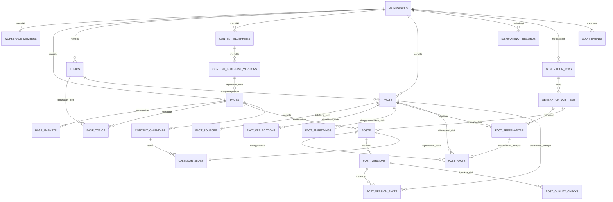

# Database Design — Content Producer MVP

## 1. Informasi dokumen

| Item | Nilai |
|---|---|
| Produk | Content Producer untuk Facebook Reels trivia/fakta |
| Tahap | MVP |
| Database | Supabase Postgres |
| Bahasa konten | English untuk audiens US, UK, CA, AU, dan global |
| Model penggunaan | Satu pemilik workspace, beberapa Facebook Page dengan niche trivia/fakta |
| Integrasi utama | Custom MCP server untuk ChatGPT |
| Dokumen sumber | `plans/PRDid.md` |
| Status | Rancangan awal siap diturunkan menjadi migration |

Dokumen ini menjelaskan rancangan database yang akan menjadi sumber kebenaran sistem. Database tidak hanya menyimpan hasil konten, tetapi juga harus mencegah duplikasi fakta, mengatur pekerjaan paralel, menjaga riwayat revisi, serta memastikan satu slot kalender tidak diambil oleh dua proses sekaligus.

---

## 2. Tujuan desain

Database MVP harus mampu:

1. Mengelola beberapa Facebook Page dalam satu workspace.
2. Menyimpan profil, target market, topic mix, dan blueprint setiap Page.
3. Menyimpan fakta beserta sumber dan hasil verifikasinya.
4. Mendeteksi duplikasi secara exact, canonical, dan semantic.
5. Mereservasi fakta secara atomik sebelum AI membuat naskah.
6. Mencegah beberapa chat menggunakan fakta yang sama.
7. Menyimpan generation job dan setiap item di dalamnya.
8. Menyimpan post, semua versinya, fakta yang dipakai, dan hasil quality check.
9. Membuat kalender konten tanpa bentrok antar-chat.
10. Menangani retry secara idempotent.
11. Menggunakan optimistic locking untuk mencegah lost update.
12. Menyediakan audit trail yang dapat ditelusuri.
13. Membatasi data berdasarkan pemilik workspace melalui RLS.
14. Mendukung pemisahan environment development dan production.

---

## 3. Batasan MVP

Database ini sengaja dirancang hanya untuk ruang lingkup berikut:

- Satu niche utama: trivia/fakta.
- Beberapa Facebook Page dalam satu workspace.
- Satu pemilik utama untuk setiap workspace.
- Proses publikasi ke Facebook masih manual.
- Penyalinan naskah ke Canva masih manual.
- Satu fakta hanya boleh dipakai satu kali di seluruh workspace, bukan hanya per Page.
- Beberapa chat ChatGPT dapat bekerja bersamaan.
- Semua operasi penulisan penting masuk melalui MCP server dan database function yang terkontrol.

Belum termasuk dalam MVP:

- Multi-niche selain trivia/fakta.
- Tim dengan role dan approval berlapis.
- Facebook Graph API.
- Canva API.
- Billing dan subscription.
- Analytics performa post dari Facebook.
- Public plugin marketplace.

Walaupun belum digunakan, beberapa keputusan struktur dibuat agar penambahan tim, niche, dan analytics nanti tidak memerlukan pembangunan ulang total.

---

## 4. Prinsip desain

### 4.1 Supabase menjadi sumber kebenaran

Riwayat percakapan ChatGPT tidak dianggap sebagai sumber status. Status fakta, reservasi, job, post, revisi, dan kalender harus selalu dibaca dari Supabase.

### 4.2 Keunikan dijaga database

Instruksi prompt seperti “jangan gunakan fakta yang sama” tidak cukup. Pencegahan bentrok harus dijaga oleh:

- unique constraint;
- partial unique index;
- foreign key;
- transaksi;
- row lock;
- idempotency key;
- optimistic locking.

### 4.3 Transaksi database harus singkat

Panggilan ke model AI, pencarian web, embedding API, atau layanan eksternal tidak boleh dilakukan ketika transaksi database masih terbuka.

Alurnya:

1. Reservasi resource dalam transaksi singkat.
2. Commit.
3. Jalankan proses AI di luar transaksi.
4. Simpan hasil dalam transaksi singkat.

### 4.4 Riwayat penting tidak ditimpa

Post yang direvisi tidak mengganti versi lama. Setiap revisi menghasilkan row baru pada `post_versions`. Audit event, versi post, dan fakta yang sudah dikonsumsi tidak boleh diubah atau dihapus melalui operasi normal.

### 4.5 Data inti dinormalisasi

Relasi penting seperti Page–market, Page–topic, post–fact, dan fact–source disimpan dalam tabel relasi. `jsonb` hanya digunakan untuk data fleksibel yang struktur detailnya dapat berkembang.

### 4.6 Status memakai `text` dan `check constraint`

MVP tidak memakai PostgreSQL enum. Nilai status menggunakan `text` dengan `check constraint` supaya penambahan state baru lebih mudah dilakukan melalui migration.

### 4.7 Semua waktu menggunakan zona waktu

- Waktu kejadian memakai `timestamptz`.
- Hari kalender lokal memakai `date`.
- Zona waktu Page memakai nama IANA seperti `America/New_York` atau `Australia/Sydney`.
- Database menyimpan waktu absolut dalam UTC melalui `timestamptz`.

### 4.8 Tidak mengandalkan hard delete

Workspace, Page, blueprint, fakta, post, dan kalender menggunakan status atau `archived_at`. Hard delete hanya untuk data sementara yang memang memiliki retention policy.

---

## 5. Pembagian schema

### 5.1 `public`

Berisi tabel bisnis yang membutuhkan RLS:

- workspace dan konfigurasi Page;
- fakta dan sumber;
- job produksi;
- post dan versi;
- kalender;
- audit.

Semua tabel di schema ini wajib mengaktifkan RLS.

### 5.2 `api`

Berisi function yang sengaja boleh dipanggil oleh MCP server melalui Data API/RPC. Schema ini tidak berisi tabel.

Contoh:

- `api.reserve_facts(...)`;
- `api.finalize_generated_post(...)`;
- `api.revise_post(...)`;
- `api.create_calendar_slots(...)`.

Hak `EXECUTE` diberikan satu per satu. Jangan mengandalkan default privilege.

### 5.3 `private`

Berisi helper function, trigger function, dan fungsi maintenance yang tidak boleh dipanggil langsung oleh client.

Contoh:

- validasi perpindahan status;
- normalisasi teks;
- pembersihan reservasi kedaluwarsa;
- cleanup idempotency record;
- maintenance job untuk Supabase Cron.

Schema ini tidak diekspos melalui Data API.

### 5.4 `extensions`

Digunakan untuk extension Supabase/Postgres, termasuk `vector`. Extension dibuat tanpa version pin agar mengikuti kebijakan extension Supabase saat ini.

---

## 6. Strategi identifier

Setiap tabel bisnis utama menggunakan dua jenis identifier:

1. `id bigint generated always as identity` sebagai primary key internal.
2. `public_id uuid default gen_random_uuid()` sebagai identifier yang dikirim melalui MCP.

Alasannya:

- `bigint` lebih kecil dan efisien untuk foreign key, index, serta join internal.
- `public_id` bersifat opaque dan aman digunakan di tool response.
- MCP tidak perlu mengekspos urutan row internal.

Aturan:

- Relasi database memakai `bigint`.
- Tool MCP menerima dan mengembalikan `public_id`.
- `public_id` selalu memiliki unique constraint.
- Untuk tabel yang hanya bermakna sebagai detail internal, seperti `post_version_facts`, `public_id` tidak wajib.

---

## 7. Aturan multi-workspace

Hampir semua tabel bisnis memiliki `workspace_id`, termasuk tabel yang secara teori dapat menurunkannya dari parent. Pengulangan terkontrol ini dipakai untuk:

- mempercepat RLS;
- mempercepat query berdasarkan workspace;
- mempermudah audit;
- mencegah relasi lintas workspace.

Setiap parent penting memiliki unique key `(workspace_id, id)`. Child memakai composite foreign key seperti:

```sql
foreign key (workspace_id, page_id)
  references public.pages (workspace_id, id)
```

Dengan cara ini, sebuah post tidak dapat menunjuk Page yang berada di workspace lain meskipun terjadi bug pada aplikasi.

---

## 8. ERD tingkat tinggi



---

## 9. Daftar tabel

| Kelompok | Tabel | Fungsi utama |
|---|---|---|
| Kepemilikan | `workspaces` | Tenant utama dan pemilik data |
| Kepemilikan | `workspace_members` | Persiapan membership; MVP berisi owner |
| Blueprint | `content_blueprints` | Identitas blueprint konten |
| Blueprint | `content_blueprint_versions` | Versi aturan produksi yang immutable |
| Page | `pages` | Konfigurasi setiap Facebook Page |
| Page | `page_markets` | Target negara dan prioritasnya |
| Taxonomy | `topics` | Daftar tema trivia/fakta |
| Page | `page_topics` | Topic mix per Page |
| Fakta | `facts` | Canonical fact yang dapat digunakan |
| Fakta | `fact_sources` | Sumber pendukung fakta |
| Fakta | `fact_verifications` | Riwayat hasil verifikasi |
| Fakta | `fact_embeddings` | Embedding untuk semantic duplicate check |
| Kontrol | `idempotency_records` | Mencegah retry membuat hasil ganda |
| Produksi | `generation_jobs` | Satu permintaan batch produksi |
| Produksi | `generation_job_items` | Satu unit post di dalam batch |
| Produksi | `fact_reservations` | Reservasi atomik fakta untuk item |
| Post | `posts` | Identitas dan lifecycle post |
| Post | `post_facts` | Fakta yang pernah dikonsumsi post |
| Post | `post_versions` | Snapshot lengkap setiap revisi |
| Post | `post_version_facts` | Teks fakta dan urutan pada versi tertentu |
| QA | `post_quality_checks` | Hasil pemeriksaan kualitas per versi |
| Kalender | `content_calendars` | Header plan kalender |
| Kalender | `calendar_slots` | Slot penerbitan yang unik |
| Audit | `audit_events` | Audit trail append-only |

---

## 10. Detail tabel

## 10.1 `workspaces`

Mewakili satu ruang data milik pengguna. Semua Page dalam workspace berbagi kumpulan fakta yang sama agar fakta tidak diulang lintas Page.

| Kolom | Tipe | Aturan |
|---|---|---|
| `id` | `bigint` | PK, identity |
| `public_id` | `uuid` | Unique, default UUID |
| `name` | `text` | Wajib |
| `slug` | `text` | Unique, lowercase |
| `owner_user_id` | `uuid` | FK ke `auth.users.id`, wajib |
| `default_language` | `text` | Default `en` |
| `status` | `text` | `active`, `suspended`, `archived` |
| `settings` | `jsonb` | Konfigurasi non-inti |
| `created_at` | `timestamptz` | Wajib |
| `updated_at` | `timestamptz` | Wajib |
| `archived_at` | `timestamptz` | Nullable |

Constraint penting:

- `slug` memakai format `^[a-z0-9]+(?:-[a-z0-9]+)*$`.
- `archived_at` wajib terisi jika status `archived`.
- Satu owner boleh memiliki lebih dari satu workspace pada pengembangan berikutnya.

Index:

- unique pada `public_id`;
- unique pada `slug`;
- `(owner_user_id, status)`.

## 10.2 `workspace_members`

Disiapkan agar struktur tidak perlu diubah ketika sistem mulai mendukung tim. Pada MVP, minimal ada satu row owner.

| Kolom | Tipe | Aturan |
|---|---|---|
| `workspace_id` | `bigint` | FK workspace |
| `user_id` | `uuid` | FK `auth.users.id` |
| `role` | `text` | `owner`, `editor`, `viewer` |
| `status` | `text` | `active`, `invited`, `disabled` |
| `created_at` | `timestamptz` | Wajib |
| `updated_at` | `timestamptz` | Wajib |

Primary key: `(workspace_id, user_id)`.

Catatan MVP:

- Otorisasi utama tetap memakai `workspaces.owner_user_id` agar RLS sederhana dan tidak mengalami recursive policy.
- Role `editor` dan `viewer` belum dibuka melalui UI atau MCP pada MVP.

## 10.3 `content_blueprints`

Menyimpan identitas blueprint. Blueprint terpisah dari versinya agar aturan produksi dapat berkembang tanpa mengubah post lama.

| Kolom | Tipe | Aturan |
|---|---|---|
| `id` | `bigint` | PK |
| `public_id` | `uuid` | Unique |
| `workspace_id` | `bigint` | FK workspace |
| `name` | `text` | Wajib |
| `description` | `text` | Nullable |
| `status` | `text` | `active`, `archived` |
| `created_at` | `timestamptz` | Wajib |
| `updated_at` | `timestamptz` | Wajib |

Unique: `(workspace_id, lower(name))`.

## 10.4 `content_blueprint_versions`

Satu row merupakan snapshot lengkap aturan produksi. Row bersifat immutable setelah dibuat.

| Kolom | Tipe | Aturan |
|---|---|---|
| `id` | `bigint` | PK |
| `public_id` | `uuid` | Unique |
| `workspace_id` | `bigint` | FK workspace |
| `blueprint_id` | `bigint` | Composite FK ke blueprint dalam workspace |
| `version_number` | `integer` | Mulai dari 1 |
| `schema_version` | `integer` | Versi bentuk JSON rules |
| `rules` | `jsonb` | Aturan lengkap produksi |
| `content_hash` | `text` | SHA-256 dari canonical rules |
| `change_notes` | `text` | Alasan perubahan |
| `created_by` | `uuid` | FK `auth.users.id` |
| `created_at` | `timestamptz` | Wajib |

Unique:

- `(blueprint_id, version_number)`;
- `(workspace_id, content_hash)` bila rules identik tidak perlu disimpan dua kali.

Isi `rules` minimal:

```json
{
  "language": "en",
  "audience": ["US", "UK", "CA", "AU", "GLOBAL"],
  "fact_count": { "min": 5, "max": 9 },
  "architectures": ["list", "contrast", "single-theme"],
  "hook_rules": {},
  "fact_style_rules": {},
  "cta_rules": {},
  "visual_rules": {},
  "quality_thresholds": {}
}
```

JSON schema divalidasi di application layer dan melalui `schema_version`. Aturan yang sering dipakai untuk filter tidak disimpan hanya di JSON.

## 10.5 `pages`

Menyimpan pengaturan produksi untuk setiap Facebook Page.

| Kolom | Tipe | Aturan |
|---|---|---|
| `id` | `bigint` | PK |
| `public_id` | `uuid` | Unique |
| `workspace_id` | `bigint` | FK workspace |
| `name` | `text` | Nama internal/Page |
| `slug` | `text` | Unique di workspace |
| `facebook_page_ref` | `text` | Nullable pada MVP; bukan access token |
| `status` | `text` | `active`, `paused`, `archived` |
| `language_code` | `text` | Default `en` |
| `english_variant` | `text` | `neutral-international`, `en-US`, `en-GB` |
| `timezone` | `text` | IANA timezone |
| `default_blueprint_version_id` | `bigint` | Blueprint aktif |
| `default_fact_min` | `smallint` | Default 5 |
| `default_fact_max` | `smallint` | Default 9 |
| `settings` | `jsonb` | Preferensi fleksibel |
| `lock_version` | `integer` | Default 1 |
| `created_at` | `timestamptz` | Wajib |
| `updated_at` | `timestamptz` | Wajib |
| `archived_at` | `timestamptz` | Nullable |

Constraint:

- `default_fact_min >= 1`.
- `default_fact_max >= default_fact_min`.
- Untuk MVP, batas atas disarankan `12`.
- `lock_version > 0`.
- `default_blueprint_version_id` harus berasal dari workspace yang sama.

Unique:

- `(workspace_id, slug)`;
- `(workspace_id, id)` untuk composite foreign key child.

`settings` dapat menyimpan preferensi seperti emoji, CTA, hashtag, dan visual, tetapi bukan credential.

## 10.6 `page_markets`

Mengatur target geografis sebuah Page tanpa membuat satu Page terkunci pada satu negara.

| Kolom | Tipe | Aturan |
|---|---|---|
| `workspace_id` | `bigint` | FK workspace |
| `page_id` | `bigint` | Composite FK Page |
| `country_code` | `text` | `US`, `GB`, `CA`, `AU`, atau `GLOBAL` |
| `priority` | `smallint` | Urutan 1 dan seterusnya |
| `weight` | `numeric(5,2)` | 0–100 |
| `is_primary` | `boolean` | Default false |
| `created_at` | `timestamptz` | Wajib |

Primary key: `(page_id, country_code)`.

Constraint:

- Maksimal satu `is_primary = true` per Page melalui partial unique index.
- Jumlah weight per Page divalidasi ketika konfigurasi disimpan. Target ideal 100, tetapi draft konfigurasi boleh belum lengkap.

## 10.7 `topics`

Taxonomy tema fakta, misalnya animals, science, space, history, human body, psychology, technology, dan everyday life.

| Kolom | Tipe | Aturan |
|---|---|---|
| `id` | `bigint` | PK |
| `public_id` | `uuid` | Unique |
| `workspace_id` | `bigint` | FK workspace |
| `name` | `text` | Wajib |
| `slug` | `text` | Unique dalam workspace |
| `description` | `text` | Nullable |
| `risk_level` | `text` | `low`, `medium`, `high` |
| `status` | `text` | `active`, `archived` |
| `created_at` | `timestamptz` | Wajib |
| `updated_at` | `timestamptz` | Wajib |

`risk_level` membantu menentukan tingkat verifikasi. Topik kesehatan, psychology, sejarah kontroversial, dan klaim statistik dapat diberi risiko lebih tinggi.

## 10.8 `page_topics`

Menentukan topic mix per Page.

| Kolom | Tipe | Aturan |
|---|---|---|
| `workspace_id` | `bigint` | FK workspace |
| `page_id` | `bigint` | Composite FK Page |
| `topic_id` | `bigint` | Composite FK topic |
| `weight` | `numeric(5,2)` | 0–100 |
| `min_gap_posts` | `smallint` | Jarak minimal topik yang sama |
| `is_enabled` | `boolean` | Default true |
| `created_at` | `timestamptz` | Wajib |
| `updated_at` | `timestamptz` | Wajib |

Primary key: `(page_id, topic_id)`.

## 10.9 `facts`

Menyimpan satu klaim fakta canonical. Tabel ini tidak menyimpan “post”; satu post dapat memakai beberapa fakta.

| Kolom | Tipe | Aturan |
|---|---|---|
| `id` | `bigint` | PK |
| `public_id` | `uuid` | Unique |
| `workspace_id` | `bigint` | FK workspace |
| `topic_id` | `bigint` | Composite FK topic |
| `verification_status` | `text` | Lifecycle verifikasi |
| `canonical_claim` | `text` | Klaim yang mudah dibaca manusia |
| `normalized_claim` | `text` | Bentuk deterministik untuk exact check |
| `claim_hash` | `text` | SHA-256 normalized claim |
| `semantic_key` | `text` | Ringkasan subjek–relasi–objek |
| `semantic_key_hash` | `text` | SHA-256 semantic key |
| `language_code` | `text` | Default `en` |
| `risk_level` | `text` | `low`, `medium`, `high` |
| `is_time_sensitive` | `boolean` | Default false |
| `as_of_date` | `date` | Tanggal berlaku klaim |
| `revalidate_after` | `timestamptz` | Batas verifikasi ulang |
| `verified_at` | `timestamptz` | Nullable |
| `verified_by` | `uuid` | User yang menyetujui, nullable |
| `duplicate_of_fact_id` | `bigint` | Self-reference bila duplicate |
| `rejection_reason` | `text` | Nullable |
| `created_by` | `uuid` | FK user, nullable untuk worker |
| `lock_version` | `integer` | Default 1 |
| `created_at` | `timestamptz` | Wajib |
| `updated_at` | `timestamptz` | Wajib |

Nilai `verification_status`:

- `candidate`;
- `verifying`;
- `verified`;
- `rejected`;
- `duplicate`.

Penting: status penggunaan tidak disimpan di `facts`. Apakah fakta masih tersedia ditentukan dari `fact_reservations`. Pemisahan ini menghindari pencampuran antara “kebenaran fakta” dan “sudah pernah dipakai”.

Constraint:

- `canonical_claim`, `normalized_claim`, dan kedua hash wajib terisi.
- Hash memiliki panjang 64 karakter hex.
- `verified_at` wajib jika status `verified`.
- `duplicate_of_fact_id` wajib jika status `duplicate`.
- Fakta tidak boleh menunjuk dirinya sendiri sebagai duplicate.
- `as_of_date` atau `revalidate_after` wajib untuk klaim time-sensitive sesuai aturan aplikasi.

Unique:

- `(workspace_id, claim_hash)`;
- `(workspace_id, semantic_key_hash)`.

Unique constraint ini menjadi perlindungan deterministik. Similarity embedding adalah lapisan tambahan, bukan pengganti constraint.

## 10.10 `fact_sources`

Menyimpan sumber yang mendukung atau membantah sebuah fakta.

| Kolom | Tipe | Aturan |
|---|---|---|
| `id` | `bigint` | PK |
| `public_id` | `uuid` | Unique |
| `workspace_id` | `bigint` | FK workspace |
| `fact_id` | `bigint` | Composite FK fact |
| `source_url` | `text` | URL asli |
| `canonical_url` | `text` | URL yang sudah dinormalisasi |
| `url_hash` | `text` | SHA-256 canonical URL |
| `publisher_name` | `text` | Nama penerbit |
| `title` | `text` | Judul halaman |
| `source_tier` | `text` | `primary`, `authoritative`, `reputable`, `secondary` |
| `stance` | `text` | `supports`, `qualifies`, `contradicts` |
| `published_at` | `timestamptz` | Nullable |
| `accessed_at` | `timestamptz` | Wajib |
| `evidence_note` | `text` | Ringkasan singkat, bukan salinan artikel |
| `created_at` | `timestamptz` | Wajib |

Unique: `(fact_id, url_hash)`.

Jangan menyimpan isi artikel penuh. Cukup metadata dan catatan bukti yang diperlukan untuk audit.

## 10.11 `fact_verifications`

Setiap row merupakan satu verification run. Riwayat lama tidak ditimpa.

| Kolom | Tipe | Aturan |
|---|---|---|
| `id` | `bigint` | PK |
| `public_id` | `uuid` | Unique |
| `workspace_id` | `bigint` | FK workspace |
| `fact_id` | `bigint` | Composite FK fact |
| `verdict` | `text` | `verified`, `qualified`, `rejected`, `needs_review` |
| `confidence` | `numeric(5,4)` | 0–1 |
| `verification_method` | `text` | `manual`, `ai-assisted`, `hybrid` |
| `checker_user_id` | `uuid` | Nullable |
| `model_name` | `text` | Nullable |
| `summary` | `text` | Penjelasan hasil |
| `details` | `jsonb` | Evidence map dan catatan terstruktur |
| `created_at` | `timestamptz` | Wajib |

Index: `(workspace_id, fact_id, created_at desc)`.

## 10.12 `fact_embeddings`

Menyimpan vector untuk mendeteksi klaim yang berbeda kata tetapi memiliki makna sama atau sangat dekat.

| Kolom | Tipe | Aturan |
|---|---|---|
| `id` | `bigint` | PK |
| `workspace_id` | `bigint` | FK workspace |
| `fact_id` | `bigint` | Composite FK fact |
| `embedding_model` | `text` | Nama model |
| `embedding_version` | `integer` | Versi internal pipeline |
| `source_hash` | `text` | Hash teks yang di-embed |
| `embedding` | `extensions.halfvec(1536)` | Vector |
| `created_at` | `timestamptz` | Wajib |

Unique: `(fact_id, embedding_model, embedding_version)`.

Index semantic:

```sql
create index fact_embeddings_embedding_hnsw_idx
on public.fact_embeddings
using hnsw (embedding extensions.halfvec_cosine_ops);
```

Keputusan penting:

- Dimensi `1536` adalah baseline MVP dan harus disesuaikan dengan model embedding yang dipilih sebelum migration final.
- Ganti model dengan dimensi berbeda melalui migration dan versi embedding baru; jangan mencampur dimensi.
- Untuk dataset kecil, exact similarity scan dalam workspace masih dapat digunakan sebagai pemeriksaan akhir.
- HNSW membantu candidate retrieval, tetapi keputusan duplicate tetap memakai threshold, canonical key, dan review rule.

## 10.13 `idempotency_records`

Mencegah operasi retry membuat job, post, revisi, atau kalender ganda.

| Kolom | Tipe | Aturan |
|---|---|---|
| `id` | `bigint` | PK |
| `public_id` | `uuid` | Unique |
| `workspace_id` | `bigint` | FK workspace |
| `actor_user_id` | `uuid` | Pemanggil |
| `operation` | `text` | Nama operasi MCP |
| `idempotency_key` | `text` | Key dari client/server |
| `request_hash` | `text` | Hash payload canonical |
| `status` | `text` | `processing`, `completed`, `failed` |
| `resource_type` | `text` | Nullable |
| `resource_public_id` | `uuid` | Nullable |
| `response_payload` | `jsonb` | Hasil aman untuk retry |
| `error_code` | `text` | Nullable |
| `expires_at` | `timestamptz` | Wajib |
| `created_at` | `timestamptz` | Wajib |
| `updated_at` | `timestamptz` | Wajib |

Unique: `(workspace_id, operation, idempotency_key)`.

Jika key yang sama dikirim dengan `request_hash` berbeda, operasi harus ditolak dengan error `IDEMPOTENCY_KEY_REUSED_WITH_DIFFERENT_PAYLOAD`.

## 10.14 `generation_jobs`

Mewakili satu permintaan user, misalnya “buat 10 post untuk Page A”.

| Kolom | Tipe | Aturan |
|---|---|---|
| `id` | `bigint` | PK |
| `public_id` | `uuid` | Unique |
| `workspace_id` | `bigint` | FK workspace |
| `page_id` | `bigint` | Composite FK Page |
| `idempotency_record_id` | `bigint` | Nullable, unique |
| `job_type` | `text` | `generate_posts`, `research_facts`, `revise_posts` |
| `status` | `text` | Lifecycle job |
| `requested_count` | `integer` | Jumlah item |
| `completed_count` | `integer` | Default 0 |
| `failed_count` | `integer` | Default 0 |
| `request_payload` | `jsonb` | Permintaan terstruktur |
| `result_summary` | `jsonb` | Ringkasan hasil |
| `requested_by` | `uuid` | FK user |
| `worker_id` | `text` | Worker yang mengklaim |
| `lease_expires_at` | `timestamptz` | Lease worker |
| `attempt_count` | `integer` | Default 0 |
| `started_at` | `timestamptz` | Nullable |
| `completed_at` | `timestamptz` | Nullable |
| `created_at` | `timestamptz` | Wajib |
| `updated_at` | `timestamptz` | Wajib |

Status:

- `queued`;
- `running`;
- `partially_completed`;
- `completed`;
- `failed`;
- `cancelled`.

Index antrean:

```sql
create index generation_jobs_queue_idx
on public.generation_jobs (created_at, id)
where status = 'queued';
```

## 10.15 `generation_job_items`

Satu row mewakili satu calon post dalam batch.

| Kolom | Tipe | Aturan |
|---|---|---|
| `id` | `bigint` | PK |
| `public_id` | `uuid` | Unique |
| `workspace_id` | `bigint` | FK workspace |
| `job_id` | `bigint` | Composite FK job |
| `item_number` | `integer` | Posisi dalam batch |
| `requested_topic_id` | `bigint` | Nullable |
| `status` | `text` | Lifecycle item |
| `attempt_count` | `integer` | Default 0 |
| `error_code` | `text` | Nullable |
| `error_message` | `text` | Nullable, sudah disanitasi |
| `started_at` | `timestamptz` | Nullable |
| `completed_at` | `timestamptz` | Nullable |
| `created_at` | `timestamptz` | Wajib |
| `updated_at` | `timestamptz` | Wajib |

Status:

- `pending`;
- `reserving_facts`;
- `generating`;
- `quality_check`;
- `completed`;
- `failed`;
- `cancelled`.

Unique: `(job_id, item_number)`.

## 10.16 `fact_reservations`

Tabel ini adalah inti keamanan proses paralel. Satu fakta yang sudah `reserved` atau `consumed` tidak boleh diambil lagi oleh item lain dalam workspace yang sama.

| Kolom | Tipe | Aturan |
|---|---|---|
| `id` | `bigint` | PK |
| `public_id` | `uuid` | Unique; juga berfungsi sebagai reservation token |
| `workspace_id` | `bigint` | FK workspace |
| `page_id` | `bigint` | Composite FK Page |
| `fact_id` | `bigint` | Composite FK fact |
| `job_item_id` | `bigint` | Composite FK job item |
| `status` | `text` | `reserved`, `consumed`, `released`, `expired` |
| `reserved_at` | `timestamptz` | Wajib |
| `expires_at` | `timestamptz` | Wajib saat reserved |
| `consumed_at` | `timestamptz` | Nullable |
| `released_at` | `timestamptz` | Nullable |
| `release_reason` | `text` | Nullable |
| `created_at` | `timestamptz` | Wajib |
| `updated_at` | `timestamptz` | Wajib |

Constraint utama:

```sql
create unique index fact_reservations_fact_active_uniq
on public.fact_reservations (workspace_id, fact_id)
where status in ('reserved', 'consumed');
```

Maknanya:

- Dua chat tidak bisa memiliki reservasi aktif untuk fakta yang sama.
- Fakta yang telah `consumed` tetap terkunci selamanya untuk workspace tersebut.
- Row `released` atau `expired` tidak menghalangi fakta untuk dicoba lagi.

Index tambahan:

- `(workspace_id, job_item_id, status)`;
- partial index `(expires_at)` untuk `status = 'reserved'`;
- `(workspace_id, page_id, consumed_at desc)` untuk audit pemakaian.

## 10.17 `posts`

Menyimpan identitas post dan statusnya. Teks lengkap berada di `post_versions`.

| Kolom | Tipe | Aturan |
|---|---|---|
| `id` | `bigint` | PK |
| `public_id` | `uuid` | Unique |
| `workspace_id` | `bigint` | FK workspace |
| `page_id` | `bigint` | Composite FK Page |
| `generation_job_item_id` | `bigint` | Nullable, unique |
| `blueprint_version_id` | `bigint` | Blueprint yang menjadi dasar |
| `status` | `text` | Lifecycle post |
| `current_version_number` | `integer` | Versi aktif |
| `lock_version` | `integer` | Optimistic lock, default 1 |
| `approved_at` | `timestamptz` | Nullable |
| `approved_by` | `uuid` | Nullable |
| `scheduled_at` | `timestamptz` | Nullable |
| `published_at` | `timestamptz` | Nullable |
| `external_post_ref` | `text` | Nullable pada MVP |
| `created_by` | `uuid` | FK user |
| `created_at` | `timestamptz` | Wajib |
| `updated_at` | `timestamptz` | Wajib |
| `archived_at` | `timestamptz` | Nullable |

Status:

- `draft`;
- `needs_review`;
- `approved`;
- `scheduled`;
- `published`;
- `rejected`;
- `archived`.

`current_version_number` menunjuk `(post_id, version_number)` pada `post_versions`. FK dapat ditambahkan setelah kedua tabel dibuat.

## 10.18 `post_facts`

Mencatat fakta yang pernah dikonsumsi oleh post. Association tidak dihapus walaupun fakta diganti pada revisi, karena fakta lama sudah pernah digunakan dalam proses produksi.

| Kolom | Tipe | Aturan |
|---|---|---|
| `id` | `bigint` | PK |
| `workspace_id` | `bigint` | FK workspace |
| `post_id` | `bigint` | Composite FK post |
| `fact_id` | `bigint` | Composite FK fact |
| `reservation_id` | `bigint` | Unique FK reservation |
| `first_version_number` | `integer` | Versi pertama penggunaan |
| `is_current` | `boolean` | Apakah masih dipakai versi aktif |
| `created_at` | `timestamptz` | Wajib |
| `updated_at` | `timestamptz` | Wajib |

Unique: `(post_id, fact_id)`.

`is_current` diperbarui hanya melalui transaction function revisi. Nilai ini mempermudah query, sedangkan riwayat sebenarnya tetap berada pada `post_version_facts`.

## 10.19 `post_versions`

Snapshot lengkap naskah yang siap disalin ke Canva.

| Kolom | Tipe | Aturan |
|---|---|---|
| `id` | `bigint` | PK |
| `workspace_id` | `bigint` | FK workspace |
| `post_id` | `bigint` | Composite FK post |
| `version_number` | `integer` | Mulai dari 1 |
| `language_code` | `text` | Default `en` |
| `english_variant` | `text` | Variant output |
| `architecture` | `text` | `list`, `contrast`, `single-theme`, dll. |
| `hook` | `text` | Hook final |
| `body_copy` | `text` | Seluruh teks utama bila diperlukan |
| `cta` | `text` | CTA final |
| `canva_copy` | `text` | Format copy-paste final |
| `caption` | `text` | Caption Facebook |
| `hashtags` | `text[]` | Daftar hashtag |
| `visual_direction` | `text` | Arahan visual dan motion |
| `duration_seconds` | `smallint` | Default 13 |
| `word_count` | `integer` | Dihitung server |
| `character_count` | `integer` | Dihitung server |
| `quality_status` | `text` | `pending`, `passed`, `failed`, `warning` |
| `quality_score` | `numeric(5,2)` | 0–100 |
| `generation_metadata` | `jsonb` | Model, prompt version, latency, dll. |
| `revision_instruction` | `text` | Nullable |
| `created_by` | `uuid` | FK user, nullable untuk worker |
| `created_at` | `timestamptz` | Wajib |

Unique: `(post_id, version_number)`.

Aturan:

- Row immutable setelah dibuat.
- Credential, raw access token, atau chain-of-thought tidak boleh disimpan di metadata.
- Prompt version boleh disimpan, tetapi full secret system prompt tidak wajib disalin ke setiap row.

## 10.20 `post_version_facts`

Menyimpan wording final dan urutan fakta pada versi tertentu.

| Kolom | Tipe | Aturan |
|---|---|---|
| `id` | `bigint` | PK |
| `workspace_id` | `bigint` | FK workspace |
| `post_id` | `bigint` | FK post |
| `version_number` | `integer` | FK ke versi post |
| `fact_id` | `bigint` | FK fact |
| `display_order` | `smallint` | Mulai dari 1 |
| `rendered_text` | `text` | Wording yang tampil pada post |
| `source_note` | `text` | Catatan sumber singkat bila diperlukan |
| `created_at` | `timestamptz` | Wajib |

Unique:

- `(post_id, version_number, display_order)`;
- `(post_id, version_number, fact_id)`.

## 10.21 `post_quality_checks`

Menyimpan hasil QA per versi supaya penyebab pass/fail dapat dilihat, tidak hanya skor total.

| Kolom | Tipe | Aturan |
|---|---|---|
| `id` | `bigint` | PK |
| `public_id` | `uuid` | Unique |
| `workspace_id` | `bigint` | FK workspace |
| `post_version_id` | `bigint` | FK post version |
| `check_type` | `text` | Jenis pemeriksaan |
| `status` | `text` | `passed`, `failed`, `warning` |
| `score` | `numeric(5,2)` | 0–100, nullable |
| `summary` | `text` | Hasil singkat |
| `details` | `jsonb` | Temuan terstruktur |
| `checked_by` | `text` | `rule-engine`, `ai`, `human` |
| `model_name` | `text` | Nullable |
| `created_at` | `timestamptz` | Wajib |

Contoh `check_type`:

- `fact_count`;
- `fact_verified`;
- `duplicate_fact`;
- `hook_quality`;
- `readability_13s`;
- `english_clarity`;
- `unsupported_superlative`;
- `cta_quality`;
- `copy_format`;
- `safety`.

Unique: `(post_version_id, check_type)`.

## 10.22 `content_calendars`

Header untuk satu planning period.

| Kolom | Tipe | Aturan |
|---|---|---|
| `id` | `bigint` | PK |
| `public_id` | `uuid` | Unique |
| `workspace_id` | `bigint` | FK workspace |
| `page_id` | `bigint` | Composite FK Page |
| `name` | `text` | Wajib |
| `start_date` | `date` | Wajib |
| `end_date` | `date` | Wajib |
| `timezone` | `text` | Snapshot zona waktu |
| `status` | `text` | `draft`, `active`, `completed`, `archived` |
| `planning_rules` | `jsonb` | Frekuensi dan distribusi |
| `created_by` | `uuid` | FK user |
| `lock_version` | `integer` | Default 1 |
| `created_at` | `timestamptz` | Wajib |
| `updated_at` | `timestamptz` | Wajib |

Constraint: `end_date >= start_date`.

## 10.23 `calendar_slots`

Mewakili satu kesempatan publikasi pada Page.

| Kolom | Tipe | Aturan |
|---|---|---|
| `id` | `bigint` | PK |
| `public_id` | `uuid` | Unique |
| `workspace_id` | `bigint` | FK workspace |
| `calendar_id` | `bigint` | Composite FK calendar |
| `page_id` | `bigint` | Composite FK Page |
| `post_id` | `bigint` | Nullable, unique untuk slot aktif |
| `topic_id` | `bigint` | Nullable |
| `local_date` | `date` | Tanggal menurut timezone Page |
| `slot_number` | `smallint` | Urutan pada hari tersebut |
| `publish_at` | `timestamptz` | Waktu absolut |
| `status` | `text` | `planned`, `assigned`, `ready`, `published`, `cancelled` |
| `notes` | `text` | Nullable |
| `lock_version` | `integer` | Default 1 |
| `created_at` | `timestamptz` | Wajib |
| `updated_at` | `timestamptz` | Wajib |

Partial unique indexes:

```sql
create unique index calendar_slots_page_day_number_active_uniq
on public.calendar_slots (page_id, local_date, slot_number)
where status <> 'cancelled';

create unique index calendar_slots_page_publish_at_active_uniq
on public.calendar_slots (page_id, publish_at)
where status <> 'cancelled';

create unique index calendar_slots_post_active_uniq
on public.calendar_slots (post_id)
where post_id is not null and status <> 'cancelled';
```

Dengan constraint ini, dua chat tidak dapat membuat slot aktif yang sama atau memasukkan satu post ke dua slot aktif.

## 10.24 `audit_events`

Audit trail append-only untuk perubahan penting.

| Kolom | Tipe | Aturan |
|---|---|---|
| `id` | `bigint` | PK |
| `public_id` | `uuid` | Unique |
| `workspace_id` | `bigint` | FK workspace |
| `actor_user_id` | `uuid` | Nullable untuk system worker |
| `actor_type` | `text` | `user`, `mcp-server`, `worker`, `cron` |
| `request_id` | `uuid` | Korelasi satu request |
| `event_type` | `text` | Nama aksi |
| `entity_type` | `text` | Jenis entity |
| `entity_id` | `bigint` | Nullable |
| `entity_public_id` | `uuid` | Nullable |
| `before_data` | `jsonb` | Snapshot aman, nullable |
| `after_data` | `jsonb` | Snapshot aman, nullable |
| `metadata` | `jsonb` | IP hash, tool name, job ID, dll. |
| `created_at` | `timestamptz` | Wajib |

Aturan:

- Tidak ada `updated_at`.
- UPDATE dan DELETE ditolak.
- Secret, access token, raw OAuth token, dan password tidak boleh masuk audit payload.
- Index utama `(workspace_id, created_at desc)` dan `(request_id)`.

---

## 11. Lifecycle dan state transition

## 11.1 Fakta

```text
candidate -> verifying -> verified
                    \-> rejected
                    \-> duplicate

verified -> verifying  (revalidation)
verified -> rejected   (koreksi setelah audit)
```

Fakta hanya dapat direservasi jika:

- `verification_status = 'verified'`;
- belum melewati `revalidate_after` untuk klaim time-sensitive;
- tidak memiliki reservasi `reserved` atau `consumed`;
- topic masih aktif;
- memiliki jumlah sumber minimum sesuai risk level.

## 11.2 Reservasi fakta

```text
reserved -> consumed
reserved -> released
reserved -> expired
```

State terminal `consumed`, `released`, dan `expired` tidak boleh kembali ke `reserved` pada row yang sama. Jika fakta boleh dicoba kembali setelah release/expired, dibuat row reservasi baru.

## 11.3 Generation item

```text
pending
  -> reserving_facts
  -> generating
  -> quality_check
  -> completed

setiap state aktif -> failed
setiap state sebelum completed -> cancelled
```

## 11.4 Post

```text
draft -> needs_review -> approved -> scheduled -> published
   \-> rejected
   \-> archived
needs_review -> draft   (setelah revisi)
approved -> draft       (jika revisi substantif)
scheduled -> approved   (jika slot dilepas)
```

Perpindahan status kritis dilakukan melalui function, bukan update bebas.

---

## 12. Pencegahan duplikasi fakta

Pencegahan duplicate dilakukan berlapis.

### 12.1 Normalisasi deterministik

Sebelum insert:

1. Unicode dinormalisasi.
2. Teks dibuat lowercase untuk kebutuhan matching.
3. Whitespace dan punctuation non-esensial dinormalisasi.
4. Unit, angka, dan istilah umum distandardisasi secara hati-hati.
5. Hasil disimpan sebagai `normalized_claim`.
6. SHA-256 disimpan sebagai `claim_hash`.

Unique `(workspace_id, claim_hash)` menangkap exact duplicate setelah normalisasi.

### 12.2 Semantic key

AI/rule engine membuat representasi ringkas subjek–relasi–objek, misalnya:

```text
octopus | has | three hearts
```

Hash dari key ini menangkap wording berbeda yang masih memiliki proposisi sama.

### 12.3 Embedding similarity

Candidate dibandingkan dengan fakta dalam workspace yang sama menggunakan cosine distance. Threshold tidak boleh dianggap angka universal; ditentukan melalui evaluation dataset.

Contoh kebijakan awal:

- similarity sangat tinggi: otomatis tandai `duplicate`;
- similarity menengah: `needs_review`;
- similarity rendah: lanjut verifikasi.

Nilai threshold final harus berasal dari pengujian terhadap kumpulan fakta nyata, bukan asumsi.

### 12.4 Unique reservation

Walaupun fakta lolos duplicate check, partial unique index di `fact_reservations` memastikan fakta tidak digunakan dua kali akibat race condition.

### 12.5 Aturan lintas Page

Keunikan fakta berlaku pada `workspace_id`, sehingga fakta yang telah digunakan Page A tidak digunakan kembali oleh Page B dalam workspace yang sama.

Jika di masa depan user ingin isolation per Page, kebijakan dapat dibuat configurable. Untuk MVP, kebijakan global-workspace lebih aman.

---

## 13. Alur reservasi fakta yang aman

Function utama: `api.reserve_facts(...)`.

Input konseptual:

```text
workspace_public_id
page_public_id
job_item_public_id
topic_public_ids[]
fact_count
reservation_ttl_seconds
```

Alur di dalam transaksi:

1. Dapatkan `auth.uid()`.
2. Validasi user memiliki workspace dan Page aktif.
3. Validasi job item berada pada workspace dan Page yang sama.
4. Pilih fakta `verified` yang memenuhi filter.
5. Abaikan fakta yang memiliki reservasi `reserved` atau `consumed`.
6. Lock row kandidat dengan `FOR UPDATE SKIP LOCKED`.
7. Ambil sejumlah `fact_count`.
8. Jika jumlah kurang, raise error dan rollback seluruh reservasi.
9. Insert row ke `fact_reservations`.
10. Ubah item menjadi `generating`.
11. Tulis audit event.
12. Commit dan kembalikan fakta beserta reservation token.

Pola query inti:

```sql
select f.id
from public.facts f
where f.workspace_id = p_workspace_id
  and f.verification_status = 'verified'
  and (not f.is_time_sensitive or f.revalidate_after > now())
  and not exists (
    select 1
    from public.fact_reservations r
    where r.workspace_id = f.workspace_id
      and r.fact_id = f.id
      and r.status in ('reserved', 'consumed')
  )
order by f.created_at, f.id
for update skip locked
limit p_fact_count;
```

`SKIP LOCKED` membuat worker kedua melewati fakta yang sedang diambil worker pertama, sehingga tidak saling menunggu lama.

AI generation baru dimulai setelah transaksi selesai.

---

## 14. Finalisasi post secara atomik

Function utama: `api.finalize_generated_post(...)`.

Function harus melakukan seluruh langkah berikut dalam satu transaksi:

1. Validasi actor dan workspace.
2. Validasi idempotency record.
3. Lock generation item.
4. Pastikan item belum memiliki post.
5. Validasi seluruh reservation token:
   - milik item yang sama;
   - status `reserved`;
   - belum expired;
   - jumlah sesuai blueprint.
6. Insert `posts`.
7. Insert `post_versions` versi 1.
8. Insert `post_facts`.
9. Insert `post_version_facts`.
10. Insert `post_quality_checks`.
11. Update reservation menjadi `consumed`.
12. Update item menjadi `completed`; hubungan ke post sudah dicatat oleh `posts.generation_job_item_id`.
13. Perbarui counter job berdasarkan data item aktual.
14. Complete idempotency record.
15. Insert audit events.
16. Commit.

Jika salah satu langkah gagal, seluruh perubahan rollback. Tidak boleh ada post yang tersimpan tanpa konsumsi fakta, atau fakta consumed tanpa post.

---

## 15. Revisi post dan optimistic locking

Client wajib mengirim `expected_lock_version`.

Pola update:

```sql
update public.posts
set current_version_number = p_new_version_number,
    lock_version = lock_version + 1,
    updated_at = now()
where id = p_post_id
  and lock_version = p_expected_lock_version
returning *;
```

Jika tidak ada row yang kembali, server mengembalikan conflict, bukan menimpa perubahan terbaru.

Function `api.revise_post(...)` melakukan:

1. Lock dan cek `expected_lock_version`.
2. Validasi status post.
3. Bila hanya wording berubah, pakai fakta yang sama.
4. Bila fakta diganti:
   - reservasi fakta baru;
   - konsumsi fakta baru ketika revisi selesai;
   - fakta lama tetap dianggap consumed;
   - perbarui `post_facts.is_current`.
5. Insert `post_versions` baru.
6. Insert `post_version_facts` baru.
7. Jalankan/simpan quality checks.
8. Update pointer versi aktif dan `lock_version`.
9. Insert audit event.

Tidak ada UPDATE terhadap row versi lama.

---

## 16. Idempotency

Semua MCP tool yang membuat atau mengubah data harus menerima `idempotency_key`.

### 16.1 Operasi yang wajib idempotent

- membuat generation job;
- finalisasi post;
- membuat kalender;
- mengisi slot kalender;
- merevisi post;
- approve post;
- cancel job.

### 16.2 Aturan server

1. Buat canonical request payload.
2. Hitung `request_hash`.
3. Coba insert `idempotency_records` dengan `ON CONFLICT`.
4. Jika row sudah `completed`, kembalikan response sebelumnya.
5. Jika `processing`, kembalikan status in-progress atau lakukan bounded wait.
6. Jika key sama tetapi hash berbeda, tolak.
7. Jika operasi gagal secara retryable, simpan status yang memungkinkan retry terkontrol.

Jangan memakai pola SELECT lalu INSERT tanpa constraint karena rentan race condition.

---

## 17. Worker queue dan parallel processing

Jika generation job diproses oleh lebih dari satu worker, claim dilakukan secara atomik.

Pola:

```sql
with next_job as (
  select id
  from public.generation_jobs
  where status = 'queued'
  order by created_at, id
  for update skip locked
  limit 1
)
update public.generation_jobs j
set status = 'running',
    worker_id = p_worker_id,
    lease_expires_at = now() + interval '5 minutes',
    attempt_count = attempt_count + 1,
    started_at = coalesce(started_at, now()),
    updated_at = now()
from next_job
where j.id = next_job.id
returning j.*;
```

Lease mencegah job hilang selamanya jika worker mati. Worker lain baru boleh mengambil ulang setelah lease kedaluwarsa dan recovery rule dijalankan.

Aturan deadlock:

- Lock resource selalu dalam urutan: workspace → job → item → fact → reservation → post → slot.
- Bila mengunci banyak fact, urutkan berdasarkan `fact.id`.
- Jangan membuka transaksi sambil menunggu model AI.

---

## 18. Kalender tanpa bentrok

Pembuatan kalender dilakukan dalam transaksi melalui `api.create_calendar_slots(...)`.

Database menjaga tiga hal:

1. Satu Page tidak memiliki dua slot aktif dengan tanggal dan nomor slot yang sama.
2. Satu Page tidak memiliki dua slot aktif pada timestamp yang sama.
3. Satu post tidak berada di dua slot aktif.

Jika dua chat mencoba membuat slot sama, salah satu insert berhasil dan yang lain menerima conflict. MCP server lalu membaca kalender terbaru dan dapat menawarkan slot alternatif.

`publish_at` dihitung dari `local_date`, jam lokal, dan timezone Page pada saat slot dibuat. Snapshot timezone juga disimpan di calendar agar perubahan pengaturan Page tidak diam-diam menggeser jadwal lama.

---

## 19. RLS dan otorisasi

## 19.1 Asumsi identitas

Setiap request MCP yang menulis atau membaca data harus dipetakan ke user Supabase yang valid. Database mengandalkan `auth.uid()`.

Integrasi OAuth MCP dan Supabase Auth akan dijelaskan di implementation plan. Yang wajib dipenuhi adalah: database tidak menerima `user_id` bebas dari payload sebagai bukti identitas.

## 19.2 Kebijakan MVP

Pada MVP, user boleh mengakses row jika:

```sql
exists (
  select 1
  from public.workspaces w
  where w.id = row.workspace_id
    and w.owner_user_id = (select auth.uid())
    and w.status = 'active'
)
```

Penggunaan `(select auth.uid())` membantu planner mengevaluasi fungsi sekali per statement.

## 19.3 Contoh policy

```sql
alter table public.pages enable row level security;

create policy pages_owner_select
on public.pages
for select
to authenticated
using (
  exists (
    select 1
    from public.workspaces w
    where w.id = pages.workspace_id
      and w.owner_user_id = (select auth.uid())
      and w.status = 'active'
  )
);
```

Untuk UPDATE, policy harus memiliki `using` dan `with check`.

## 19.4 Matriks akses

| Role | Read | Direct write | Function/RPC |
|---|---|---|---|
| `anon` | Tidak | Tidak | Tidak |
| `authenticated` | Row milik workspace sendiri | Hanya tabel konfigurasi berisiko rendah bila diperlukan | Tool yang diberikan secara eksplisit |
| MCP application role | Sesuai identitas user | Melalui transaksi terkontrol | Ya |
| Background worker | Data job yang diperlukan | Operasi worker terbatas | Function worker |
| `service_role` | Internal saja | Internal saja | Tidak pernah dikirim ke client |

## 19.5 Tabel kritis

Untuk tabel berikut, direct INSERT/UPDATE/DELETE dari client sebaiknya dicabut:

- `facts` setelah verified;
- `fact_reservations`;
- `generation_jobs` dan items pada state aktif;
- `posts`, `post_facts`, dan version tables;
- `calendar_slots`;
- `audit_events`.

Perubahan dilakukan melalui function terkontrol.

Jika function perlu memakai `SECURITY DEFINER`, persyaratannya:

- hanya untuk workflow atomik yang benar-benar memerlukannya;
- `set search_path = ''`;
- semua object memakai schema-qualified name;
- `REVOKE EXECUTE ... FROM PUBLIC` segera setelah pembuatan;
- grant hanya kepada role yang membutuhkan;
- cek `auth.uid()` dan ownership di awal function;
- tidak menerima `workspace_id` tanpa memverifikasi kepemilikan;
- memiliki test lintas-tenant dan privilege escalation.

Function biasa memakai `SECURITY INVOKER` bila memungkinkan.

## 19.6 Grant eksplisit

Jangan menganggap tabel baru otomatis tersedia atau otomatis aman di Data API. Migration harus mencantumkan:

- revoke default yang tidak diperlukan;
- grant SELECT/DML yang memang dibutuhkan;
- grant USAGE pada schema;
- grant EXECUTE per function;
- RLS policy per operation.

---

## 20. Index strategy

Semua foreign key perlu index pada sisi child, kecuali sudah menjadi prefix index lain.

Index utama yang diperlukan:

| Tabel | Index |
|---|---|
| `workspaces` | `(owner_user_id, status)` |
| `pages` | `(workspace_id, status)`, unique `(workspace_id, slug)` |
| `page_markets` | `(workspace_id, page_id, priority)` |
| `page_topics` | `(workspace_id, page_id, is_enabled, weight desc)` |
| `facts` | `(workspace_id, verification_status, topic_id, created_at)` |
| `facts` | unique `(workspace_id, claim_hash)` |
| `facts` | unique `(workspace_id, semantic_key_hash)` |
| `facts` | partial `(workspace_id, revalidate_after)` untuk verified time-sensitive |
| `fact_sources` | `(workspace_id, fact_id)`, unique `(fact_id, url_hash)` |
| `fact_embeddings` | HNSW cosine index |
| `generation_jobs` | partial queue index untuk `queued` |
| `generation_job_items` | `(workspace_id, job_id, status)` |
| `fact_reservations` | partial unique fakta aktif |
| `fact_reservations` | partial `(expires_at)` untuk `reserved` |
| `posts` | `(workspace_id, page_id, status, created_at desc)` |
| `post_versions` | unique `(post_id, version_number)` |
| `calendar_slots` | `(workspace_id, page_id, local_date)` |
| `audit_events` | `(workspace_id, created_at desc)`, `(request_id)` |

Composite index mengikuti pola equality columns lebih dulu, lalu range/sort column.

Jangan menambahkan GIN index ke setiap JSONB secara otomatis. GIN atau expression index hanya dibuat jika query production benar-benar membutuhkannya.

---

## 21. Trigger dan helper database

Trigger yang direkomendasikan:

### 21.1 `updated_at`

Satu trigger function di `private` mengisi `updated_at = now()` pada tabel mutable.

### 21.2 Immutable row guard

Menolak UPDATE/DELETE pada:

- `content_blueprint_versions`;
- `post_versions`;
- `post_version_facts`;
- `fact_verifications`;
- `audit_events`.

Koreksi dibuat sebagai row baru, bukan mengubah sejarah.

### 21.3 State transition guard

Menolak perpindahan status yang tidak diizinkan pada reservation, job, item, dan post. Function workflow tetap melakukan validasi bisnis utama; trigger menjadi pertahanan terakhir.

### 21.4 Audit helper

Function internal untuk menulis audit event dengan `request_id` yang sama selama satu operasi.

Hindari trigger audit yang menyalin seluruh row secara buta karena dapat memasukkan data sensitif atau membuat payload terlalu besar. Lebih baik function workflow menulis event yang relevan dan tersanitasi.

---

## 22. Cron dan maintenance

Supabase Cron dapat dipakai untuk maintenance singkat.

### 22.1 Expire reservasi

Jadwal awal: setiap 5 menit.

```sql
update public.fact_reservations
set status = 'expired',
    released_at = now(),
    release_reason = 'reservation_ttl_expired',
    updated_at = now()
where status = 'reserved'
  and expires_at <= now();
```

Function juga menandai job item yang ditinggalkan sebagai failed/retryable sesuai lease policy.

### 22.2 Recover worker lease

Job `running` dengan `lease_expires_at < now()` dapat dikembalikan ke `queued` jika attempt belum melewati batas.

### 22.3 Revalidation queue

Cari fakta verified yang `revalidate_after <= now()` dan masukkan ke workflow verifikasi ulang. Fakta tersebut tidak boleh direservasi sampai verifikasi selesai.

### 22.4 Cleanup idempotency

Hapus idempotency record yang sudah melewati retention dan tidak lagi diperlukan untuk audit. Audit event dan resource final tetap disimpan.

Cron hanya menjalankan query/function singkat. Proses AI panjang tetap berjalan di worker, bukan di dalam database transaction atau Cron query.

---

## 23. Retention policy

| Data | Retention awal |
|---|---|
| Fakta dan sumber | Selama workspace aktif |
| Fakta consumed | Permanen untuk mencegah reuse |
| Post dan semua versi | Selama workspace aktif |
| Audit event | Minimal 24 bulan; evaluasi sebelum produksi |
| Reservation consumed | Permanen |
| Reservation released/expired | 90 hari, lalu dapat diarsipkan |
| Generation job dan item | Minimal 12 bulan |
| Idempotency completed | 30–90 hari sesuai operasi |
| Idempotency failed tanpa resource | 30 hari |
| Quality checks | Mengikuti umur post version |

Hard delete melalui maintenance harus mempertimbangkan foreign key dan audit. Pada MVP, lebih aman menunda purge otomatis selain idempotency dan data sementara.

---

## 24. View yang dapat ditambahkan

View bukan sumber kebenaran, tetapi dapat menyederhanakan query.

### 24.1 `api.available_fact_summary`

Jumlah fakta verified dan belum terpakai per topic, tanpa mengembalikan seluruh fact text.

### 24.2 `api.page_production_summary`

Ringkasan jumlah draft, approved, scheduled, dan published per Page.

### 24.3 `api.calendar_overview`

Gabungan slot, post aktif, topic, dan status untuk rentang tanggal.

Semua view harus memakai `security_invoker = true` agar mengikuti RLS caller.

---

## 25. Error code database/application

MCP server menerjemahkan database error menjadi kode stabil:

| Kode | Arti |
|---|---|
| `WORKSPACE_NOT_FOUND` | Workspace tidak ada atau tidak dapat diakses |
| `PAGE_NOT_ACTIVE` | Page tidak aktif |
| `INSUFFICIENT_VERIFIED_FACTS` | Fakta yang memenuhi syarat kurang |
| `FACT_ALREADY_RESERVED` | Race condition pada reservasi |
| `RESERVATION_EXPIRED` | Finalisasi melewati TTL |
| `IDEMPOTENCY_CONFLICT` | Key dipakai untuk payload berbeda |
| `RESOURCE_VERSION_CONFLICT` | `lock_version` sudah berubah |
| `CALENDAR_SLOT_CONFLICT` | Slot telah diambil proses lain |
| `INVALID_STATE_TRANSITION` | Perubahan status tidak diizinkan |
| `QUALITY_CHECK_FAILED` | Post tidak lolos syarat minimum |
| `CROSS_WORKSPACE_REFERENCE` | Relasi mencoba menyeberang workspace |

Pesan kepada user harus jelas, tetapi detail SQL internal tidak boleh dibocorkan.

---

## 26. Urutan migration yang direkomendasikan

Migration dibuat kecil dan terurut:

1. `extensions_and_schemas`
   - `api`, `private`, `extensions`;
   - pgvector tanpa version pin.
2. `workspace_and_identity`
   - workspaces;
   - members;
   - helper timestamp.
3. `blueprints_pages_topics`
   - blueprint;
   - Page;
   - market;
   - topic mix.
4. `facts_and_sources`
   - facts;
   - sources;
   - verifications;
   - embeddings.
5. `generation_and_reservations`
   - idempotency;
   - jobs;
   - items;
   - reservations.
6. `posts_and_quality`
   - posts;
   - versions;
   - post facts;
   - quality checks.
7. `calendars`
   - calendar;
   - slots.
8. `audit`
   - audit events;
   - immutable guards.
9. `transaction_functions`
   - reserve;
   - finalize;
   - revise;
   - calendar operations.
10. `rls_and_grants`
    - RLS seluruh tabel;
    - policies;
    - revoke/grant eksplisit.
11. `cron_and_maintenance`
    - expiry;
    - lease recovery;
    - cleanup.
12. `seed_mvp`
    - topic awal;
    - blueprint V1.

Nama file final akan mengikuti timestamp yang dibuat Supabase CLI, bukan angka manual di atas.

---

## 27. Seed data awal

### 27.1 Topic awal

Daftar awal dapat mencakup:

- animals;
- human body;
- science;
- space;
- history;
- geography;
- technology;
- psychology;
- language;
- everyday life;
- food;
- nature.

Topic berisiko tinggi diberi rule verifikasi lebih ketat. Psychology harus dibatasi ke general-interest facts dan tidak menghasilkan diagnosis atau medical advice.

### 27.2 Blueprint V1

Blueprint V1 memuat DNA konten hasil audit tiga dataset:

- curiosity-driven hook;
- fakta singkat dan mudah dipindai;
- novelty tinggi tetapi dapat diverifikasi;
- plain English yang dapat dipahami lintas US/UK/CA/AU;
- 5–9 fakta sebagai default;
- CTA ringan;
- layout siap Canva;
- visual 13 detik dengan background motion halus.

Seed hanya membuat blueprint dan taxonomy. Dataset kompetitor tidak otomatis dimasukkan sebagai verified fact tanpa proses normalisasi, sumber, dan verifikasi.

---

## 28. Pengujian database

## 28.1 Constraint test

- Menolak duplicate `claim_hash` dalam workspace yang sama.
- Menolak duplicate `semantic_key_hash`.
- Menolak cross-workspace foreign key.
- Menolak dua active reservation untuk satu fakta.
- Menolak dua slot aktif yang sama.
- Menolak version number ganda.
- Menolak perpindahan status ilegal.

## 28.2 RLS test

- User A tidak dapat membaca data user B.
- User A tidak dapat menulis ke workspace B dengan mengganti ID di payload.
- `anon` tidak mendapat data.
- View mengikuti RLS caller.
- Function `SECURITY DEFINER` tidak dapat dipakai untuk privilege escalation.
- User non-owner tidak dapat membuat reservation atau post.

## 28.3 Concurrency test

Jalankan minimal 10 transaksi paralel yang meminta kumpulan fakta sama.

Expected result:

- tidak ada fact consumed dua kali;
- tidak ada deadlock;
- worker yang kalah mendapat kandidat lain atau error shortage;
- job counter tetap benar;
- retry dengan idempotency key sama menghasilkan resource yang sama.

Jalankan pula dua proses yang:

- merevisi post sama dengan `lock_version` sama;
- membuat slot kalender sama;
- finalisasi generation item yang sama.

Hanya satu proses boleh berhasil pada masing-masing kasus.

## 28.4 Query performance test

Gunakan `EXPLAIN (ANALYZE, BUFFERS)` untuk:

- mencari fakta tersedia;
- mengambil antrean job;
- membuka daftar post per Page;
- membaca kalender satu bulan;
- semantic candidate search;
- audit event per workspace.

Pengujian harus memakai volume data yang realistis, bukan hanya puluhan row.

## 28.5 Migration test

- Apply seluruh migration dari database kosong.
- Jalankan seed.
- Jalankan database tests.
- Reset lokal dan ulangi.
- Uji migration terhadap snapshot schema versi sebelumnya.
- Jalankan Supabase security dan performance advisors sebelum production.

---

## 29. Backup dan pemulihan

Sebelum production:

- aktifkan backup sesuai plan Supabase;
- dokumentasikan Point-in-Time Recovery jika tersedia pada plan yang dipilih;
- uji restore ke environment terpisah;
- pastikan backup mencakup schema, data, function, policy, dan extension configuration;
- jangan menganggap backup berhasil sebelum pernah diuji restore.

Audit dan fakta consumed sangat penting karena kehilangan data tersebut dapat menyebabkan sistem mengulang fakta lama.

---

## 30. Observability

Database dan MCP server perlu mencatat metrik berikut:

- jumlah fact candidate, verified, rejected, duplicate;
- jumlah fact available per topic;
- reservation success, shortage, expired, released;
- generation job duration dan failure rate;
- idempotency hit rate;
- optimistic locking conflict;
- calendar slot conflict;
- query latency p50/p95/p99;
- database connection usage;
- cron failure;
- jumlah fakta time-sensitive yang overdue untuk revalidation.

Log aplikasi memakai `request_id` yang sama dengan `audit_events.request_id` agar satu operasi dapat ditelusuri dari MCP request sampai perubahan database.

---

## 31. Connection management

MCP server menggunakan connection pooling yang sesuai dengan deployment serverless/container.

Pedoman:

- Gunakan transaction pooler untuk request pendek dan stateless.
- Batasi connection per instance.
- Jangan membuat connection baru untuk setiap sub-step generation.
- Jangan menyimpan transaksi selama model AI berjalan.
- Prepared statement dan session state harus disesuaikan dengan mode pooler.
- Background worker memiliki batas concurrency agar tidak menghabiskan connection.

---

## 32. Data yang tidak boleh disimpan di tabel bisnis

- Supabase `service_role` key.
- OAuth access token mentah.
- Refresh token mentah.
- Password.
- Secret API key model/provider.
- Full chain-of-thought model.
- Salinan lengkap artikel sumber berhak cipta.
- Data pribadi yang tidak diperlukan.

Secret disimpan pada secret manager/environment deployment. Jika kelak token integrasi Facebook diperlukan, gunakan penyimpanan terenkripsi dan tabel khusus dengan akses sangat terbatas, bukan kolom `pages.settings`.

---

## 33. Keputusan yang sengaja ditunda

Keputusan berikut harus diselesaikan sebelum migration final, tetapi tidak mengubah arsitektur utama:

1. Model embedding dan dimensi final.
2. Threshold semantic duplicate berdasarkan evaluation dataset.
3. TTL reservasi fakta; baseline awal 10–20 menit.
4. Retention audit final berdasarkan kebutuhan operasional.
5. Mekanisme pemetaan OAuth MCP ke Supabase user JWT.
6. Apakah background worker memakai Edge Functions atau service terpisah.
7. Jam publikasi default per timezone.
8. Batas minimal jumlah sumber berdasarkan risk level.

Semua nilai tersebut menjadi configuration atau migration parameter, bukan alasan mengubah model relasi inti.

---

## 34. Acceptance criteria desain database

Desain dianggap berhasil diterapkan jika:

- [ ] Seluruh tabel bisnis memiliki primary key dan timestamp yang tepat.
- [ ] Seluruh child workspace memakai composite foreign key untuk mencegah cross-workspace reference.
- [ ] Semua foreign key memiliki supporting index.
- [ ] Semua tabel di schema exposed mengaktifkan RLS.
- [ ] `anon` tidak mendapat akses data.
- [ ] `service_role` tidak pernah berada di client atau ChatGPT.
- [ ] Exact duplicate fact ditolak oleh unique constraint.
- [ ] Semantic duplicate check tersimpan dan dapat diaudit.
- [ ] Dua chat tidak bisa mereservasi fakta yang sama.
- [ ] Fakta consumed tidak dapat dipakai lagi lintas Page dalam workspace.
- [ ] Retry tidak membuat generation job atau post ganda.
- [ ] Dua revisi bersamaan tidak saling menimpa.
- [ ] Dua chat tidak bisa membuat calendar slot yang sama.
- [ ] Post version dan audit event bersifat immutable.
- [ ] Expired reservation dapat dibersihkan otomatis.
- [ ] Worker queue aman untuk proses paralel.
- [ ] Semua function privileged memiliki explicit ownership check dan grant.
- [ ] Security tests dan concurrency tests lulus.
- [ ] Migration dapat dijalankan dari database kosong.
- [ ] Restore backup pernah diuji sebelum production.

---

## 35. Rekomendasi implementasi berikutnya

Setelah dokumen ini disetujui, urutan pekerjaan yang paling aman adalah:

1. Menulis implementation plan berdasarkan PRD dan desain database ini.
2. Menentukan stack MCP server dan deployment.
3. Membuat Supabase project development.
4. Membuat migration per kelompok tabel.
5. Menulis RLS dan database test lebih dahulu sebelum tool produksi.
6. Mengimplementasikan `reserve_facts` dan menguji race condition.
7. Mengimplementasikan idempotency dan finalisasi post.
8. Mengimplementasikan calendar locking.
9. Baru menghubungkan model AI dan ChatGPT plugin.
10. Menjalankan security, concurrency, dan restore test sebelum production.

---

## 36. Referensi teknis resmi

- [Supabase Row Level Security](https://supabase.com/docs/guides/database/postgres/row-level-security)
- [Supabase Vector Indexes](https://supabase.com/docs/guides/ai/vector-indexes)
- [Supabase Automatic Embeddings](https://supabase.com/docs/guides/ai/automatic-embeddings)
- [Supabase Semantic Search](https://supabase.com/docs/guides/functions/examples/semantic-search)
- [Supabase Cron](https://supabase.com/docs/guides/cron)
- [Supabase Changelog](https://supabase.com/changelog?types=breaking-change)
