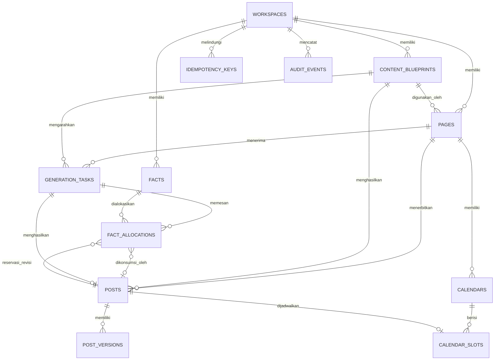

# Database Design — Content Producer MVP

## Opsi 2 Disempurnakan: Hybrid 12 Tabel

## 1. Informasi dokumen

| Item | Nilai |
|---|---|
| Produk | Content Producer untuk Facebook Reels trivia/fakta |
| Versi dokumen | 1.1 |
| Database | Supabase Postgres |
| Model desain | Hybrid relational + JSONB |
| Jumlah tabel aplikasi | 12 |
| Pemilik MVP | Satu owner per workspace |
| Multi-Page | Ya |
| Parallel ChatGPT chat | Ya |
| Target audiens konten | US, UK, CA, AU, dan global |
| Status | Desain database utama yang diselaraskan untuk MVP |
| Dokumen sebelumnya | `plans/database-design-1.md` — dipertahankan sebagai pembanding |
| Dokumen sumber | `plans/PRDid.md` dan `plans/implementation-plan.md` |

Dokumen ini menggantikan rancangan 24 tabel sebagai desain yang direkomendasikan untuk MVP. Tujuannya adalah mempertahankan kemampuan production—anti-duplikasi, parallel processing, versioning, idempotency, kalender, RLS, dan audit—dengan struktur yang lebih mudah dibaca melalui Supabase Dashboard.

`database-design-1.md` tidak dihapus oleh dokumen ini. File tersebut dapat dipertahankan sampai desain baru selesai diimplementasikan dan lulus pengujian.

### 1.1 Batas kewenangan dokumen

- `PRDid.md` mengatur ruang lingkup produk, perilaku pengguna, aturan konten, dan acceptance criteria.
- Dokumen ini mengatur nama tabel/kolom, lifecycle status, constraint, transaksi, dan tanggung jawab database function.
- `implementation-plan.md` mengatur urutan pengerjaan, struktur repository, nama MCP tool final, deployment, dan pengujian.
- Database hanya mengembalikan UUID `public_id` melalui schema `api`; primary key `bigint` tidak boleh keluar ke MCP.
- Bila ada konflik, implementasi bagian terkait dihentikan sampai ketiga dokumen diselaraskan. Tidak ada interpretasi ad hoc.

---

## 2. Prioritas desain

Desain ini dioptimalkan untuk tiga prioritas utama:

1. ChatGPT dapat bekerja cepat dengan sedikit tool call dan payload yang ringkas.
2. Sistem mudah dikembangkan untuk niche, format, dan fitur baru.
3. Struktur mudah dibaca dan diperiksa melalui Supabase Dashboard.

Prioritas tersebut tidak boleh mengorbankan:

- keunikan fakta lintas Page;
- keamanan beberapa chat yang berjalan bersamaan;
- source traceability;
- post version history;
- calendar uniqueness;
- tenant isolation melalui RLS;
- retry safety;
- audit trail.

---

## 3. Batasan MVP

Rancangan ini mendukung:

- satu owner per workspace;
- beberapa Facebook Page;
- satu niche aktif: trivia/fakta;
- beberapa Page dengan konfigurasi market dan topic berbeda;
- fakta sourced dan verified;
- exact dan semantic duplicate detection;
- produksi post dari beberapa chat secara paralel;
- output siap disalin ke Canva;
- kalender konten;
- publikasi manual ke Facebook.

Belum diaktifkan pada MVP:

- tim dengan owner/editor/reviewer/viewer;
- niche quote, psychology, atau niche lain;
- Facebook Graph API;
- Canva API;
- public plugin marketplace;
- billing dan subscription;
- autonomous background text generation;
- analytics Facebook.

Struktur sudah menyediakan extension point agar fitur tersebut dapat ditambahkan melalui migration, bukan pembangunan ulang total.

---

## 4. Prinsip utama

### 4.1 Relational untuk data kritis

Data tetap menjadi kolom atau tabel relational jika digunakan untuk:

- foreign key;
- unique constraint;
- RLS;
- filtering rutin;
- sorting;
- locking;
- queue processing;
- calendar collision;
- optimistic concurrency.

Contohnya:

```text
workspace_id
page_id
fact_id
post_id
status
topic
claim_hash
semantic_key_hash
publish_at
lock_version
created_at
```

### 4.2 JSONB untuk struktur fleksibel

JSONB digunakan untuk data yang bentuknya dapat berkembang, tetapi tidak menjadi inti relasi:

- workspace settings;
- Page markets dan topic mix;
- blueprint rules;
- fact sources dan current verification detail;
- generation request;
- post content;
- quality check details;
- calendar planning rules;
- stored idempotent response.

JSONB tidak digunakan sebagai pengganti seluruh schema.

### 4.3 Semua JSONB memiliki versi

Setiap JSONB bisnis mempunyai pasangan `*_schema_version` atau field `schema_version` di dalam objek.

Contoh:

```json
{
  "schema_version": 1,
  "markets": [],
  "topics": []
}
```

Tujuannya:

- migration JSON dapat dilacak;
- server dapat menolak bentuk lama yang tidak didukung;
- format dapat dikembangkan tanpa menebak struktur row;
- data dapat dibackfill secara bertahap.

### 4.4 Database adalah sumber kebenaran

Riwayat chat bukan sumber status. Semua status berikut berasal dari database:

- fact verification;
- fact availability;
- task claim;
- fact allocation;
- post version;
- approval;
- calendar slot;
- retry/idempotency.

### 4.5 ChatGPT tidak mengakses tabel langsung

ChatGPT memakai MCP tools yang memanggil database functions. Model tidak perlu mengetahui join dan detail 12 tabel.

Alur utama satu post:

```text
prepare_next_post
  -> claim task
  -> reserve facts
  -> read Page + blueprint
  -> return compact generation packet

finalize_post
  -> validate draft
  -> create post/version
  -> consume facts
  -> complete task
  -> return Canva-ready copy
```

### 4.6 Transaksi singkat

Tidak ada external API call di dalam transaksi database.

Embedding atau proses AI dilakukan sebelum atau sesudah transaksi singkat:

1. baca/claim resource;
2. commit;
3. panggil layanan eksternal;
4. simpan hasil dalam transaksi baru.

### 4.7 Riwayat penting immutable

Data berikut tidak diubah setelah dibuat:

- blueprint version;
- post version;
- audit event;
- fact allocation yang sudah consumed.

Koreksi dibuat sebagai row atau event baru.

---

## 5. Pembagian schema

## 5.1 Schema `app`

Berisi enam tabel bisnis yang paling sering dibuka melalui Dashboard:

1. `app.workspaces`
2. `app.pages`
3. `app.content_blueprints`
4. `app.facts`
5. `app.posts`
6. `app.calendars`

Schema ini menjawab pertanyaan bisnis:

- Workspace apa yang aktif?
- Page apa saja yang dikelola?
- Blueprint apa yang digunakan?
- Fakta apa yang tersedia atau sudah terpakai?
- Post apa yang sedang diproduksi?
- Kalender mana yang aktif?

## 5.2 Schema `ops`

Berisi enam tabel operasional:

7. `ops.generation_tasks`
8. `ops.fact_allocations`
9. `ops.post_versions`
10. `ops.calendar_slots`
11. `ops.idempotency_keys`
12. `ops.audit_events`

Schema ini dibuka ketika memeriksa:

- task yang gagal atau tertunda;
- fakta yang sedang reserved;
- versi post lama;
- slot kalender;
- retry request;
- riwayat perubahan.

## 5.3 Schema `api`

Tidak berisi tabel. Hanya berisi database functions yang sengaja boleh dipanggil MCP server.

Contoh:

- `api.get_page_context(...)`;
- `api.submit_fact_candidates(...)`;
- `api.create_generation_batch(...)`;
- `api.prepare_next_post(...)`;
- `api.finalize_post(...)`;
- `api.prepare_post_revision(...)`;
- `api.revise_post(...)`;
- `api.mark_post_published(...)`;
- `api.create_calendar(...)`.

Schema ini menjadi satu-satunya application schema yang perlu diekspos melalui Supabase Data API jika seluruh table access dilakukan melalui RPC.

## 5.4 Schema `private`

Tidak diekspos melalui Data API. Digunakan untuk:

- helper functions;
- trigger functions;
- JSON validators;
- maintenance functions;
- Cron entry functions;
- internal authorization helpers.

## 5.5 Schema `extensions`

Digunakan untuk extension seperti:

- `vector`;
- `pg_jsonschema` bila tersedia; jika tidak, kontrak yang sama tetap wajib ditegakkan oleh Zod di Edge Function dan private validation functions/checks di database;
- `pg_cron` sesuai konfigurasi Supabase.

Extension dibuat tanpa version pin mengikuti kebijakan Supabase terkini.

---

## 6. Tampilan Dashboard

Untuk pekerjaan harian, operator cukup membuka schema `app`:

```text
app
├── workspaces
├── pages
├── content_blueprints
├── facts
├── posts
└── calendars
```

Tabel teknis dipisahkan:

```text
ops
├── generation_tasks
├── fact_allocations
├── post_versions
├── calendar_slots
├── idempotency_keys
└── audit_events
```

Pemisahan schema bukan pengganti RLS. Semua tabel tetap memiliki RLS sebagai defense in depth.

---

## 7. Strategi identifier

Setiap tabel utama menggunakan:

```text
id         bigint identity — primary key internal
public_id  uuid — identifier untuk MCP dan UI
```

Aturan:

- foreign key internal menggunakan `bigint`;
- MCP input/output menggunakan `public_id`;
- `public_id` mempunyai unique constraint;
- internal bigint tidak dikirim ke model;
- UUID bukan bukti authorization;
- ownership tetap diverifikasi dari JWT dan `workspace_id`.

`batch_id` dan `allocation_group_id` juga berupa UUID opaque yang boleh keluar melalui MCP. Keduanya adalah correlation/group identifiers, bukan primary key internal.

Menggunakan bigint untuk relasi menjaga index dan join tetap kecil. UUID digunakan hanya sebagai identifier opaque di luar database.

Kode market disimpan memakai bentuk ISO-like yang disepakati sistem: `US`, `GB`, `CA`, `AU`, dan `GLOBAL`. Label pengguna “UK” dipetakan ke kode penyimpanan `GB`; keduanya tidak boleh muncul sebagai dua market terpisah.

---

## 8. Aturan workspace

Hampir semua tabel memiliki `workspace_id`, walaupun nilainya dapat diturunkan dari parent.

Tujuannya:

- RLS lebih cepat dan mudah dibaca;
- query selalu dapat dibatasi tenant;
- audit lebih mudah;
- relasi lintas workspace dapat dicegah;
- index sesuai pola akses MCP.

Parent penting mempunyai unique key `(workspace_id, id)`. Child memakai composite foreign key:

```sql
foreign key (workspace_id, page_id)
  references app.pages (workspace_id, id)
```

Dengan demikian, bug aplikasi tidak dapat menghubungkan post Workspace A ke Page Workspace B.

---

## 9. ERD



---

## 10. Daftar tabel final

| No. | Schema | Tabel | Fungsi |
|---:|---|---|---|
| 1 | `app` | `workspaces` | Tenant dan owner utama |
| 2 | `app` | `pages` | Konfigurasi Facebook Page |
| 3 | `app` | `content_blueprints` | Aturan konten yang versioned |
| 4 | `app` | `facts` | Fakta, sources, verification, embedding |
| 5 | `app` | `posts` | Identitas dan lifecycle post |
| 6 | `app` | `calendars` | Header plan kalender |
| 7 | `ops` | `generation_tasks` | Satu unit post di dalam batch produksi |
| 8 | `ops` | `fact_allocations` | Allocation reserved dan consumed fakta |
| 9 | `ops` | `post_versions` | Snapshot immutable setiap revisi |
| 10 | `ops` | `calendar_slots` | Slot penerbitan unik |
| 11 | `ops` | `idempotency_keys` | Perlindungan retry |
| 12 | `ops` | `audit_events` | Audit trail append-only |

---

# 11. Detail Tabel Schema `app`

## 11.1 `app.workspaces`

Satu workspace memiliki satu owner pada MVP. Semua Page di dalam workspace berbagi fact pool agar fakta tidak diulang lintas Page.

### Kolom

| Kolom | Tipe | Aturan |
|---|---|---|
| `id` | `bigint` | PK, generated identity |
| `public_id` | `uuid` | Unique, default UUID |
| `owner_user_id` | `uuid` | FK `auth.users.id`, wajib |
| `name` | `text` | Wajib |
| `slug` | `text` | Unique, lowercase |
| `status` | `text` | `active`, `suspended`, `archived` |
| `default_language` | `text` | Default `en` |
| `settings_schema_version` | `integer` | Default 1 |
| `settings` | `jsonb` | Pengaturan workspace fleksibel |
| `created_at` | `timestamptz` | Default `now()` |
| `updated_at` | `timestamptz` | Default `now()` |
| `archived_at` | `timestamptz` | Nullable |

### Contoh `settings`

```json
{
  "schema_version": 1,
  "fact_uniqueness_scope": "workspace",
  "default_fact_count": {
    "min": 5,
    "default": 6,
    "max": 9
  },
  "default_duration_seconds": 13,
  "supported_markets": ["US", "GB", "CA", "AU", "GLOBAL"],
  "generation_enabled": true
}
```

### Constraint

- `slug` mengikuti format lowercase kebab-case.
- `settings_schema_version > 0`.
- `default_fact_count.min <= default_fact_count.default <= default_fact_count.max` dan batas MVP tetap 5–9.
- `archived_at` terisi jika status `archived`.
- maksimal satu workspace `active` per owner pada MVP melalui partial unique index;
- satu owner dapat memiliki lebih dari satu workspace pada pengembangan berikutnya setelah constraint tersebut diubah melalui migration dan `get_workspace` menerima selector eksplisit.

### Index

- unique `public_id`;
- unique `slug`;
- `(owner_user_id, status)`.
- partial unique `(owner_user_id) where status = 'active'`.

### Data yang tidak boleh disimpan

- API key;
- access token;
- refresh token;
- OAuth client secret;
- database password.

---

## 11.2 `app.content_blueprints`

Menjadi extension point utama untuk niche dan format konten. Setiap row adalah satu versi. Isi aturan pada versi yang sudah diaktifkan bersifat immutable; hanya status lifecycle yang boleh berubah melalui function terkontrol.

### Kolom

| Kolom | Tipe | Aturan |
|---|---|---|
| `id` | `bigint` | PK |
| `public_id` | `uuid` | Unique |
| `workspace_id` | `bigint` | FK workspace |
| `blueprint_key` | `text` | Identitas keluarga blueprint |
| `version_number` | `integer` | Mulai dari 1 |
| `name` | `text` | Nama yang mudah dibaca |
| `description` | `text` | Nullable |
| `niche_key` | `text` | MVP: `trivia` |
| `content_type` | `text` | MVP: `fact_reel` |
| `rules_schema_version` | `integer` | Versi bentuk rules |
| `rules` | `jsonb` | Aturan produksi lengkap |
| `content_hash` | `text` | SHA-256 canonical rules |
| `status` | `text` | `draft`, `active`, `retired` |
| `change_notes` | `text` | Alasan versi baru |
| `created_by` | `uuid` | FK `auth.users.id` |
| `created_at` | `timestamptz` | Default `now()` |

Tidak ada `updated_at` karena isi versi tidak diedit. Perubahan aturan selalu membuat version row baru.

### Contoh `rules`

```json
{
  "schema_version": 1,
  "language": "en",
  "english_variant": "neutral-international",
  "spelling_standard": "american",
  "audience": ["US", "GB", "CA", "AU", "GLOBAL"],
  "allowed_topics": [
    "animals",
    "food_science",
    "human_body",
    "nature_science",
    "geography",
    "history_origins",
    "inventions_everyday",
    "general_trivia"
  ],
  "fact_count": {
    "min": 5,
    "default": 6,
    "max": 9
  },
  "architectures": [
    "themed",
    "single_subject",
    "mixed"
  ],
  "architecture_weights": {
    "themed": 45,
    "single_subject": 40,
    "mixed": 15
  },
  "hook_rules": {
    "max_characters": 90,
    "avoid_false_promises": true
  },
  "fact_style_rules": {
    "plain_english": true,
    "max_words_per_fact": 18,
    "max_sentence_characters": 150,
    "preserve_qualifiers": true
  },
  "canva_copy_rules": {
    "min_total_words": 65,
    "max_total_words": 120
  },
  "cta_rules": {
    "style": "light-engagement",
    "avoid_begging": true,
    "max_characters": 100
  },
  "caption_rules": {
    "max_characters": 500
  },
  "hashtag_rules": {
    "min_count": 0,
    "default_count": 3,
    "max_count": 5
  },
  "visual_rules": {
    "duration_seconds": 13,
    "motion": "subtle-background",
    "layout": "static-photo-style"
  },
  "quality_thresholds": {
    "minimum_score": 85,
    "fact_fidelity_required": true
  }
}
```

### Constraint

- unique `(workspace_id, blueprint_key, version_number)`;
- unique `(workspace_id, blueprint_key, content_hash)`;
- `version_number > 0`;
- `rules_schema_version > 0`;
- `fact_count.min <= fact_count.default <= fact_count.max` dan ketiganya berada pada rentang 5–9 untuk blueprint MVP;
- `english_variant = neutral-international` dan `spelling_standard = american` untuk blueprint MVP;
- maksimal satu active version per `(workspace_id, blueprint_key)` melalui partial unique index;
- field isi versi (`name`, `description`, `niche_key`, `content_type`, `rules_schema_version`, `rules`, `content_hash`, `change_notes`) tidak dapat berubah setelah status meninggalkan `draft`;
- status hanya boleh bergerak `draft → active → retired` melalui function terkontrol;
- DELETE ditolak; koreksi aturan dilakukan dengan membuat versi baru.

### Index

- `(workspace_id, niche_key, content_type, status)`;
- partial unique active blueprint;
- unique public ID.

### Ekspansi

Nanti blueprint baru dapat ditambahkan tanpa mengubah tabel:

```text
quote-reel
psychology-fact-reel
motivational-reel
history-story-reel
```

Setiap format mempunyai `rules_schema_version` sendiri.

---

## 11.3 `app.pages`

Menyimpan konfigurasi setiap Facebook Page.

### Kolom

| Kolom | Tipe | Aturan |
|---|---|---|
| `id` | `bigint` | PK |
| `public_id` | `uuid` | Unique |
| `workspace_id` | `bigint` | FK workspace |
| `blueprint_id` | `bigint` | Composite FK blueprint dalam workspace |
| `name` | `text` | Nama Page |
| `slug` | `text` | Unique dalam workspace |
| `facebook_page_ref` | `text` | Nullable, bukan credential |
| `status` | `text` | `active`, `paused`, `archived` |
| `niche_key` | `text` | MVP: `trivia` |
| `content_type` | `text` | MVP: `fact_reel` |
| `language_code` | `text` | Default `en` |
| `locale_code` | `text` | Default `en-US`; format BCP 47 |
| `english_variant` | `text` | Default `neutral-international` |
| `timezone` | `text` | Nama timezone IANA |
| `config_schema_version` | `integer` | Default 1 |
| `config` | `jsonb` | Markets, topics, overrides, preferences |
| `lock_version` | `integer` | Default 1 |
| `created_at` | `timestamptz` | Default `now()` |
| `updated_at` | `timestamptz` | Default `now()` |
| `archived_at` | `timestamptz` | Nullable |

### Contoh `config`

```json
{
  "schema_version": 1,
  "markets": [
    {"code": "US", "weight": 40, "is_primary": true},
    {"code": "GB", "weight": 20, "is_primary": false},
    {"code": "CA", "weight": 20, "is_primary": false},
    {"code": "AU", "weight": 20, "is_primary": false}
  ],
  "topics": [
    {"slug": "animals", "weight": 25, "min_gap_posts": 2},
    {"slug": "food_science", "weight": 20, "min_gap_posts": 2},
    {"slug": "human_body", "weight": 15, "min_gap_posts": 3},
    {"slug": "nature_science", "weight": 15, "min_gap_posts": 2},
    {"slug": "geography", "weight": 15, "min_gap_posts": 2},
    {"slug": "history_origins", "weight": 5, "min_gap_posts": 3},
    {"slug": "inventions_everyday", "weight": 3, "min_gap_posts": 3},
    {"slug": "general_trivia", "weight": 2, "min_gap_posts": 3}
  ],
  "blueprint_overrides": {
    "fact_count": {"min": 6, "default": 6, "max": 8}
  },
  "architecture_mix": {
    "themed": 45,
    "single_subject": 40,
    "mixed": 15
  },
  "cta_preferences": {
    "enabled": true,
    "avoid_repeating_within_posts": 5
  },
  "emoji_policy": {
    "enabled": false
  },
  "visual_preferences": {
    "background_style": "photo",
    "motion": "subtle"
  },
  "posting_defaults": {
    "posts_per_day": 2,
    "local_times": ["09:00", "19:00"]
  }
}
```

### Constraint

- unique `(workspace_id, slug)`;
- unique `(workspace_id, id)` untuk composite FK;
- `lock_version > 0`;
- `config_schema_version > 0`;
- `locale_code` wajib valid BCP 47 dan tetap konsisten dengan `language_code`;
- market weight 0–100 dan total 100 saat Page diaktifkan;
- satu market primary;
- topic slug harus berasal dari allowlist blueprint/server;
- topic weight total 100 saat Page diaktifkan;
- architecture mix hanya memakai `themed`, `single_subject`, dan `mixed`, dengan total weight 100 saat Page diaktifkan;
- `niche_key` dan `content_type` harus sesuai blueprint;
- archived timestamp sesuai status.

Validasi array dan total weight dilakukan oleh API function. JSON Schema memvalidasi bentuk data.

### Index

- `(workspace_id, status)`;
- `(workspace_id, niche_key, content_type)`;
- unique public ID;
- unique workspace slug.

JSONB tidak diberi GIN index pada awal MVP. Index hanya ditambahkan bila query production rutin membutuhkan pencarian langsung di dalam `config`.

---

## 11.4 `app.facts`

Menyimpan satu canonical factual claim, sources, current verification state, dan satu embedding aktif.

### Kolom

| Kolom | Tipe | Aturan |
|---|---|---|
| `id` | `bigint` | PK |
| `public_id` | `uuid` | Unique |
| `workspace_id` | `bigint` | FK workspace |
| `topic` | `text` | Indexed, bukan JSONB |
| `canonical_claim` | `text` | Klaim mudah dibaca |
| `normalized_claim` | `text` | Bentuk deterministik |
| `claim_hash` | `text` | SHA-256 normalized claim |
| `semantic_key` | `text` | Subject–relation–object |
| `semantic_key_hash` | `text` | SHA-256 semantic key |
| `language_code` | `text` | Default `en` |
| `risk_level` | `text` | `low`, `medium`, `high` |
| `verification_status` | `text` | Lifecycle verification |
| `sources_schema_version` | `integer` | Default 1 |
| `sources` | `jsonb` | Array source objects |
| `verification_schema_version` | `integer` | Default 1 |
| `verification` | `jsonb` | Current verification summary |
| `embedding` | `extensions.halfvec(1536)` | Nullable sampai dibuat |
| `embedding_model` | `text` | Nullable |
| `embedding_version` | `integer` | Nullable |
| `embedding_source_hash` | `text` | Nullable |
| `is_time_sensitive` | `boolean` | Default false |
| `as_of_date` | `date` | Nullable |
| `revalidate_after` | `timestamptz` | Nullable |
| `duplicate_of_fact_id` | `bigint` | Self-reference, nullable |
| `rejection_reason` | `text` | Nullable |
| `created_by` | `uuid` | FK user, nullable untuk system |
| `lock_version` | `integer` | Default 1 |
| `created_at` | `timestamptz` | Default `now()` |
| `updated_at` | `timestamptz` | Default `now()` |

### Verification status

```text
candidate
verifying
needs_review
verified
rejected
duplicate
```

Fact usage tidak disimpan pada status ini. Apakah fakta tersedia ditentukan dari `ops.fact_allocations`.

### Contoh `sources`

```json
{
  "schema_version": 1,
  "items": [
    {
      "url": "https://example.org/research",
      "canonical_url": "https://example.org/research",
      "url_hash": "sha256-hex",
      "publisher": "Example Research Organization",
      "title": "Example source title",
      "tier": "authoritative",
      "stance": "supports",
      "published_at": "2025-05-10T00:00:00Z",
      "accessed_at": "2026-10-06T10:00:00Z",
      "evidence_note": "Supports the central claim."
    }
  ]
}
```

### Contoh `verification`

```json
{
  "schema_version": 1,
  "verdict": "verified",
  "confidence": 0.96,
  "method": "ai-assisted",
  "verified_at": "2026-10-06T10:15:00Z",
  "verified_by": "user-public-reference",
  "summary": "The authoritative source supports the claim without material qualification.",
  "warnings": []
}
```

History perubahan verification berada di `ops.audit_events`. Current state tetap mudah dilihat pada row fact.

### Constraint

- unique `(workspace_id, claim_hash)`;
- unique `(workspace_id, semantic_key_hash)`;
- hash berformat 64 karakter hex;
- source items wajib untuk status `verified`;
- verification verdict wajib sesuai status;
- high-risk fact tidak auto-verified tanpa manual-review marker;
- `duplicate_of_fact_id` wajib pada status duplicate;
- fact tidak boleh menunjuk dirinya sendiri;
- time-sensitive verified fact wajib mempunyai `as_of_date` dan `revalidate_after`;
- embedding model/version/hash harus sama-sama null atau sama-sama terisi;
- `lock_version > 0`.

### Index

- unique public ID;
- unique claim hash per workspace;
- unique semantic key hash per workspace;
- `(workspace_id, verification_status, topic, created_at)`;
- partial `(workspace_id, revalidate_after)` untuk verified time-sensitive facts;
- HNSW cosine index pada embedding;
- index self-reference `duplicate_of_fact_id`.

Contoh vector index:

```sql
create index facts_embedding_hnsw_idx
on app.facts
using hnsw (embedding extensions.halfvec_cosine_ops)
where embedding is not null;
```

### Batas desain

MVP menyimpan satu embedding aktif per fact. Jika nanti diperlukan beberapa model/dimensi secara bersamaan, embedding dipromosikan ke tabel `fact_embeddings` melalui migration.

---

## 11.5 `app.posts`

Menyimpan identitas dan lifecycle post. Konten lengkap disimpan di `ops.post_versions`.

### Kolom

| Kolom | Tipe | Aturan |
|---|---|---|
| `id` | `bigint` | PK |
| `public_id` | `uuid` | Unique |
| `workspace_id` | `bigint` | FK workspace |
| `page_id` | `bigint` | Composite FK Page |
| `blueprint_id` | `bigint` | Blueprint version yang menjadi dasar |
| `niche_key` | `text` | MVP `trivia` |
| `content_type` | `text` | MVP `fact_reel` |
| `primary_topic` | `text` | Topik utama dari allowlist blueprint, indexed |
| `theme` | `text` | Tema spesifik, nullable |
| `status` | `text` | Lifecycle post |
| `current_version_id` | `bigint` | Nullable saat insert awal, FK ditambah setelah versions tersedia |
| `current_version_number` | `integer` | Default 0 sampai versi pertama dibuat |
| `lock_version` | `integer` | Default 1 |
| `approved_at` | `timestamptz` | Nullable |
| `approved_by` | `uuid` | Nullable |
| `rejected_at` | `timestamptz` | Nullable |
| `rejected_by` | `uuid` | Nullable |
| `rejection_reason` | `text` | Nullable, dibatasi panjangnya |
| `scheduled_at` | `timestamptz` | Nullable |
| `published_at` | `timestamptz` | Nullable |
| `external_post_ref` | `text` | Nullable, untuk pengembangan Facebook API |
| `created_by` | `uuid` | FK user, nullable untuk system |
| `created_at` | `timestamptz` | Default `now()` |
| `updated_at` | `timestamptz` | Default `now()` |
| `archived_at` | `timestamptz` | Nullable |

### Status

```text
draft
needs_review
approved
scheduled
published
rejected
archived
```

### Constraint

- unique `(workspace_id, id)`;
- `lock_version > 0`;
- `current_version_number >= 0`;
- Page dan blueprint berasal dari workspace sama;
- niche/content type sesuai Page dan blueprint;
- `primary_topic` wajib berasal dari topic allowlist blueprint/Page;
- `theme` dibatasi panjangnya dan tidak boleh menjadi pengganti topic terstruktur;
- approved metadata wajib pada status `approved`, `scheduled`, atau `published`;
- rejected metadata dan reason wajib pada status `rejected`;
- scheduled timestamp wajib pada status scheduled;
- published timestamp wajib pada status published;
- archived timestamp wajib pada status archived.

### Index

- unique public ID;
- `(workspace_id, page_id, status, created_at desc)`;
- `(workspace_id, page_id, primary_topic, created_at desc)`;
- `(workspace_id, status, scheduled_at)`;
- partial `(page_id, published_at desc)` untuk published posts;
- index `blueprint_id`.

### Current version pointer

Setelah `ops.post_versions` dibuat, tambahkan composite FK agar current version benar-benar milik post tersebut:

```text
(id, current_version_id)
  -> ops.post_versions(post_id, id)
```

Finalisasi post dilakukan dalam satu transaksi:

1. insert post beserta `primary_topic`/`theme`, tanpa current version;
2. insert version 1;
3. update current pointer;
4. consume facts;
5. complete generation task.

---

## 11.6 `app.calendars`

Header satu planning period untuk satu Page.

### Kolom

| Kolom | Tipe | Aturan |
|---|---|---|
| `id` | `bigint` | PK |
| `public_id` | `uuid` | Unique |
| `workspace_id` | `bigint` | FK workspace |
| `page_id` | `bigint` | Composite FK Page |
| `name` | `text` | Wajib |
| `start_date` | `date` | Wajib |
| `end_date` | `date` | Wajib |
| `timezone` | `text` | Snapshot timezone IANA |
| `status` | `text` | `draft`, `active`, `completed`, `archived` |
| `planning_rules_schema_version` | `integer` | Default 1 |
| `planning_rules` | `jsonb` | Frequency dan topic distribution |
| `lock_version` | `integer` | Default 1 |
| `activated_at` | `timestamptz` | Nullable |
| `completed_at` | `timestamptz` | Nullable |
| `archived_at` | `timestamptz` | Nullable |
| `created_by` | `uuid` | FK user |
| `created_at` | `timestamptz` | Default `now()` |
| `updated_at` | `timestamptz` | Default `now()` |

### Contoh `planning_rules`

```json
{
  "schema_version": 1,
  "posts_per_day": 2,
  "local_times": ["09:00", "19:00"],
  "weekdays": [1, 2, 3, 4, 5, 6, 7],
  "topic_distribution": {
    "animals": 25,
    "food_science": 20,
    "human_body": 15,
    "nature_science": 15,
    "geography": 15,
    "history_origins": 5,
    "inventions_everyday": 3,
    "general_trivia": 2
  },
  "allow_unassigned_slots": true
}
```

### Constraint

- `end_date >= start_date`;
- `lock_version > 0`;
- Page berada di workspace sama;
- timezone valid menurut allowlist/runtime validation;
- rules valid sebelum status menjadi active;
- active calendar wajib mempunyai minimal satu non-cancelled slot;
- completed calendar wajib mempunyai minimal satu published slot dan tidak mempunyai slot non-cancelled yang belum published;
- `activated_at`, `completed_at`, dan `archived_at` wajib sesuai status/transisi masing-masing.

### Index

- unique public ID;
- `(workspace_id, page_id, start_date, end_date)`;
- `(workspace_id, status)`.

---

# 12. Detail Tabel Schema `ops`

## 12.1 `ops.generation_tasks`

Satu row selalu mewakili satu calon post. Beberapa generation task dikelompokkan oleh `batch_id`; tidak ada parent batch row.

### Kolom

| Kolom | Tipe | Aturan |
|---|---|---|
| `id` | `bigint` | PK |
| `public_id` | `uuid` | Unique |
| `workspace_id` | `bigint` | FK workspace |
| `page_id` | `bigint` | Composite FK Page |
| `blueprint_id` | `bigint` | Blueprint untuk task |
| `batch_id` | `uuid` | ID pengelompokan batch |
| `item_number` | `integer` | Posisi dalam batch |
| `status` | `text` | Lifecycle task |
| `request_schema_version` | `integer` | Default 1 |
| `request` | `jsonb` | Topic/architecture/request detail |
| `lease_owner` | `uuid` | Request/worker token, nullable |
| `lease_expires_at` | `timestamptz` | Nullable |
| `attempt_count` | `integer` | Default 0 |
| `result_post_id` | `bigint` | Nullable, unique FK post |
| `error_code` | `text` | Nullable |
| `error_message` | `text` | Nullable, disanitasi |
| `started_at` | `timestamptz` | Nullable |
| `completed_at` | `timestamptz` | Nullable |
| `created_by` | `uuid` | FK user |
| `created_at` | `timestamptz` | Default `now()` |
| `updated_at` | `timestamptz` | Default `now()` |

### Status

```text
pending
facts_reserved
completed
failed
cancelled
```

### Contoh `request`

```json
{
  "schema_version": 1,
  "topic": "animals",
  "architecture": "themed",
  "fact_count": 7,
  "target_markets": ["US", "GB", "CA", "AU"],
  "calendar_slot_public_id": null,
  "user_instruction": "Focus on lesser-known but verifiable facts."
}
```

`user_instruction` harus dibatasi panjangnya dan diperlakukan sebagai input tidak tepercaya.

### Constraint

- unique `(workspace_id, batch_id, item_number)`;
- unique `result_post_id` jika tidak null;
- `item_number > 0`;
- `attempt_count` berada pada 0–3 untuk baseline MVP;
- task active (`facts_reserved`) wajib memiliki lease;
- completed task wajib mempunyai result post;
- Page, blueprint, dan result post berada di workspace sama.

### Index

- unique public ID;
- partial queue index `(workspace_id, page_id, created_at, id)` untuk pending;
- partial lease index `(lease_expires_at)` untuk active tasks;
- `(workspace_id, batch_id, item_number)`;
- `(workspace_id, status, created_at)`;
- index setiap FK.

### Queue claim

Gunakan atomic claim:

```sql
update ops.generation_tasks
set status = 'facts_reserved',
    lease_owner = p_lease_owner,
    lease_expires_at = now() + interval '20 minutes',
    attempt_count = attempt_count + 1,
    started_at = coalesce(started_at, now()),
    updated_at = now()
where id = (
  select id
  from ops.generation_tasks
  where workspace_id = p_workspace_id
    and page_id = p_page_id
    and status = 'pending'
    and attempt_count < 3
  order by created_at, id
  for update skip locked
  limit 1
)
returning *;
```

Dengan satu row per post, beberapa chat dapat memproses batch yang sama tanpa parent job table.

---

## 12.2 `ops.fact_allocations`

Menggabungkan allocation reserved/consumed dan hubungan fakta ke post.

### Kolom

| Kolom | Tipe | Aturan |
|---|---|---|
| `id` | `bigint` | PK |
| `public_id` | `uuid` | Unique allocation token |
| `workspace_id` | `bigint` | FK workspace |
| `page_id` | `bigint` | Composite FK Page |
| `fact_id` | `bigint` | Composite FK Fact |
| `purpose` | `text` | `generation` atau `revision` |
| `allocation_group_id` | `uuid` | Mengelompokkan satu hasil prepare secara atomik |
| `generation_task_id` | `bigint` | Nullable; composite FK task untuk purpose `generation` |
| `post_id` | `bigint` | Nullable pada generation-reserved; wajib pada revision dan consumed |
| `status` | `text` | `reserved`, `consumed`, `released`, `expired` |
| `reserved_at` | `timestamptz` | Default `now()` |
| `expires_at` | `timestamptz` | Wajib ketika reserved |
| `consumed_at` | `timestamptz` | Nullable |
| `released_at` | `timestamptz` | Nullable |
| `expired_at` | `timestamptz` | Nullable |
| `release_reason` | `text` | Nullable |
| `created_at` | `timestamptz` | Default `now()` |
| `updated_at` | `timestamptz` | Default `now()` |

### Constraint utama

```sql
create unique index fact_allocations_fact_active_uniq
on ops.fact_allocations (workspace_id, fact_id)
where status in ('reserved', 'consumed');
```

Maknanya:

- satu fakta hanya dapat memiliki satu allocation aktif;
- fakta consumed tidak pernah tersedia kembali;
- released atau expired allocation tidak menghalangi allocation baru;
- perlindungan berlaku lintas semua Page di workspace.

### Constraint tambahan

- consumed wajib mempunyai `post_id` dan `consumed_at`;
- purpose `generation` wajib mempunyai `generation_task_id`; saat masih reserved, `post_id` harus null;
- purpose `revision` wajib mempunyai `post_id` sejak reserved dan `generation_task_id` harus null;
- seluruh row yang dibuat oleh satu prepare call memakai `allocation_group_id` yang sama;
- satu `allocation_group_id` tidak boleh dipakai ulang untuk purpose, Page, task, atau post berbeda; enforcement dilakukan oleh guarded API function/constraint trigger;
- unique `(workspace_id, allocation_group_id, fact_id)`;
- released wajib mempunyai `released_at` dan `release_reason`;
- expired wajib mempunyai `expired_at`; `release_reason` boleh berisi alasan expiry yang aman;
- Page, fact, optional task, dan optional post berasal dari workspace yang sama;
- transition terminal tidak dapat kembali ke reserved.

### Index

- unique public ID;
- partial unique active fact;
- partial `(expires_at)` untuk reserved;
- `(workspace_id, generation_task_id, status)`;
- `(workspace_id, allocation_group_id, status)`;
- `(workspace_id, post_id)`;
- `(workspace_id, page_id, consumed_at desc)`;
- index setiap FK.

### Mengapa tetap relational

Fact allocations tidak boleh dipindahkan ke JSONB karena menjadi inti:

- anti-duplikasi;
- locking;
- audit penggunaan;
- relasi fact–post;
- parallel chat safety.

---

## 12.3 `ops.post_versions`

Snapshot immutable setiap versi post. Menggabungkan detail versi, rendered facts, dan quality checks.

### Kolom

| Kolom | Tipe | Aturan |
|---|---|---|
| `id` | `bigint` | PK |
| `public_id` | `uuid` | Unique |
| `workspace_id` | `bigint` | FK workspace |
| `post_id` | `bigint` | Composite FK post |
| `version_number` | `integer` | Mulai dari 1 |
| `blueprint_id` | `bigint` | Blueprint snapshot reference |
| `blueprint_content_hash` | `text` | Hash rules yang digunakan |
| `content_schema_version` | `integer` | Default 1 |
| `content` | `jsonb` | Naskah lengkap siap Canva |
| `quality_schema_version` | `integer` | Default 1 |
| `quality` | `jsonb` | Hasil QA terstruktur |
| `word_count` | `integer` | Dihitung server |
| `character_count` | `integer` | Dihitung server |
| `revision_instruction` | `text` | Nullable |
| `created_by` | `uuid` | FK user, nullable untuk system |
| `created_at` | `timestamptz` | Default `now()` |

Tidak ada `updated_at`; row immutable.

### Contoh `content`

```json
{
  "schema_version": 1,
  "language": "en",
  "english_variant": "neutral-international",
  "spelling_standard": "american",
  "topic": "animals",
  "theme": "octopus biology",
  "architecture": "themed",
  "hook": "These facts sound made up, but they are real.",
  "facts": [
    {
      "display_order": 1,
      "allocation_public_id": "00000000-0000-0000-0000-000000000000",
      "fact_public_id": "00000000-0000-0000-0000-000000000000",
      "rendered_text": "An octopus has three hearts.",
      "source_note": "Verified from an authoritative marine source."
    }
  ],
  "cta": "Which fact surprised you most?",
  "canva_copy": "...",
  "caption": "...",
  "hashtags": ["#facts", "#didyouknow"],
  "visual_direction": {
    "duration_seconds": 13,
    "background": "subtle-moving-ocean-photo",
    "text_layout": "high-contrast-centered"
  }
}
```

### Contoh `quality`

```json
{
  "schema_version": 1,
  "status": "passed",
  "score": 94,
  "checks": {
    "fact_count": {"status": "passed"},
    "fact_fidelity": {"status": "passed"},
    "duplicate_fact": {"status": "passed"},
    "english_clarity": {"status": "passed", "score": 95},
    "canva_format": {"status": "passed"},
    "safety": {"status": "passed"}
  },
  "warnings": []
}
```

### Constraint

- unique `(post_id, version_number)`;
- unique `(post_id, id)` untuk current pointer;
- `version_number > 0`;
- content dan quality lulus JSON Schema;
- `content.topic` sama dengan `app.posts.primary_topic` dan `content.theme` sama dengan snapshot tema post;
- architecture `mixed` wajib memakai `primary_topic = general_trivia` dan boleh memiliki theme null;
- `content.english_variant` dan `content.spelling_standard` sesuai blueprint yang digunakan;
- setiap allocation ID pada content dimiliki post yang sama;
- setiap fact ID sesuai allocation;
- display order unik di dalam content;
- blueprint hash sesuai blueprint row;
- word dan character count non-negatif;
- UPDATE/DELETE ditolak melalui immutable trigger dan grants.

Relasi allocation di dalam JSON divalidasi oleh finalization/revision function sebelum row dibuat. Source of truth hubungan fact–post tetap `ops.fact_allocations`.

### Index

- unique public ID;
- unique post/version;
- `(workspace_id, post_id, created_at desc)`;
- index blueprint ID;
- tidak menambahkan GIN content/quality pada awal MVP.

---

## 12.4 `ops.calendar_slots`

Satu row mewakili satu kesempatan publikasi.

### Kolom

| Kolom | Tipe | Aturan |
|---|---|---|
| `id` | `bigint` | PK |
| `public_id` | `uuid` | Unique |
| `workspace_id` | `bigint` | FK workspace |
| `calendar_id` | `bigint` | Composite FK calendar |
| `page_id` | `bigint` | Composite FK Page |
| `post_id` | `bigint` | Nullable |
| `topic` | `text` | Nullable untuk unassigned slot |
| `local_date` | `date` | Tanggal menurut Page timezone |
| `slot_number` | `smallint` | Urutan slot hari tersebut |
| `publish_at` | `timestamptz` | Waktu absolut |
| `status` | `text` | `planned`, `ready`, `published`, `cancelled` |
| `notes` | `text` | Nullable |
| `lock_version` | `integer` | Default 1 |
| `created_at` | `timestamptz` | Default `now()` |
| `updated_at` | `timestamptz` | Default `now()` |

### Partial unique indexes

```sql
create unique index calendar_slots_page_day_number_active_uniq
on ops.calendar_slots (page_id, local_date, slot_number)
where status <> 'cancelled';

create unique index calendar_slots_page_publish_at_active_uniq
on ops.calendar_slots (page_id, publish_at)
where status <> 'cancelled';

create unique index calendar_slots_post_active_uniq
on ops.calendar_slots (post_id)
where post_id is not null and status <> 'cancelled';
```

### Constraint

- `slot_number > 0`;
- `lock_version > 0`;
- Page harus sama dengan Page calendar;
- ready/published slot wajib mempunyai post;
- post harus berasal dari Page sama;
- jika post terisi, `slot.topic` wajib sama dengan `post.primary_topic`;
- published slot mengarah pada published post;
- cancelled slot tidak digunakan oleh production flow.

### Index

- unique public ID;
- tiga partial unique indexes;
- `(workspace_id, page_id, local_date)`;
- `(calendar_id, local_date, slot_number)`;
- index post dan topic sesuai query.

---

## 12.5 `ops.idempotency_keys`

Mencegah retry menghasilkan resource ganda.

### Kolom

| Kolom | Tipe | Aturan |
|---|---|---|
| `id` | `bigint` | PK |
| `public_id` | `uuid` | Unique |
| `workspace_id` | `bigint` | FK workspace |
| `actor_user_id` | `uuid` | Pemanggil |
| `operation` | `text` | Nama operasi stabil |
| `idempotency_key` | `text` | Key dari client/tool |
| `request_hash` | `text` | SHA-256 canonical request |
| `status` | `text` | `processing`, `completed`, `failed` |
| `resource_type` | `text` | Nullable |
| `resource_public_id` | `uuid` | Nullable |
| `response_schema_version` | `integer` | Nullable |
| `response_payload` | `jsonb` | Response aman untuk retry |
| `error_code` | `text` | Nullable |
| `expires_at` | `timestamptz` | Wajib |
| `created_at` | `timestamptz` | Default `now()` |
| `updated_at` | `timestamptz` | Default `now()` |

### Constraint

- unique `(workspace_id, operation, idempotency_key)`;
- key sama dengan request hash berbeda ditolak;
- completed wajib mempunyai response/resource;
- failed wajib mempunyai stable `error_code`; replay key yang sama mengembalikan error tersimpan dan tidak menjalankan ulang operasi;
- request hash berformat SHA-256;
- expiry setelah creation.

### Index

- unique public ID;
- unique operation/key;
- partial `(expires_at)` untuk record yang dapat dibersihkan;
- `(workspace_id, actor_user_id, created_at desc)`.

### Operasi wajib idempotent

- create/update Page;
- submit/review fact batch;
- create generation batch;
- prepare next post;
- release generation task;
- finalize post;
- prepare/release post revision;
- revise/approve/reject/mark published/archive post;
- create/assign/unassign/reschedule/activate/archive calendar.

---

## 12.6 `ops.audit_events`

Audit trail append-only.

### Kolom

| Kolom | Tipe | Aturan |
|---|---|---|
| `id` | `bigint` | PK |
| `public_id` | `uuid` | Unique |
| `workspace_id` | `bigint` | FK workspace |
| `actor_user_id` | `uuid` | Nullable untuk system/Cron |
| `actor_type` | `text` | `user`, `mcp-server`, `worker`, `cron` |
| `request_id` | `uuid` | Correlation ID |
| `event_type` | `text` | Nama event stabil |
| `entity_type` | `text` | Jenis entity |
| `entity_id` | `bigint` | Nullable |
| `entity_public_id` | `uuid` | Nullable |
| `before_schema_version` | `integer` | Nullable |
| `before_data` | `jsonb` | Snapshot aman, nullable |
| `after_schema_version` | `integer` | Nullable |
| `after_data` | `jsonb` | Snapshot aman, nullable |
| `metadata` | `jsonb` | Context tersanitasi |
| `created_at` | `timestamptz` | Default `now()` |

Tidak ada `updated_at`.

### Event penting

```text
workspace.created
page.created
page.updated
blueprint.activated
fact.submitted
fact.verified
fact.rejected
fact.duplicate_detected
task.prepared
fact.reserved
fact.released
fact.consumed
post.finalized
post.revised
post.approved
post.rejected
calendar.created
slot.ready
slot.rescheduled
oauth.client_connected
```

### Constraint

- UPDATE/DELETE ditolak;
- actor atau actor_type system harus teridentifikasi;
- request ID wajib;
- secret tidak boleh masuk snapshot/metadata.

### Index

- unique public ID;
- `(workspace_id, created_at desc)`;
- `(request_id)`;
- `(workspace_id, entity_type, entity_public_id, created_at desc)`;
- `(workspace_id, event_type, created_at desc)`.

### Data yang dilarang

- OAuth token;
- refresh token;
- API key;
- password;
- database URL dengan credential;
- full chain-of-thought;
- full copyrighted source content.

---

# 13. Mapping Desain 24 Tabel ke 12 Tabel

| Desain lama | Desain baru | Cara penggabungan |
|---|---|---|
| `workspaces` | `app.workspaces` | Dipertahankan |
| `workspace_members` | Belum ada | MVP memakai `owner_user_id`; ditambah saat team feature |
| `content_blueprints` | `app.content_blueprints` | Digabung dengan version rows |
| `content_blueprint_versions` | `app.content_blueprints` | Satu row = satu immutable version |
| `pages` | `app.pages` | Dipertahankan |
| `page_markets` | `app.pages.config` | JSONB markets |
| `topics` | Allowlist + blueprint rules | Topic utama tetap kolom pada fact/task/slot |
| `page_topics` | `app.pages.config` | JSONB topic mix |
| `facts` | `app.facts` | Dipertahankan |
| `fact_sources` | `app.facts.sources` | JSONB sourced evidence |
| `fact_verifications` | `app.facts.verification` + audit | Current state + history event |
| `fact_embeddings` | `app.facts.embedding` | Satu active embedding |
| `generation_jobs` | `ops.generation_tasks.batch_id` | Batch tidak membutuhkan parent row |
| `generation_job_items` | `ops.generation_tasks` | Satu row = satu post task |
| `fact_reservations` | `ops.fact_allocations` | Konsep lama digabung sebagai allocation reserved/consumed |
| `post_facts` | `ops.fact_allocations.post_id` | Relasi relational tetap ada |
| `posts` | `app.posts` | Dipertahankan |
| `post_versions` | `ops.post_versions` | Dipertahankan |
| `post_version_facts` | `post_versions.content.facts` | JSONB, divalidasi terhadap allocations |
| `post_quality_checks` | `post_versions.quality` | JSONB quality map |
| `content_calendars` | `app.calendars` | Dipertahankan |
| `calendar_slots` | `ops.calendar_slots` | Dipertahankan |
| `idempotency_records` | `ops.idempotency_keys` | Dipertahankan, nama dipersingkat |
| `audit_events` | `ops.audit_events` | Dipertahankan |

---

# 14. JSONB Validation Contracts

JSONB harus lolos dua lapisan:

1. Zod/input schema di MCP server.
2. JSON Schema/check function di database untuk critical writes.

## 14.1 Workspace settings

Wajib memiliki:

- `schema_version`;
- uniqueness scope;
- generation enabled flag;
- default fact count;
- default duration.

## 14.2 Blueprint rules

Wajib memiliki:

- `schema_version`;
- language;
- audience;
- output structure;
- validation/quality rules;
- visual rules.

## 14.3 Page config

Wajib memiliki:

- `schema_version`;
- markets array;
- topic mix array;
- blueprint overrides object;
- posting defaults.

## 14.4 Fact sources

Setiap item wajib memiliki:

- HTTPS URL;
- canonical URL;
- URL hash;
- publisher;
- title;
- tier;
- stance;
- accessed timestamp;
- evidence note.

## 14.5 Fact verification

Wajib memiliki:

- verdict;
- method;
- confidence;
- timestamp;
- summary;
- warnings array.

## 14.6 Generation task request

Wajib memiliki:

- schema version;
- requested fact count;
- topic/architecture or selection policy;
- target markets;
- bounded user instruction.

## 14.7 Post content

Wajib memiliki:

- language, neutral-international variant, dan American spelling standard;
- primary topic dan optional theme;
- architecture;
- hook;
- facts array;
- CTA;
- Canva copy;
- caption;
- hashtags;
- visual direction.

## 14.8 Post quality

Wajib memiliki:

- overall status;
- score;
- named checks;
- warnings.

## 14.9 Calendar planning rules

Wajib memiliki:

- posting frequency;
- local times;
- weekdays;
- topic distribution.

---

# 15. Fact Uniqueness dan Availability

## 15.1 Exact normalization

Sebelum fact disimpan:

1. Unicode normalization.
2. Lowercase untuk comparison.
3. Whitespace normalization.
4. Punctuation non-esensial normalization.
5. Preserve negation, number, unit, dan qualifier.
6. Hash normalized claim.

Unique constraint menangkap exact duplicate:

```text
unique(workspace_id, claim_hash)
```

## 15.2 Semantic key

Representasi ringkas:

```text
octopus | has | three hearts
```

Unique constraint:

```text
unique(workspace_id, semantic_key_hash)
```

## 15.3 Embedding similarity

Embedding dipakai untuk mencari paraphrase atau klaim yang sangat dekat.

Decision states:

```text
high similarity   -> duplicate
medium similarity -> needs_review
low similarity    -> continue verification
```

Threshold harus dikalibrasi dari labeled evaluation set. Jangan memakai angka tebakan sebagai production threshold.

## 15.4 Availability

Fact tersedia jika:

- verification status `verified`;
- bukan overdue untuk revalidation;
- tidak mempunyai allocation `reserved`;
- tidak mempunyai allocation `consumed`;
- topic sesuai permintaan;
- source policy sesuai risk level.

Availability tidak disimpan sebagai boolean karena dapat berubah akibat allocation dan waktu. Nilainya dihitung melalui query/function.

---

# 16. Lifecycle

## 16.1 Fact

```text
candidate    -> verifying | rejected | duplicate
verifying    -> verified | needs_review | rejected | duplicate
needs_review -> verified | rejected | duplicate
verified     -> verifying  (revalidation)
verified     -> rejected   (correction)
```

## 16.2 Generation task

```text
pending -> facts_reserved -> completed
pending/facts_reserved -> cancelled
facts_reserved -> failed
facts_reserved -> pending  (lease recovery jika belum ada consumption)
```

## 16.3 Fact allocation

```text
reserved -> consumed
reserved -> released
reserved -> expired
```

Terminal allocation tidak kembali ke reserved. Allocation berikutnya membuat row baru.

## 16.4 Post

```text
draft        -> needs_review | rejected | archived
needs_review -> approved | rejected | archived
approved     -> needs_review | scheduled | published | rejected | archived
scheduled    -> approved | published | archived
published    -> archived
rejected     -> archived
```

Catatan:

- finalisasi normal langsung membuat `needs_review`; `draft` hanya untuk recovery/penyimpanan pekerjaan belum lengkap;
- revisi substantif pada post approved mengembalikannya ke `needs_review`;
- post scheduled harus dilepas dari slot menjadi approved sebelum revisi substantif;
- `scheduled → approved` terjadi saat slot dilepas;
- `approved → published` mendukung publikasi manual tanpa kalender;
- archive dari scheduled membatalkan/melepas slot secara atomik;
- `failed` hanya status generation task, bukan post; task aktif tetap `facts_reserved` selama ChatGPT menulis dan melakukan QA.

## 16.5 Calendar slot

```text
planned -> ready -> published
planned/ready -> cancelled
```

State transition dijalankan melalui database functions dan dilindungi trigger/checks.

## 16.6 Calendar

```text
draft -> active -> completed -> archived
draft/active -> archived
```

- create selalu menghasilkan `draft`;
- activate memerlukan minimal satu slot dan tidak ada collision;
- completed diatur otomatis ketika seluruh slot non-cancelled published dan minimal satu slot published;
- archive dengan planned/ready slots memerlukan flag pembatalan eksplisit, membatalkan slot tersebut, dan mengembalikan scheduled posts terkait ke approved secara atomik.

---

# 17. Parallel Chat Safety

## 17.1 Task claim

`prepare_next_post` mengklaim satu pending task menggunakan `FOR UPDATE SKIP LOCKED`.

Hasil:

- Chat A mendapat task 1.
- Chat B melewati task 1 dan mendapat task 2.
- Tidak ada wait panjang.

## 17.2 Fact allocation

Setelah task diklaim, facts dipilih dan di-lock dalam urutan `fact.id`.

Partial unique index menjadi perlindungan terakhir jika dua transaksi memilih kandidat sama.

## 17.3 Lease

Task lease dan reserved allocation memakai TTL awal 20 menit.

- Jika ChatGPT selesai: allocation consumed.
- Jika user membatalkan: allocation released.
- Jika chat hilang: Cron menandai expired.
- Task kembali pending hanya bila `attempt_count < 3`; jika batas tercapai, task menjadi failed.

TTL final dikalibrasi melalui UAT.

## 17.4 Lock order

Semua function mengikuti urutan:

```text
workspace
-> page
-> generation task
-> facts ordered by ID
-> fact allocations
-> post
-> post version
-> calendar slot
```

Urutan konsisten mengurangi risiko deadlock.

## 17.5 Tidak ada external call dalam transaksi

Content generation dan embedding API tidak dipanggil saat row locks masih terbuka.

---

# 18. Idempotency

Write MCP tool menerima `idempotency_key`.

Alur:

1. Canonicalize request.
2. Hash request.
3. Insert idempotency record dengan `ON CONFLICT`.
4. Jika key sudah ada tetapi request hash berbeda, tolak.
5. Jika completed, kembalikan stored response.
6. Jika failed, kembalikan stored stable error tanpa menjalankan ulang operasi.
7. Jika processing, return in-progress.
8. Jika record baru, jalankan operasi.
9. Simpan resource/response atau stable failure.

Idempotency tidak menggantikan unique constraint. Keduanya digunakan bersama.

Contoh stable error:

```text
IDEMPOTENCY_CONFLICT
```

---

# 19. Optimistic Locking

Tabel mutable utama memiliki `lock_version`:

- pages;
- facts;
- posts;
- calendars;
- calendar slots.

Pola:

```sql
update app.posts
set lock_version = lock_version + 1,
    updated_at = now()
where id = p_post_id
  and lock_version = p_expected_lock_version
returning *;
```

Jika tidak ada row, server mengembalikan:

```text
RESOURCE_VERSION_CONFLICT
```

ChatGPT harus membaca ulang resource sebelum mencoba revisi.

---

# 20. Database Function Interfaces

Nama database function pada bagian ini adalah baseline final MVP. Perubahan nama/tanggung jawab wajib memperbarui PRD, implementation plan, MCP mapping, dan contract tests secara bersamaan.

## 20.1 Workspace dan Page

### `api.get_workspace()`

Mengembalikan satu active workspace milik caller dan summary counts. MVP menjamin maksimal satu active workspace per owner.

### `api.list_pages(...)`

Read-only, paginated.

### `api.get_page_context(page_public_id)`

Menggabungkan:

- Page;
- active blueprint;
- fact inventory summary;
- recent topic usage;
- current calendar summary.

Function ini mengurangi jumlah round trip ChatGPT.

### `api.create_page(...)`

Idempotent, memvalidasi config dan blueprint.

### `api.update_page(...)`

Memerlukan expected lock version.

## 20.2 Facts

### `api.get_fact_inventory(...)`

Mengembalikan counts per topic/status, bukan seluruh facts.

### `api.check_fact_candidates(...)`

Exact hash, semantic key, dan vector candidate search.

### `api.submit_fact_candidates(...)`

Batch bounded, idempotent, menyimpan candidate/source metadata.

### `api.list_facts_needing_review(...)`

Read-only, paginated, dan terbatas pada fact `needs_review` atau overdue revalidation milik workspace caller.

### `api.review_fact_candidates(...)`

Batch review, memperbarui current verification dan audit.

## 20.3 Generation

### `api.create_generation_batch(...)`

Membuat N task dengan satu batch ID.

### `api.prepare_next_post(...)`

Dalam transaksi singkat:

1. claim task;
2. membuat reserved allocations untuk verified facts;
3. update task status;
4. write audit;
5. return generation packet beserta satu `allocation_group_id`.

### `api.release_generation_task(...)`

Melepas hanya allocation `reserved` milik task dan lease caller. Input target action hanya `retry` atau `cancel`: `retry` memetakan ke `pending` jika `attempt_count < 3`, atau `failed` jika batas tercapai; `cancel` memetakan ke `cancelled`. Operasi idempotent dan tidak dapat melepas allocation `consumed`.

### `api.validate_post_draft(...)`

Read-only. Memvalidasi lease, allocation group, fact/blueprint state, serta aturan deterministik yang memerlukan database; tidak mengonsumsi allocation atau mengubah task.

### `api.finalize_post(...)`

Dalam satu transaksi:

1. validate idempotency;
2. validate task lease;
3. validate allocation group, purpose `generation`, dan seluruh allocations;
4. validate post content/QA;
5. insert post;
6. insert version 1;
7. set current pointer;
8. consume allocations;
9. complete task;
10. write audit;
11. complete idempotency.

### `api.get_generation_batch(batch_id)`

Menghitung counts dan derived status (`pending`, `in_progress`, `completed`, `partially_completed`, `failed`, atau `cancelled`) dari generation task rows; tidak membaca parent row.

Precedence derived status mengikuti PRD: all pending; any pending/`facts_reserved` after start; all completed; completed mixed dengan failed/cancelled; all cancelled; lalu terminal failure tanpa completed.

## 20.4 Posts

### `api.get_post(...)`

Mengembalikan current version secara default.

### `api.list_posts(...)`

Bounded filter dan pagination, termasuk filter `primary_topic`.

### `api.prepare_post_revision(...)`

Dalam satu transaksi, memvalidasi post/lock version, memilih verified replacement facts, lalu membuat allocations dengan purpose `revision`, `post_id` terisi, dan satu `allocation_group_id` baru.

### `api.release_post_revision(...)`

Melepas seluruh allocation `reserved` pada satu revision allocation group milik post/caller. Operasi idempotent; allocation `consumed` tidak pernah dilepas.

### `api.revise_post(...)`

Membuat version baru dengan optimistic locking. Untuk penggantian fakta, function memvalidasi revision allocation group lalu mengonsumsinya. `primary_topic` dan `theme` pada header post diperbarui atomik agar sama dengan current version.

### `api.approve_post(...)`

Memastikan current version lulus QA.

### `api.reject_post(...)`

Memerlukan expected lock version dan alasan. Hanya draft/needs_review/approved yang dapat ditolak; scheduled post harus di-unassign lebih dahulu. Allocation consumed tetap immutable dan tidak dilepas.

### `api.mark_post_published(...)`

Memerlukan expected lock version dan `published_at`, mengubah post menjadi `published`, menyimpan optional external reference, dan memperbarui ready calendar slot menjadi `published` secara atomik bila ada. Jika post mempunyai slot, calendar wajib `active`. Setelah itu function menandai calendar `completed` jika seluruh slot non-cancelled sudah published dan minimal satu slot published.

### `api.archive_post(...)`

Memerlukan expected lock version, memvalidasi transition, mengubah status menjadi `archived`, membatalkan/melepaskan active slot secara atomik bila post scheduled, menghitung ulang completion calendar terkait, dan menulis audit event. Tidak menghapus post, version, atau allocation history.

## 20.5 Calendar

### `api.preview_calendar_plan(...)`

Read-only. Mengembalikan bounded conflict/inventory context untuk candidate slots tanpa menyimpan calendar atau slot.

### `api.create_calendar(...)`

Membuat header dan slots atomik.

### `api.assign_post_to_slot(...)`

Memvalidasi Page, post `approved`, dan slot version; mengubah slot menjadi `ready` dan post menjadi `scheduled` dalam satu transaksi.

### `api.unassign_post_from_slot(...)`

Memerlukan expected slot dan post lock versions. Hanya ready slot yang belum published dapat dilepas; post kembali `approved` dan slot kembali `planned` dalam satu transaksi.

### `api.get_calendar(...)`

Mengembalikan kalender dan slots dalam rentang terbatas.

### `api.reschedule_calendar_slot(...)`

Optimistic locking dan collision validation.

### `api.activate_calendar(...)`

Memvalidasi calendar draft, minimal satu slot, seluruh JSON rules, dan collision; lalu mengubah status menjadi active menggunakan expected lock version.

### `api.archive_calendar(...)`

Mengarsipkan draft/active/completed calendar. Planned/ready slots hanya boleh dibatalkan jika caller mengirim flag eksplisit; scheduled posts terkait kembali approved dalam transaksi yang sama.

---

# 21. MCP Data Contract untuk Kecepatan AI

Database functions mengembalikan compact structured results. Jangan mengembalikan row mentah dari seluruh tabel.

## 21.1 Generation packet

```json
{
  "task_public_id": "uuid",
  "batch_id": "uuid",
  "allocation_group_id": "uuid",
  "lease_expires_at": "timestamp",
  "page": {
    "public_id": "uuid",
    "name": "Page A",
    "language": "en",
    "locale": "en-US",
    "english_variant": "neutral-international",
    "spelling_standard": "american",
    "markets": ["US", "GB", "CA", "AU"]
  },
  "blueprint": {
    "public_id": "uuid",
    "version": 1,
    "content_hash": "sha256",
    "rules": {}
  },
  "facts": [
    {
      "fact_public_id": "uuid",
      "allocation_public_id": "uuid",
      "canonical_claim": "...",
      "topic": "animals",
      "source_summary": "..."
    }
  ],
  "required_output": {}
}
```

Tidak dikembalikan:

- internal IDs;
- full embedding vector;
- seluruh source page content;
- irrelevant audit history;
- data Page lain.

## 21.2 Final result

```json
{
  "post_public_id": "uuid",
  "page_public_id": "uuid",
  "version_public_id": "uuid",
  "version_number": 1,
  "lock_version": 1,
  "status": "needs_review",
  "topic": "animals",
  "theme": "octopus biology",
  "architecture": "themed",
  "hook": "These facts sound made up, but they are real.",
  "facts": [
    {"fact_public_id": "00000000-0000-0000-0000-000000000001", "rendered_text": "Rendered fact 1."},
    {"fact_public_id": "00000000-0000-0000-0000-000000000002", "rendered_text": "Rendered fact 2."},
    {"fact_public_id": "00000000-0000-0000-0000-000000000003", "rendered_text": "Rendered fact 3."},
    {"fact_public_id": "00000000-0000-0000-0000-000000000004", "rendered_text": "Rendered fact 4."},
    {"fact_public_id": "00000000-0000-0000-0000-000000000005", "rendered_text": "Rendered fact 5."},
    {"fact_public_id": "00000000-0000-0000-0000-000000000006", "rendered_text": "Rendered fact 6."}
  ],
  "cta": "Which fact surprised you most?",
  "canva_copy": "...",
  "caption": "...",
  "hashtags": [],
  "visual_direction": {
    "duration_seconds": 13,
    "background": "subtle-moving-ocean-photo",
    "text_layout": "high-contrast-centered"
  },
  "fact_count": 6,
  "source_notes": [
    {"fact_public_id": "00000000-0000-0000-0000-000000000001", "note": "Verified source note 1."},
    {"fact_public_id": "00000000-0000-0000-0000-000000000002", "note": "Verified source note 2."},
    {"fact_public_id": "00000000-0000-0000-0000-000000000003", "note": "Verified source note 3."},
    {"fact_public_id": "00000000-0000-0000-0000-000000000004", "note": "Verified source note 4."},
    {"fact_public_id": "00000000-0000-0000-0000-000000000005", "note": "Verified source note 5."},
    {"fact_public_id": "00000000-0000-0000-0000-000000000006", "note": "Verified source note 6."}
  ],
  "quality_result": {
    "status": "passed",
    "score": 94,
    "warnings": []
  }
}
```

---

# 22. RLS dan Authorization

## 22.1 Identitas

MCP request menggunakan Supabase Auth OAuth JWT. Database memperoleh user melalui:

```sql
(select auth.uid())
```

`user_id` dari input tool tidak pernah dipercaya sebagai identitas.

## 22.2 Workspace policy

MVP memakai direct ownership:

```sql
owner_user_id = (select auth.uid())
```

Child policy memeriksa workspace owner:

```sql
exists (
  select 1
  from app.workspaces w
  where w.id = table_name.workspace_id
    and w.owner_user_id = (select auth.uid())
    and w.status = 'active'
)
```

Index `workspaces(owner_user_id, status)` wajib tersedia.

## 22.3 Semua tabel memakai RLS

RLS diaktifkan pada 12 tabel, termasuk schema `ops` yang tidak diekspos.

Alasan:

- defense in depth;
- future exposure safety;
- SQL/RPC consistency;
- testing ownership seragam.

## 22.4 Data API exposure

Konfigurasi yang direkomendasikan:

- expose `api` schema;
- jangan expose `app` dan `ops` secara langsung pada MVP;
- MCP menggunakan `api` RPC;
- explicit grants tetap diperlukan;
- RLS tetap aktif pada underlying tables.

## 22.5 Function security

Gunakan `SECURITY INVOKER` bila memungkinkan.

Jika function benar-benar membutuhkan `SECURITY DEFINER`:

- bukan untuk menutupi permission error;
- gunakan `set search_path = ''`;
- schema-qualify seluruh objects;
- validasi `auth.uid()`;
- validasi ownership workspace;
- revoke execute dari `PUBLIC`;
- grant hanya role yang diperlukan;
- buat privilege escalation tests;
- jalankan Supabase security advisors.

## 22.6 Grants

- `anon`: tidak memiliki akses data aplikasi.
- `authenticated`: hanya privileges yang dibutuhkan RPC dan RLS.
- `service_role`: server-only; tidak dikirim ke ChatGPT atau browser.
- maintenance functions: private dan explicit execute grants.

---

# 23. Index Strategy

## 23.1 Prinsip

- setiap FK pada child mempunyai index;
- equality columns lebih dulu, range/sort terakhir;
- partial indexes untuk active queue/allocations/slots;
- JSONB index hanya ketika ada query nyata;
- index dievaluasi dengan `EXPLAIN (ANALYZE, BUFFERS)`.

## 23.2 Ringkasan index

| Tabel | Index utama |
|---|---|
| `workspaces` | owner/status, unique slug/public ID |
| `content_blueprints` | workspace/key/version, active partial, niche/content type |
| `pages` | workspace/status, workspace/niche/content type, unique slug |
| `facts` | hashes, status/topic/time, revalidation partial, HNSW |
| `posts` | Page/status/time, scheduled, published partial |
| `calendars` | Page/date range, status |
| `generation_tasks` | pending queue partial, lease partial, batch, status |
| `fact_allocations` | active fact partial unique, expiry partial, task/post |
| `post_versions` | post/version, post/time |
| `calendar_slots` | active day/time/post unique, Page/date |
| `idempotency_keys` | operation/key unique, expiry partial |
| `audit_events` | workspace/time, request, entity, event |

## 23.3 JSONB index policy

Tidak membuat GIN index secara default pada:

- Page config;
- blueprint rules;
- fact sources;
- post content;
- post quality.

Jika ada query rutin, pilih:

- expression index untuk key tertentu;
- GIN `jsonb_path_ops` untuk containment;
- atau promosikan field menjadi kolom.

---

# 24. Trigger dan Guards

## 24.1 Updated timestamp

Private trigger mengisi `updated_at` pada tabel mutable.

## 24.2 Immutable guard

UPDATE/DELETE ditolak pada:

- field isi `app.content_blueprints` setelah blueprint meninggalkan status `draft`; perubahan status tetap dibatasi oleh lifecycle guard;
- `ops.post_versions`;
- `ops.audit_events`;
- consumed fact allocations.

DELETE blueprint selalu ditolak agar post lama tetap dapat menunjuk versi aturan yang benar.

## 24.3 Status transition guard

Menolak transisi yang tidak diizinkan pada:

- fact;
- generation task;
- allocation;
- post;
- calendar slot;
- idempotency record.

## 24.4 Current post version guard

Memastikan current version:

- dimiliki post yang sama;
- mempunyai version number yang sama;
- merupakan versi terbaru yang dipilih secara sah.

## 24.5 JSON validation

Critical writes memanggil validator sesuai schema version. Trigger dapat menjadi defense terakhir untuk mencegah bypass.

---

# 25. Cron dan Maintenance

## 25.1 Allocation expiry

Jadwal awal setiap 5 menit:

- ubah reserved allocations yang kedaluwarsa menjadi expired;
- isi `expired_at` dan reason aman;
- pulihkan task dengan batas maksimal 3 attempts.

## 25.2 Task lease recovery

Task `facts_reserved` yang lease-nya kedaluwarsa:

- kembali pending jika `attempt_count < 3`;
- failed jika `attempt_count >= 3`;
- release allocations yang belum consumed.

## 25.3 Fact revalidation

Fact dengan `revalidate_after <= now()`:

- tidak dipilih untuk allocation;
- masuk needs review/revalidation queue;
- current verification tidak dihapus;
- audit event dibuat saat status berubah.

## 25.4 Idempotency cleanup

Record lama dibersihkan berdasarkan retention. Resource dan audit tidak ikut dihapus.

## 25.5 Maintenance rules

- query bounded;
- job singkat;
- tidak memanggil AI di transaction;
- log request/job summary tanpa secret;
- maksimal concurrency mengikuti Supabase Cron guidance saat implementasi.

---

# 26. Retention

| Data | Retention awal |
|---|---|
| Workspaces, Pages, blueprints | Selama workspace aktif |
| Verified/consumed facts | Selama workspace aktif |
| Posts dan versions | Selama workspace aktif |
| Consumed allocations | Permanen untuk anti-reuse |
| Released/expired allocations | 90 hari sebelum archive/purge review |
| Generation tasks | Minimal 12 bulan |
| Calendar/slots | Selama workspace aktif |
| Completed idempotency keys | 30–90 hari |
| Audit events | Minimal 24 bulan; final sesuai kebijakan operasional |

Pada MVP, hard delete dibatasi. Workspace/Page/Post menggunakan archive state.

---

# 27. Dashboard Views Opsional

Views tidak termasuk hitungan 12 tabel.

Jika diperlukan, buat schema `reporting` yang tidak diekspos atau hanya read-only:

## 27.1 `reporting.fact_inventory`

Menampilkan per Page/topic:

- verified available;
- reserved;
- consumed;
- needs review;
- overdue revalidation.

## 27.2 `reporting.post_overview`

Menampilkan:

- Page;
- post status;
- current version;
- quality score;
- calendar slot;
- created/published time.

## 27.3 `reporting.generation_batch_overview`

Menampilkan counts per batch:

- derived status (`pending`, `in_progress`, `completed`, `partially_completed`, `failed`, atau `cancelled`);
- total;
- pending;
- active;
- completed;
- failed;
- cancelled.

## 27.4 `reporting.calendar_overview`

Menggabungkan calendar, slots, posts, dan topic.

Semua view yang diakses user harus menggunakan `security_invoker = true` dan mengikuti RLS underlying tables.

---

# 28. Error Codes

| Kode | Arti |
|---|---|
| `UNAUTHENTICATED` | OAuth token tidak ada/tidak valid |
| `FORBIDDEN` | Caller tidak berhak melakukan operasi |
| `WORKSPACE_NOT_FOUND` | Tidak ada atau tidak dapat diakses |
| `PAGE_NOT_FOUND` | Page tidak ada atau tidak dapat diakses |
| `PAGE_NOT_ACTIVE` | Page paused/archived |
| `BLUEPRINT_NOT_ACTIVE` | Blueprint tidak dapat digunakan |
| `INVALID_JSON_SCHEMA_VERSION` | Versi JSON tidak didukung |
| `INVALID_PAGE_CONFIGURATION` | Market/topic/config tidak valid |
| `FACT_DUPLICATE_EXACT` | Claim hash sudah ada |
| `FACT_DUPLICATE_SEMANTIC` | Semantic duplicate terdeteksi |
| `FACT_REVIEW_REQUIRED` | Similarity/evidence ambigu |
| `INSUFFICIENT_VERIFIED_FACTS` | Fact pool tidak cukup |
| `TASK_ALREADY_CLAIMED` | Task sedang dikerjakan chat lain |
| `FACT_ALREADY_ALLOCATED` | Fact reserved/consumed |
| `FACT_ALLOCATION_EXPIRED` | Allocation TTL lewat |
| `IDEMPOTENCY_CONFLICT` | Key sama, request berbeda |
| `RESOURCE_VERSION_CONFLICT` | Lock version sudah berubah |
| `POST_QUALITY_FAILED` | Draft tidak lolos QA |
| `CALENDAR_SLOT_CONFLICT` | Slot/post sudah dipakai |
| `INVALID_STATE_TRANSITION` | Transisi status ilegal |
| `CROSS_WORKSPACE_REFERENCE` | Relasi lintas workspace |
| `RATE_LIMITED` | Batas operasi sementara terlampaui |
| `DEPENDENCY_UNAVAILABLE` | Dependency eksternal tidak tersedia |
| `INTERNAL_ERROR` | Kegagalan internal yang disanitasi |

Error response mencantumkan:

- stable code;
- concise message;
- `retryable` boolean;
- safe next action;
- request ID.

Tidak mengembalikan SQL atau stack trace.

---

# 29. Urutan Migration

Gunakan Supabase CLI `migration new` untuk setiap file. Jangan membuat timestamp filename manual.

## Migration 1 — Schemas dan extensions

- `app`;
- `ops`;
- `api`;
- `private`;
- vector;
- optional `pg_jsonschema` dengan fallback validator yang mempertahankan kontrak sama.

## Migration 2 — Helpers

- updated timestamp;
- immutable guard;
- JSON validation helpers;
- hashing/normalization support yang memang database-side.

## Migration 3 — Workspace dan blueprint

- workspaces;
- content blueprints;
- constraints/indexes.

## Migration 4 — Pages

- pages;
- Page config validation;
- indexes.

## Migration 5 — Facts

- facts;
- vector index;
- duplicate/revalidation indexes.

## Migration 6 — Generation dan allocations

- generation tasks dibuat tanpa FK `result_post_id` ke posts;
- fact allocations dibuat tanpa FK `post_id` ke posts;
- `result_post_id` dan `post_id` tetap nullable pada tahap ini;
- queue/allocation indexes.

## Migration 7 — Posts dan versions

- posts;
- post versions;
- tambahkan composite FK `generation_tasks.result_post_id` dan `fact_allocations.post_id` setelah posts tersedia;
- current pointer FK;
- immutable guards.

## Migration 8 — Calendars dan slots

- calendars;
- calendar slots;
- collision indexes.

## Migration 9 — Idempotency dan audit

- idempotency keys;
- audit events;
- immutable guards.

## Migration 10 — RLS dan grants

- RLS seluruh tabel;
- policies;
- schema/table/sequence grants;
- revoke defaults.

## Migration 11 — API functions

- read contexts;
- fact pipeline;
- generation functions;
- post lifecycle;
- calendar functions.

## Migration 12 — Maintenance dan Cron

- expire allocations;
- recover tasks;
- fact revalidation scan;
- idempotency cleanup;
- schedules.

## Migration 13 — Seed

- trivia blueprint V1;
- allowed topics/config;
- tidak memasukkan test user atau competitor posts ke production seed.

Setelah setiap migration group:

1. reset local database;
2. run pgTAP tests;
3. regenerate TypeScript types;
4. review migration;
5. commit migration dan tests bersama.

---

# 30. Seed Blueprint V1

Blueprint trivia V1 menerapkan DNA konten hasil audit tiga dataset:

- curiosity-driven hook;
- short, scannable facts;
- high novelty tetapi sourced;
- plain neutral English;
- mudah dipahami US/UK/CA/AU;
- 5–9 facts;
- CTA ringan;
- 13-second static-photo-style Reel;
- subtle background motion;
- Canva-ready structure.

Topic allowlist awal:

```text
animals
human-body
science
space
history
geography
technology
language
everyday-life
food
nature
psychology-general
```

`psychology-general` dibatasi pada general-interest facts, bukan diagnosis atau mental-health advice.

Competitor datasets tidak otomatis dimasukkan sebagai verified facts. Mereka hanya digunakan untuk blueprint/pattern reference.

---

# 31. Testing Strategy

## 31.1 Schema tests

- 12 tabel tersedia;
- expected columns dan types;
- PK/FK/unique/check constraints;
- indexes pada semua FK;
- immutable tables tidak dapat diubah;
- JSON schema version validation.

## 31.2 RLS tests

- owner membaca workspace sendiri;
- owner tidak membaca workspace lain;
- anonymous mendapat nol data;
- cross-workspace public ID ditolak;
- direct table access mengikuti grants;
- RPC tidak melakukan privilege escalation;
- view mengikuti RLS.

## 31.3 Duplicate tests

- normalized exact duplicate;
- semantic-key duplicate;
- embedding paraphrase;
- same subject/different fact;
- changed number;
- negation change;
- qualifier change;
- false-positive boundary.

## 31.4 Concurrency tests

Minimal 10 parallel clients:

- claim tasks dari batch sama;
- reserve fact pool sama;
- finalize task sama;
- revise post sama;
- create overlapping calendar;
- assign post sama.

Expected:

- nol duplicate consumption;
- nol duplicate task completion;
- nol lost update;
- nol unhandled deadlock;
- loser menerima conflict/retryable response.

## 31.5 JSON validation tests

- missing schema version;
- unknown version;
- market weights salah;
- topic weights salah;
- source tanpa URL;
- invalid source tier;
- content fact tanpa allocation;
- duplicate allocation di content;
- malformed quality map;
- oversized user instruction.

## 31.6 Transaction rollback tests

Simulasikan kegagalan setelah setiap tahap finalisasi:

- setelah post insert;
- setelah version insert;
- saat current pointer update;
- saat allocation consumption;
- saat task completion;
- saat audit insert.

Tidak boleh tersisa partial post atau consumed fact tanpa post.

## 31.7 Performance tests

Gunakan realistic volume untuk:

- available facts lookup;
- semantic match;
- task claim;
- Page post list;
- calendar month;
- audit lookup;
- JSONB validation.

Gunakan `EXPLAIN (ANALYZE, BUFFERS)` sebelum menambah index baru.

---

# 32. Acceptance Criteria

Desain dianggap berhasil diterapkan jika:

## Keterbacaan

- [ ] Hanya enam tabel bisnis berada di schema `app`.
- [ ] Enam tabel teknis berada di schema `ops`.
- [ ] Current fact state dapat dibaca dari satu row.
- [ ] Current Page configuration dapat dibaca dari satu row.
- [ ] Current post dapat dibaca melalui post + current version.
- [ ] Optional reporting views membantu tanpa menambah tabel.

## Kecepatan AI

- [ ] Page context diperoleh satu tool call.
- [ ] Claim dan fact allocation digabung dalam `prepare_next_post`.
- [ ] Post finalization selesai satu tool call.
- [ ] Tool result tidak mengembalikan internal IDs/vector/full audit.
- [ ] Generation packet bounded dan ringkas.

## Extensibility

- [ ] Blueprint memiliki niche/content type/version/schema version.
- [ ] Page memiliki niche/content type/config version.
- [ ] Post menyimpan niche/content type/blueprint.
- [ ] JSON contracts versioned.
- [ ] JSON fields dapat dipromosikan ke tabel tanpa mengubah IDs utama.

## Integritas dan keamanan

- [ ] Exact hash unique per workspace.
- [ ] Semantic key unique per workspace.
- [ ] Fact allocation partial unique aktif.
- [ ] Parallel task claim aman.
- [ ] Idempotency aktif pada semua writes.
- [ ] Optimistic locking aktif.
- [ ] Calendar collisions dicegah database.
- [ ] Post versions immutable.
- [ ] Audit events immutable.
- [ ] RLS aktif pada 12 tabel.
- [ ] Anonymous tidak mendapat data.
- [ ] Service role tidak dikirim ke client.

## Operasional

- [ ] Allocation expiry otomatis.
- [ ] Task lease recovery otomatis.
- [ ] Fact revalidation queue tersedia.
- [ ] Advisors tidak memiliki critical security finding.
- [ ] Database dapat dibangun ulang dari migrations.
- [ ] Backup/restore pernah diuji sebelum production.

---

# 33. Kapan JSONB Harus Dipisah Menjadi Tabel

Desain hybrid bukan keputusan permanen untuk menyimpan semua detail di JSONB. Gunakan aturan berikut.

## Tambahkan `workspace_members` jika

- ada lebih dari satu user per workspace;
- dibutuhkan owner/editor/reviewer/viewer;
- approval harus dibedakan berdasarkan role.

## Pisahkan Page markets/topics jika

- analytics lintas banyak Page menjadi rutin;
- market/topic mempunyai metadata sendiri;
- aturan referential lebih kompleks;
- topic menjadi user-editable taxonomy.

## Pisahkan `fact_sources` jika

- source perlu diverifikasi/di-refresh secara individual;
- publisher analytics menjadi penting;
- satu source mendukung banyak facts;
- URL-level deduplication menjadi kebutuhan utama.

## Pisahkan `fact_verifications` jika

- banyak reviewer;
- multi-stage approval;
- comparison antar verification run dibutuhkan;
- compliance menuntut structured history selain audit event.

## Pisahkan `fact_embeddings` jika

- beberapa embedding model aktif bersamaan;
- dimensi berbeda harus disimpan;
- re-embedding bertahap memerlukan old/new comparison.

## Tambahkan `generation_batches` jika

- batch mempunyai lifecycle/approval/billing sendiri;
- batch metadata tidak layak diulang pada tasks;
- reporting batch sangat kompleks.

## Pisahkan `post_version_facts` jika

- analytics individual rendered fact menjadi rutin;
- wording A/B test per fact;
- fact-level engagement tersedia dari Facebook.

## Pisahkan `post_quality_checks` jika

- quality engine mempunyai banyak run per version;
- checks perlu diperbandingkan lintas model/version;
- debugging QA menjadi pekerjaan harian.

Migration pemisahan dapat membaca JSONB lama menggunakan `jsonb_to_recordset`, mengisi tabel baru, memverifikasi counts/hash, lalu mengubah API function tanpa mengganti public IDs utama.

---

# 34. Jalur Ekspansi Fitur

## 34.1 Multi-niche

1. Tambah blueprint niche baru.
2. Tambah content type validator.
3. Tambah Page dengan niche/content type baru.
4. Tambah MCP generation strategy.
5. Facts tetap khusus trivia; niche lain dapat menambah asset/knowledge table bila diperlukan.

## 34.2 Multi-user

1. Tambah workspace members.
2. Tambah roles/permissions.
3. Migrasi RLS dari owner check ke membership check.
4. Tambah approval assignment.

## 34.3 Facebook integration

1. Tambah encrypted integration credential table di private schema.
2. Tambah publish jobs/status.
3. Isi `external_post_ref`.
4. Tambah Facebook analytics tables bila diperlukan.

Credential tidak dimasukkan ke `pages.config`.

## 34.4 Canva integration

1. Tambah template registry.
2. Tambah render jobs/assets.
3. Hubungkan post version ke rendered asset.
4. Pertahankan post version sebagai immutable source copy.

## 34.5 Performance analytics

1. Tambah metrics ingestion table.
2. Hubungkan metrics ke post/public platform ID.
3. Bangun aggregate/materialized views.
4. Gunakan hasil untuk blueprint experiments, bukan mengubah historical versions.

---

# 35. Backup, Recovery, dan Data Safety

- Gunakan backup Supabase sesuai plan.
- Uji restore ke environment terpisah.
- Pastikan facts, consumed allocations, post versions, audit, functions, policies, dan indexes ikut pulih.
- Jangan menggunakan `db reset --linked` pada production.
- Database migrations production bersifat forward-only.
- Perbaikan production menggunakan repair migration.
- Code rollback menggunakan release/tag sebelumnya.
- Schema rollback yang berisiko kehilangan data tidak dilakukan otomatis.

Consumed fact history adalah data kritis. Kehilangan history dapat menyebabkan sistem memakai ulang fakta lama.

---

# 36. Observability

Metrik minimum:

- available facts per topic;
- submitted/verified/rejected/duplicate facts;
- semantic review rate;
- allocation success/conflict/expiry;
- task claim/completion/failure;
- idempotency hits/conflicts;
- post QA pass/fail;
- optimistic lock conflicts;
- calendar slot conflicts;
- embedding calls/errors/cost;
- function latency p50/p95/p99;
- database deadlocks;
- Cron failures;
- overdue revalidations.

Gunakan `request_id` yang sama pada MCP log dan audit event agar satu operasi dapat ditelusuri tanpa menyimpan sensitive payload.

---

# 37. Keputusan yang Diselesaikan Sebelum Migration Final

1. Konfirmasi model embedding masih tersedia dan dimensi 1536 didukung.
2. Kalibrasi semantic duplicate thresholds.
3. Finalisasi JSON Schemas versi 1.
4. Konfirmasi topic allowlist trivia dari PRD dan bentuk JSON Schema versi 1; penambahan slug memerlukan versi blueprint baru.
5. Finalisasi allocation/task TTL melalui UAT.
6. Finalisasi retention audit/idempotency.
7. Verifikasi schema exposure dan grant behavior project Supabase saat implementation.
8. Verifikasi Supabase CLI, Edge Runtime, dan extension availability terkini.

Keputusan ini tidak mengubah jumlah atau relasi inti 12 tabel.

---

# 38. Kesimpulan Desain

Desain final MVP menggunakan 12 tabel hybrid:

```text
app: 6 tabel bisnis
ops: 6 tabel operasional
```

Desain ini mempertahankan relational guarantees pada bagian yang paling berisiko:

- uniqueness;
- queue claim;
- fact allocation;
- post identity/versioning;
- calendar slots;
- idempotency;
- audit.

JSONB dipakai hanya pada data fleksibel yang lebih mudah dibaca sebagai satu kesatuan:

- configuration;
- blueprint rules;
- sources;
- verification details;
- post content;
- quality details;
- planning rules.

Hasilnya adalah database yang lebih mudah dipahami melalui dashboard, lebih cepat digunakan MCP/ChatGPT, dan tetap menyediakan jalur migration yang jelas ketika sistem berkembang menjadi multi-niche, multi-user, atau terintegrasi dengan Facebook dan Canva.

---

# 39. Referensi Teknis Resmi

- [Supabase JSON and unstructured data](https://supabase.com/docs/guides/database/json)
- [Supabase Row Level Security](https://supabase.com/docs/guides/database/postgres/row-level-security)
- [Supabase Vector indexes](https://supabase.com/docs/guides/ai/vector-indexes)
- [Supabase Semantic search](https://supabase.com/docs/guides/ai/semantic-search)
- [Supabase Database migrations](https://supabase.com/docs/guides/local-development/database-migrations)
- [Supabase Testing overview](https://supabase.com/docs/guides/local-development/testing/overview)
- [Supabase Cron](https://supabase.com/docs/guides/cron)
- [Supabase Changelog](https://supabase.com/changelog?types=breaking-change)
