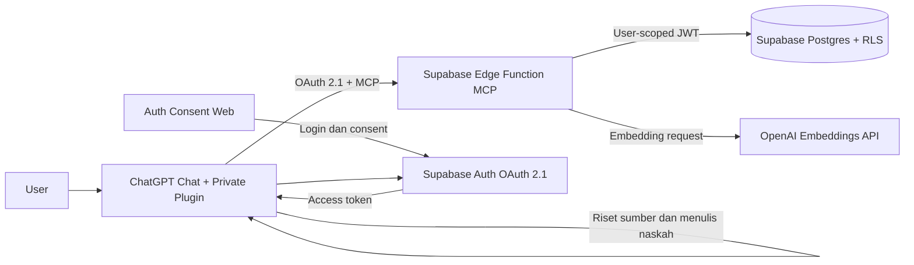

# Implementation Plan — Content Producer MVP

## 1. Informasi dokumen

| Item | Nilai |
|---|---|
| Produk | Content Producer untuk Facebook Reels trivia/fakta |
| Versi dokumen | 1.1 |
| Tanggal revisi | 6 Oktober 2026 |
| Dokumen sumber | `plans/PRDid.md` dan `plans/database-design.md` |
| Target | Private ChatGPT plugin dengan custom MCP server |
| Database dan Auth | Supabase |
| MCP hosting | Supabase Edge Function |
| Auth web | Web mini untuk login dan OAuth consent |
| Content generator | Model ChatGPT pada percakapan pengguna |
| Semantic duplicate | OpenAI Embeddings API + pgvector |
| Model database | Opsi 2 Disempurnakan — hybrid 12 tabel (`app`: 6, `ops`: 6) |
| Deployment | Development dan production terpisah |
| Revisi plan | Diselaraskan dengan `database-design.md` versi 12 tabel |
| Status | Rencana berurutan, belum dieksekusi |

Dokumen ini adalah urutan pelaksanaan dari repository kosong sampai sistem siap dipakai untuk produksi. Tahap tidak boleh dilompati. Setiap fase memiliki entry criteria, langkah berurutan, hasil, dan exit gate.

### 1.1 Batas kewenangan dokumen

- `PRDid.md` mengatur ruang lingkup produk, perilaku pengguna, aturan konten, dan acceptance criteria.
- `database-design.md` mengatur nama tabel/kolom, status, constraint, transaksi, dan tanggung jawab database function.
- Dokumen ini mengatur urutan pengerjaan, struktur repository, nama MCP tool final, deployment, dan pengujian.
- MCP hanya menerima dan mengembalikan UUID `public_id`; primary key `bigint` internal tidak pernah masuk kontrak tool.
- Bila ditemukan konflik, hentikan fase terkait dan selaraskan ketiga dokumen sebelum melanjutkan. Jangan membuat keputusan arsitektur diam-diam di dalam kode.

---

## 2. Aturan menjalankan plan

1. Kerjakan fase sesuai urutan nomor.
2. Jangan memulai fase berikutnya sebelum exit gate fase aktif lulus.
3. Setiap perubahan database harus berasal dari migration yang tersimpan di Git.
4. Setiap write tool harus idempotent sebelum diuji di ChatGPT.
5. Setiap tabel exposed harus memiliki RLS sebelum menerima data nyata.
6. Semua dependency harus dipasang dengan versi yang tercatat di lockfile.
7. Production tidak boleh menjadi tempat eksperimen schema atau tool.
8. Secret tidak boleh disalin ke chat, source code, migration, seed, atau Git.
9. AI boleh menjalankan pekerjaan teknis lokal setelah mendapat akses yang diperlukan, tetapi tindakan akun, credential, consent, billing, dan production approval tetap dilakukan manusia.
10. Bila dokumentasi atau CLI berbeda dengan plan ini, hentikan langkah tersebut, periksa dokumentasi resmi terbaru, lalu perbarui plan atau ADR sebelum lanjut.
11. Nama tabel, lifecycle, JSON contract, dan tanggung jawab function mengikuti `plans/database-design.md`; perubahan arsitektur wajib memperbarui kedua dokumen.
12. Schema `app` dan `ops` tidak diekspos langsung ke Data API pada MVP; akses aplikasi dilakukan melalui RPC pada schema `api` dengan grants eksplisit.

---

## 3. Penanda penanggung jawab

| Penanda | Arti |
|---|---|
| **[AI]** | Dapat dikerjakan penuh oleh AI di repository/terminal setelah environment tersedia |
| **[MANUAL]** | Harus dilakukan Anda karena melibatkan akun, credential, consent, billing, atau keputusan bisnis |
| **[BERSAMA]** | AI menyiapkan dan memandu; Anda memeriksa atau menyetujui hasil |
| **[OTOMATIS]** | Dijalankan CI/CD, Cron, atau test suite setelah dikonfigurasi |

Jika AI sedang mengimplementasikan plan ini, AI harus melaporkan langkah yang selesai, hasil verifikasi, dan gate yang belum terpenuhi. AI tidak boleh menganggap langkah manual selesai tanpa konfirmasi Anda.

---

## 4. Keputusan arsitektur yang dikunci untuk MVP

### 4.1 Komponen



### 4.2 Keputusan utama

1. MCP server menggunakan Streamable HTTP dan di-host sebagai Supabase Edge Function.
2. Endpoint development dan production berbentuk:

   ```text
   https://<project-ref>.supabase.co/functions/v1/mcp
   ```

3. Supabase Auth menjadi OAuth 2.1 authorization server.
4. Dynamic Client Registration (DCR) dipakai karena panduan Supabase MCP saat ini mendukung alur tersebut. Dukungan dan rekomendasi OpenAI/Supabase wajib diverifikasi lagi pada saat implementasi; Client ID Metadata Documents (CIMD) dapat menjadi migrasi berikutnya bila didukung end-to-end.
5. Web mini menyediakan halaman sign-in, consent, dan pengelolaan grant.
6. Supabase JWT diteruskan ke database supaya RLS memakai identitas user asli.
7. MCP tool tidak menggunakan `service_role` untuk operasi user normal.
8. Content generation dilakukan oleh model ChatGPT yang memanggil tool.
9. Backend tidak memanggil API text-generation pada MVP.
10. OpenAI API key hanya digunakan server-side untuk membuat embedding fakta.
11. Model embedding baseline adalah `text-embedding-3-small` dengan 1536 dimensi.
12. Database menerapkan uniqueness lintas semua Page dalam satu workspace.
13. Tidak ada custom plugin UI pada MVP; tool mengembalikan structured content dan teks siap salin.
14. Posting ke Facebook dan penyalinan ke Canva tetap manual.
15. Plugin tetap private. Public submission bukan bagian MVP.
16. Gunakan URL project Supabase pada MVP; custom domain ditunda agar OAuth issuer discovery tidak menjadi sumber kegagalan tambahan.

### 4.3 Mengapa generation tetap di ChatGPT

Alur satu post:

1. ChatGPT memanggil `prepare_next_post` untuk mengklaim satu generation task sekaligus membuat reserved fact allocations.
2. MCP mengembalikan content brief, blueprint, dan fakta terverifikasi.
3. ChatGPT menulis hook, body, CTA, caption, hashtags, dan visual direction.
4. ChatGPT mengirim hasil ke tool finalisasi.
5. MCP menjalankan validasi deterministik dan menyimpan hasil.
6. Fakta berubah dari reserved menjadi consumed secara atomik.
7. Tool mengembalikan format akhir siap Canva.

Keuntungan pendekatan ini:

- tidak ada biaya text-generation API kedua;
- instruksi dan tool dapat digunakan langsung di beberapa chat;
- database tetap mengontrol keunikan dan concurrency;
- model tidak diberi kewenangan mengubah state tanpa tool terkontrol.

---

## 5. Struktur repository target

```text
content-producer/
  apps/
    auth-web/
      app/
        login/
        oauth/consent/
        agents/
      components/
      lib/
      tests/
      package.json
  plugin/
    plugin.json
    mcp.json
    assets/
  supabase/
    config.toml
    migrations/
    seed.sql
    tests/
      database/
    functions/
      mcp/
        index.ts
        database.types.ts
        server.ts
        config.ts
        errors.ts
        auth.ts
        schemas/
        tools/
        services/
        repositories/
        quality/
        prompts/
        tests/
      _shared/
  tests/
    e2e/
    fixtures/
    evals/
  scripts/
  docs/
    operations/
    security/
    releases/
  plans/
  .github/
    workflows/
  .env.example
  .gitignore
  package.json
  pnpm-workspace.yaml
  README.md
```

Catatan:

- `plugin/` tidak berisi secret.
- `database.types.ts` dibuat ulang dari schema dan tidak diedit manual.
- SQL bisnis tetap berada pada migration/function database, bukan diduplikasi di banyak tool handler.
- Source code MCP dipecah per domain agar satu file tidak menjadi terlalu besar.

---

## 6. Ringkasan urutan fase

| Fase | Nama | Hasil utama |
|---|---|---|
| 0 | Readiness dan keputusan final | Semua akun, biaya, dan keputusan tersedia |
| 1 | Repository dan toolchain | Repository lokal/GitHub siap |
| 2 | Compatibility spike | Transport MCP dan Edge Function terbukti bekerja |
| 3 | Supabase local baseline | Stack lokal reproducible |
| 4 | Database foundation | Seluruh schema dan tabel terbuat |
| 5 | Database safety | RLS, grants, functions, concurrency aman |
| 6 | Auth web dan OAuth | Login/consent lokal bekerja |
| 7 | MCP authenticated smoke test | Tool percobaan memakai user JWT |
| 8 | Konfigurasi workspace/Page | Multi-Page dapat dikelola |
| 9 | Fact pipeline | Fakta unik, sourced, verified, embedded |
| 10 | Generation orchestration | Batch task dan beberapa chat bekerja aman |
| 11 | Content QA dan finalisasi | Output siap Canva tersimpan atomik |
| 12 | Revisi dan lifecycle post | Versioning dan conflict control bekerja |
| 13 | Kalender konten | Kalender tanpa slot bentrok |
| 14 | MCP metadata dan plugin behavior | Tool mudah dipilih model |
| 15 | Automated test dan eval | Risiko fungsi dan kualitas terukur |
| 16 | CI/CD | Test dan deployment repeatable |
| 17 | Development deployment | Remote dev tersedia melalui HTTPS |
| 18 | ChatGPT connection | Private plugin terhubung |
| 19 | UAT dan parallel test | Alur nyata lulus |
| 20 | Production hardening | Security, backup, limits siap |
| 21 | Production deployment | Sistem production aktif |
| 22 | Operasional dan maintenance | Proses harian terdokumentasi |

---

# FASE 0 — Readiness dan keputusan final

## Tujuan

Memastikan seluruh kebutuhan yang tidak dapat dibuat oleh kode tersedia sebelum implementation dimulai.

## Langkah berurutan

### 0.1 Validasi dokumen acuan

- **[AI]** Baca `plans/PRDid.md` seluruhnya.
- **[AI]** Baca `plans/database-design.md` seluruhnya.
- **[AI]** Buat daftar perbedaan bila PRD, database design, dan implementation plan tidak konsisten.
- **[BERSAMA]** Putuskan perubahan jika ada konflik.
- **[AI]** Perbarui ketiga dokumen agar konsisten sebelum menulis kode.

### 0.2 Siapkan akun

- **[MANUAL]** Pastikan akun ChatGPT memiliki menu Plugins dan `Create custom MCP server`.
- **[MANUAL]** Aktifkan MFA pada akun ChatGPT, GitHub, Supabase, hosting auth web, dan OpenAI Platform.
- **[MANUAL]** Buat atau pilih GitHub account/organization.
- **[MANUAL]** Buat Supabase organization.
- **[MANUAL]** Siapkan akun hosting auth web; rekomendasi MVP: Vercel.
- **[MANUAL]** Buat OpenAI Platform project khusus aplikasi ini.
- **[MANUAL]** Atur billing/usage limit untuk Embeddings API.

ChatGPT Plus dan OpenAI API billing adalah dua layanan berbeda. Plus tidak otomatis menyediakan API credit.

### 0.3 Tentukan environment

Pilihan yang direkomendasikan:

- local development: Supabase CLI + Docker;
- remote development: satu Supabase project development;
- production: satu Supabase project production;
- auth web preview/development;
- auth web production.

Langkah:

- **[MANUAL]** Buat project Supabase development.
- **[MANUAL]** Buat project Supabase production.
- **[MANUAL]** Catat project ref tanpa menyalin database password ke dokumen.
- **[MANUAL]** Pilih region yang masuk akal untuk lokasi operator dan latency ChatGPT.
- **[MANUAL]** Konfirmasi biaya dua project dapat diterima.

Fallback minimum jika belum ingin membayar dua hosted project:

- local sebagai development;
- satu hosted project untuk development/UAT lalu project production dibuat menjelang launch.

Fallback hanya boleh dipakai jika production belum berisi data nyata.

### 0.4 Kunci batas konten

- **[BERSAMA]** Konfirmasi topic allowlist PRD: `animals`, `food_science`, `human_body`, `nature_science`, `geography`, `history_origins`, `inventions_everyday`, dan `general_trivia`.
- **[BERSAMA]** Keluarkan medical advice, legal advice, financial advice, current politics, dan diagnosis psychology dari MVP.
- **[BERSAMA]** Konfirmasi rentang 5–9 fakta per post dengan default 6.
- **[BERSAMA]** Konfirmasi enum architecture `themed`, `single_subject`, dan `mixed`.
- **[BERSAMA]** Konfirmasi neutral international English yang mudah dipahami US/UK/CA/AU dengan American spelling sebagai standar ejaan.
- **[BERSAMA]** Konfirmasi background motion 13 detik sebagai visual baseline.
- **[BERSAMA]** Konfirmasi fakta tidak boleh diulang lintas Page dalam workspace yang sama.

### 0.5 Kunci kebijakan sumber

Baseline:

- low risk: minimal satu authoritative source;
- medium risk: minimal dua sumber yang masuk akal, salah satunya authoritative;
- high risk: tidak dipakai pada auto-production MVP tanpa review manual;
- time-sensitive: wajib `as_of_date` dan `revalidate_after`.

- **[BERSAMA]** Setujui baseline ini.
- **[AI]** Dokumentasikan daftar publisher/source type yang diterima dan ditolak.

### 0.6 Kunci baseline database 12 tabel

- **[BERSAMA]** Konfirmasi Opsi 2 Disempurnakan pada `plans/database-design.md` sebagai source of truth database MVP.
- **[AI]** Catat enam tabel bisnis `app` dan enam tabel operasional `ops` pada architecture checklist.
- **[AI]** Verifikasi model embedding yang dipilih masih tersedia dan mendukung dimensi 1536 sebelum migration vector dibuat.
- **[BERSAMA]** Konfirmasi allowed topic trivia dari PRD dan finalisasi JSON contract version 1 sebelum seed; slug baru memerlukan versi blueprint baru.
- **[BERSAMA]** Gunakan task/allocation TTL 20 menit sebagai baseline sementara; perubahan dilakukan setelah hasil UAT.
- **[BERSAMA]** Gunakan maksimal 3 attempts per generation task sebagai baseline MVP.
- **[BERSAMA]** Tentukan retention awal untuk idempotency dan audit sebelum production hardening.

## Deliverable

- Seluruh akun tersedia.
- Scope dan kebijakan konten disetujui.
- Dua environment remote sudah diputuskan.

## Exit gate

- [ ] Tidak ada konflik terbuka antar-dokumen.
- [ ] Supabase dev dan prod tersedia atau fallback disetujui.
- [ ] OpenAI API project dan spending limit tersedia.
- [ ] Topic dan risk policy disetujui.
- [ ] Model database 12 tabel dan embedding dimension dikonfirmasi.

---

# FASE 1 — Repository dan toolchain

## Tujuan

Membuat source of truth implementasi di Git dengan toolchain yang dapat diulang.

## Langkah berurutan

### 1.1 Inisialisasi Git

- **[AI]** Periksa apakah folder saat ini sudah Git repository.
- **[AI]** Jika belum, jalankan `git init` setelah mendapat konfirmasi nama branch default.
- **[AI]** Buat `.gitignore` untuk Node, Deno, Supabase temp, coverage, environment files, dan editor files.
- **[AI]** Pastikan dataset dan plans tetap ikut Git kecuali user memutuskan dataset bersifat rahasia.
- **[AI]** Buat commit baseline dokumentasi.
- **[MANUAL]** Buat private GitHub repository.
- **[MANUAL]** Berikan URL repository kepada AI atau hubungkan remote sendiri.
- **[AI]** Tambahkan remote dan push baseline setelah diizinkan.

### 1.2 Periksa tool lokal

- **[AI]** Periksa `git --version`.
- **[AI]** Periksa Docker/runtime compatible.
- **[AI]** Periksa Node.js dan package manager.
- **[AI]** Periksa Deno.
- **[AI]** Periksa Supabase CLI.
- **[AI]** Jalankan `supabase --help` dan help untuk command yang akan digunakan.
- **[AI]** Catat versi Supabase CLI yang dipakai dan verifikasi terhadap minimum pada dokumentasi MCP/Edge terbaru; jangan mengandalkan nomor versi lama di plan.
- **[MANUAL]** Menyetujui instalasi/upgrade bila tool belum tersedia.
- **[AI]** Instal atau upgrade hanya setelah persetujuan yang diperlukan.

### 1.3 Pin versi runtime

- **[AI]** Tambahkan file version manager yang dipilih, misalnya `.node-version` atau konfigurasi mise/asdf.
- **[AI]** Gunakan versi Node yang didukung framework dan Supabase CLI, minimal Node 20; pilih active LTS saat implementasi.
- **[AI]** Pin package manager melalui `packageManager` pada root `package.json`.
- **[AI]** Commit lockfile.
- **[AI]** Catat versi Deno/Edge Runtime yang dipakai untuk test lokal.

### 1.4 Buat workspace

- **[AI]** Buat root `package.json`.
- **[AI]** Buat `pnpm-workspace.yaml` bila pnpm dipilih.
- **[AI]** Buat folder target sesuai struktur repository.
- **[AI]** Tambahkan script root untuk lint, typecheck, test, test:db, test:e2e, dan format.
- **[AI]** Tambahkan `.env.example` hanya berisi nama variable dan placeholder.

### 1.5 Aturan kontribusi

- **[AI]** Buat `README.md` dengan setup minimum.
- **[AI]** Buat dokumen `docs/operations/local-development.md`.
- **[AI]** Buat convention untuk branch, commit, migration, dan release tag.
- **[AI]** Tambahkan formatter/linter sesuai stack.

## Exit gate

- [ ] Repository dapat di-clone.
- [ ] Tidak ada secret yang ter-track.
- [ ] Runtime dan CLI version tercatat.
- [ ] Install dependency menghasilkan lockfile yang konsisten.
- [ ] Baseline berhasil dipush ke private GitHub repository.

---

# FASE 2 — Compatibility spike MCP pada Edge Function

## Tujuan

Membuktikan transport MCP dan runtime pilihan bekerja sebelum database kompleks dibuat.

## Mengapa fase ini dilakukan lebih awal

Dokumentasi OpenAI menyebut official TypeScript SDK, sementara panduan Edge Function Supabase terkini menyediakan handler stateless yang sesuai Edge Runtime. Package dan API dapat berubah. Spike mencegah seluruh sistem dibangun di atas kombinasi package yang ternyata tidak kompatibel.

## Langkah berurutan

### 2.1 Verifikasi dokumentasi saat eksekusi

- **[AI]** Buka dokumentasi resmi OpenAI “Build an MCP server”.
- **[AI]** Buka dokumentasi resmi Supabase “Deploy MCP servers”.
- **[AI]** Catat package, minimum CLI, dan transport yang direkomendasikan saat itu.
- **[AI]** Tulis ADR `docs/architecture/ADR-001-mcp-runtime.md`.
- **[BERSAMA]** Setujui jika pilihan berbeda dari plan ini.

### 2.2 Buat server percobaan stateless

- **[AI]** Jalankan `supabase init` bila belum ada folder Supabase.
- **[AI]** Gunakan `supabase functions new mcp` untuk membuat function.
- **[AI]** Buat satu tool `health_check` read-only.
- **[AI]** Tool mengembalikan server version, environment name, dan status `ok`; jangan mengembalikan secret.
- **[AI]** Tambahkan HTTP `GET /healthz` pada function sebagai liveness endpoint terpisah dari MCP calls; respons hanya status generik dan version, tanpa user/database data.
- **[AI]** Konfigurasikan Streamable HTTP.
- **[AI]** Set function agar middleware sendiri menangani auth/discovery pada fase selanjutnya.
- **[AI]** Pin dependency dalam mekanisme yang didukung Edge Runtime.

### 2.3 Uji lokal tanpa auth

- **[AI]** Perlakukan mode tanpa auth ini sebagai spike localhost sementara; jangan deploy mode ini ke remote development atau production.
- **[AI]** Jalankan local Supabase stack.
- **[AI]** Serve function MCP.
- **[AI]** Panggil initialize dan `tools/list` melalui HTTP.
- **[AI]** Buka MCP Inspector.
- **[AI]** Pastikan initialize berhasil.
- **[AI]** Pastikan hanya `health_check` tampil.
- **[AI]** Panggil tool dengan input valid dan invalid.
- **[AI]** Pastikan output memiliki `structuredContent` dan text summary.

### 2.4 Catat keputusan final package

- **[AI]** Catat nama package, versi, cara import, dan alasan pemilihan pada ADR.
- **[AI]** Hapus kode contoh yang tidak akan dipakai.
- **[AI]** Simpan `health_check` sebagai smoke tool internal untuk development.

## Exit gate

- [ ] MCP Inspector dapat initialize server lokal.
- [ ] `tools/list` stabil.
- [ ] Tool read-only berhasil dipanggil.
- [ ] Server membuat instance stateless per request.
- [ ] Dependency dan transport tercatat pada ADR.

Jika gate gagal, jangan lanjut ke database. Selesaikan runtime/transport lebih dulu.

---

# FASE 3 — Supabase local baseline

## Tujuan

Membuat environment lokal yang dapat dibangun ulang hanya dari repository.

## Langkah berurutan

### 3.1 Konfigurasi project lokal

- **[AI]** Review `supabase/config.toml` yang dibuat CLI.
- **[AI]** Set project ID lokal yang unik.
- **[AI]** Set Auth Site URL lokal untuk auth web.
- **[AI]** Aktifkan OAuth server lokal dalam config.
- **[AI]** Set authorization path ke `/oauth/consent`.
- **[AI]** Aktifkan dynamic registration untuk local testing.
- **[AI]** Konfigurasikan function `mcp` agar gateway tidak memblokir unauthenticated OAuth discovery sebelum middleware berjalan.
- **[AI]** Jangan memasukkan credential nyata ke `config.toml`; gunakan environment reference jika diperlukan.

### 3.2 Tentukan migration style

Keputusan MVP: imperative migrations.

- **[AI]** Gunakan `supabase migration new <name>` untuk setiap migration.
- **[AI]** Jangan membuat nama timestamp migration secara manual.
- **[AI]** Jangan memelihara declarative schema kedua pada MVP.
- **[AI]** Jalankan migration di local terlebih dahulu.
- **[AI]** Gunakan `supabase db reset` untuk membuktikan reproducibility.

### 3.3 Seed lokal minimum

- **[AI]** Buat `supabase/seed.sql`.
- **[AI]** Seed hanya data development yang aman.
- **[AI]** Jangan dump production data ke seed.
- **[AI]** Siapkan satu user fixture, satu workspace, dua Page dengan topic configuration berbeda, dan blueprint V1 melalui mekanisme test yang sesuai.
- **[AI]** Jangan memasukkan real password ke seed.

### 3.4 Test harness database

- **[AI]** Buat `supabase/tests/database/`.
- **[AI]** Buat test pgTAP pertama untuk memeriksa extension dan schema.
- **[AI]** Pastikan test dibungkus transaction dan rollback.
- **[AI]** Tambahkan script root untuk `supabase test db`.

## Exit gate

- [ ] `supabase start` berhasil.
- [ ] `supabase db reset` berhasil dari awal.
- [ ] Seed aman dan repeatable.
- [ ] Test database pertama lulus.
- [ ] Config tidak mengandung secret.

---

# FASE 4 — Database foundation 12 tabel

## Tujuan

Mengubah `database-design.md` menjadi migration yang dapat diuji, diulang, dan mudah dibaca melalui Supabase Dashboard.

Setiap subfase mengikuti siklus:

1. Jalankan CLI help bila command belum pernah diverifikasi.
2. Buat file dengan `supabase migration new <nama>`; jangan membuat timestamp manual.
3. Tulis SQL dan test yang terkait.
4. Jalankan reset lokal dari database kosong.
5. Jalankan pgTAP/test integrasi terkait.
6. Regenerate database types bila bentuk schema berubah.
7. Review diff, security impact, dan query plan penting.
8. Commit migration dan test bersama.

Konvensi yang berlaku pada seluruh tabel:

- internal PK menggunakan `bigint generated always as identity`;
- identifier yang keluar melalui MCP menggunakan unique `public_id uuid`;
- child table membawa `workspace_id` dan memakai composite FK untuk mencegah relasi lintas workspace;
- parent yang menjadi target composite FK memiliki unique `(workspace_id, id)`;
- setiap FK memiliki supporting index;
- seluruh timestamp memakai `timestamptz` dan default database yang konsisten.

## Langkah berurutan

### 4.1 Migration schema dan extensions

- **[AI]** Buat schema `app`, `ops`, `api`, dan `private`.
- **[AI]** Aktifkan pgvector pada schema `extensions` tanpa version pin.
- **[AI]** Aktifkan `pg_jsonschema` bila tersedia. Jika tidak, gunakan Zod di Edge Function plus private validation functions/checks di database dengan contract tests yang sama; ketiadaan extension tidak boleh melemahkan validasi.
- **[AI]** Atur default privileges secara eksplisit dan revoke akses yang tidak diperlukan dari `PUBLIC`.
- **[AI]** Jangan membuat object custom pada schema milik platform seperti `auth`, `storage`, atau `realtime`.
- **[AI]** Test bahwa schema dan extension tersedia.

### 4.2 Migration helpers dan JSON contracts

- **[AI]** Buat helper `updated_at`, immutable guard, status-transition guard, dan validasi hash/slug yang diperlukan.
- **[AI]** Buat JSON Schema version 1 untuk workspace settings, blueprint rules, Page config, fact sources, fact verification, generation request, post content, post quality, dan calendar planning rules.
- **[AI]** Buat helper validasi JSONB dengan batas ukuran dan schema version yang jelas.
- **[AI]** Gunakan schema-qualified object dan `search_path` aman.
- **[AI]** Test valid, malformed, oversized, dan unsupported schema version.

### 4.3 Migration workspace dan blueprint

- **[AI]** Buat `app.workspaces`.
- **[AI]** Tambahkan partial unique index agar satu owner hanya memiliki satu workspace `active` pada MVP.
- **[AI]** Buat `app.content_blueprints`; satu row mewakili satu versi blueprint.
- **[AI]** Tambahkan unique public ID, slug, `(workspace_id, blueprint_key, version_number)`, dan content hash.
- **[AI]** Tambahkan partial unique index agar hanya satu versi aktif per blueprint key.
- **[AI]** Validasi fact count blueprint `min/default/max` berada pada 5–9, default 6, serta bahasa `neutral-international` dengan spelling standard `american`.
- **[AI]** Terapkan aturan: isi versi membeku setelah aktif, status hanya `draft → active → retired`, dan DELETE ditolak.
- **[AI]** Test owner, archive state, duplicate version, duplicate content, dan lifecycle blueprint.

`workspace_members` tidak dibuat pada MVP. Multi-user ditambahkan melalui migration terpisah setelah MVP bila dibutuhkan.

### 4.4 Migration Page

- **[AI]** Buat `app.pages`.
- **[AI]** Simpan markets, topic mix, architecture mix, production defaults, dan overrides pada `config jsonb` tervalidasi.
- **[AI]** Pertahankan niche, content type, status, timezone, blueprint, dan lock version sebagai kolom biasa.
- **[AI]** Simpan `language_code=en`, BCP 47 `locale_code` (default `en-US`), dan `english_variant=neutral-international` sebagai kolom tervalidasi.
- **[AI]** Tambahkan composite FK agar workspace Page dan blueprint selalu sama.
- **[AI]** Tambahkan index workspace/status, workspace/niche/content type, blueprint, dan unique slug/public ID.
- **[AI]** Test invalid market, topic/architecture weight tidak valid, timezone tidak valid, duplicate slug, dan cross-workspace reference.

Tidak ada tabel `page_markets`, `topics`, atau `page_topics` pada MVP.

### 4.5 Migration facts

- **[AI]** Buat `app.facts` yang menyimpan canonical claim, sources, current verification, dan satu embedding aktif.
- **[AI]** Gunakan `extensions.halfvec(1536)` untuk embedding nullable.
- **[AI]** Tambahkan unique `(workspace_id, claim_hash)` dan `(workspace_id, semantic_key_hash)`.
- **[AI]** Tambahkan constraint source, verification, risk, duplicate reference, dan time-sensitive revalidation.
- **[AI]** Tambahkan HNSW cosine index serta index status/topic/revalidation.
- **[AI]** Pastikan model, version, dan source hash embedding terisi atau null sebagai satu kelompok.
- **[AI]** Test exact duplicate, semantic-key duplicate, dimensi vector salah, invalid lifecycle, dan cross-workspace duplicate reference.

Sources, verification summary, dan embedding tidak memakai tabel terpisah pada MVP. Riwayat perubahan verification dicatat pada `ops.audit_events`.

### 4.6 Migration generation tasks dan fact allocations

- **[AI]** Buat `ops.generation_tasks`; satu row selalu mewakili satu calon post.
- **[AI]** Gunakan `batch_id` dan `item_number` untuk mengelompokkan task tanpa parent job table.
- **[AI]** Tambahkan request JSONB tervalidasi, lease, attempt, sanitized error, dan result post pointer.
- **[AI]** Buat `ops.fact_allocations` sebagai allocation reserved/consumed dan hubungan fact–post.
- **[AI]** Tambahkan `purpose` (`generation`/`revision`) dan `allocation_group_id`; `generation_task_id` nullable untuk revision allocation.
- **[AI]** Pada migration ini buat `result_post_id` dan `post_id` nullable tanpa FK ke post lebih dulu karena `app.posts` belum tersedia.
- **[AI]** Tambahkan partial unique `(workspace_id, fact_id)` untuk status `reserved` atau `consumed`.
- **[AI]** Tambahkan queue, lease, expiry, allocation group, task, post, dan Page indexes.
- **[AI]** Terapkan constraint: generation-reserved memiliki task tanpa post; revision-reserved memiliki post tanpa task; consumed selalu memiliki post.
- **[AI]** Test dua transaksi tidak dapat mengklaim task atau membuat active allocation untuk fact yang sama.
- **[AI]** Test transition `reserved → consumed/released/expired` dan larangan kembali ke reserved.

Tidak ada tabel `generation_jobs`, `generation_job_items`, atau `fact_reservations` pada MVP.

### 4.7 Migration posts dan versions

- **[AI]** Buat `app.posts` lebih dulu dengan current version pointer nullable.
- **[AI]** Tambahkan `primary_topic` dan nullable `theme` pada post, validasi topic terhadap allowlist, serta index Page/topic/created time.
- **[AI]** Tambahkan approved/rejected/scheduled/published/archived metadata beserta lifecycle constraints; rejection reason wajib untuk status rejected.
- **[AI]** Setelah `app.posts` tersedia, tambahkan composite FK untuk `ops.generation_tasks.result_post_id` dan `ops.fact_allocations.post_id` beserta unique/index yang diperlukan.
- **[AI]** Buat `ops.post_versions` sebagai snapshot immutable yang berisi content dan quality JSONB tervalidasi.
- **[AI]** Tambahkan composite FK current version setelah kedua tabel tersedia.
- **[AI]** Tambahkan unique `(post_id, id)` pada versions sebagai target current pointer.
- **[AI]** Pastikan current version benar-benar milik post yang sama.
- **[AI]** Validasi setiap allocation dan fact reference di dalam content terhadap `ops.fact_allocations`.
- **[AI]** Simpan topic, theme, neutral-international English, dan American spelling pada content snapshot; pastikan header post sama dengan current version.
- **[AI]** Tambahkan unique post/version, public IDs, Page/status/time indexes, dan immutable guard.
- **[AI]** Test duplicate version, invalid pointer, invalid allocation, UPDATE/DELETE versi lama, serta lifecycle post.

Tidak ada tabel `post_facts`, `post_version_facts`, atau `post_quality_checks`. Source of truth hubungan fact–post adalah allocation consumed; snapshot tampilan dan QA berada pada `ops.post_versions`.

### 4.8 Migration calendars dan slots

- **[AI]** Buat `app.calendars` dan `ops.calendar_slots`.
- **[AI]** Simpan planning rules fleksibel pada JSONB tervalidasi, tetapi dates/status/timezone tetap menjadi kolom.
- **[AI]** Tambahkan activated/completed/archived timestamps beserta lifecycle constraints.
- **[AI]** Tambahkan partial unique index untuk Page/day/slot number, Page/publish time, dan active post assignment.
- **[AI]** Tambahkan composite FK lintas workspace dan Page.
- **[AI]** Test duplicate slot, duplicate post assignment, invalid Page, DST, dan dua insert paralel.

### 4.9 Migration idempotency dan audit

- **[AI]** Buat `ops.idempotency_keys`.
- **[AI]** Tambahkan unique `(workspace_id, operation, idempotency_key)`, request hash, safe response payload, status, dan expiry.
- **[AI]** Buat `ops.audit_events` sebagai append-only audit trail.
- **[AI]** Tambahkan index workspace/time, request ID, entity, event, dan cleanup expiry.
- **[AI]** Test key sama/payload sama, key sama/payload berbeda, dan immutable audit.

### 4.10 Migration RLS, grants, dan Data API exposure

- **[AI]** Enable RLS pada seluruh 12 tabel, termasuk `ops` sebagai defense in depth.
- **[AI]** Buat ownership policy berdasarkan `app.workspaces.owner_user_id = (select auth.uid())`.
- **[AI]** Tambahkan index untuk predicate RLS.
- **[AI]** Revoke direct write dan broad default privileges.
- **[AI]** Pastikan `anon` tidak mempunyai akses data aplikasi.
- **[AI]** Konfigurasikan hanya schema `api` sebagai surface RPC yang disengaja; jangan mengandalkan tabel baru otomatis terekspos.
- **[AI]** Gunakan security-invoker view untuk reporting bila view dibuat.
- **[AI]** Test owner, cross-workspace, anonymous, direct REST, dan view behavior.

### 4.11 Seed blueprint dan config V1

- **[AI]** Terjemahkan DNA konten dari PRD menjadi `app.content_blueprints.rules` versi 1.
- **[AI]** Simpan allowed topics dan default trivia config pada blueprint/Page fixture, bukan taxonomy table.
- **[AI]** Seed Page fixtures hanya untuk local test.
- **[AI]** Jangan mengimpor post kompetitor sebagai verified facts.
- **[AI]** Pastikan production seed tidak berisi test user, Page, post, atau credential.

### 4.12 Generate TypeScript types dan schema manifest

- **[AI]** Verifikasi syntax CLI melalui `supabase gen types --help`, lalu generate types lokal untuk schema `app`, `ops`, dan `api`.
- **[AI]** Simpan output pada MCP function dan jangan diedit manual.
- **[AI]** Buat manifest test yang menyatakan tepat 6 tabel `app` dan 6 tabel `ops`.
- **[AI]** Tambahkan CI check yang gagal jika generated types tertinggal dari schema.

## Exit gate

- [ ] Tepat 12 tabel aplikasi tersedia: 6 pada `app` dan 6 pada `ops`.
- [ ] Tidak ada tabel lama hasil desain 24 tabel yang ikut dibuat.
- [ ] Seluruh FK memiliki supporting index.
- [ ] JSONB penting tervalidasi dan memiliki schema version.
- [ ] `supabase db reset` berhasil dari database kosong.
- [ ] Seluruh constraint, lifecycle, immutable, dan concurrency tests lulus.
- [ ] Generated TypeScript types sesuai schema.
- [ ] `app` dan `ops` tidak terekspos langsung pada Data API.
- [ ] Tidak ada production credential pada seed atau migration.

---

# FASE 5 — Database functions, concurrency, dan authorization

## Tujuan

Memindahkan aturan kritis ke database sehingga beberapa chat dapat bekerja paralel dengan sedikit round trip tanpa menyebabkan task, fact, post, atau calendar collision.

Seluruh function dibuat melalui versioned migration setelah tabel dasarnya stabil. Gunakan `SECURITY INVOKER` bila memungkinkan.

## Langkah berurutan

### 5.1 Idempotency primitives

- **[AI]** Implementasikan acquire idempotency key dengan `INSERT ... ON CONFLICT`.
- **[AI]** Canonicalize request dan validasi request hash.
- **[AI]** Implementasikan complete/fail response yang aman untuk replay.
- **[AI]** Jangan menyimpan token, secret, full vector, atau raw stack pada response payload.
- **[AI]** Test replay completed, in-progress response, replay failed yang mengembalikan stable error tanpa re-execution, serta payload berbeda dengan key sama.

### 5.2 Workspace dan Page functions

- **[AI]** Implementasikan `api.get_workspace`, `api.list_pages`, dan `api.get_page_context`.
- **[AI]** `api.get_workspace` mengembalikan tepat satu active workspace; nol menghasilkan `WORKSPACE_NOT_FOUND` dan lebih dari satu dianggap invariant violation.
- **[AI]** Pastikan `get_page_context` menggabungkan Page, active blueprint, bounded fact inventory, recent topic usage, dan calendar summary dalam satu call.
- **[AI]** Implementasikan `api.create_page` dan `api.update_page` secara idempotent.
- **[AI]** Validasi config JSON, blueprint, niche/content type, ownership, dan `expected_lock_version`.
- **[AI]** Test Page multi-workspace, stale version, dan payload injection.

### 5.3 Fact pipeline functions

- **[AI]** Implementasikan `api.get_fact_inventory` dengan counts, bukan raw inventory tanpa batas.
- **[AI]** Implementasikan `api.check_fact_candidates` untuk exact hash, semantic key, dan bounded vector search.
- **[AI]** Implementasikan `api.submit_fact_candidates` dalam batch terbatas dan idempotent.
- **[AI]** Implementasikan `api.review_fact_candidates` untuk memperbarui current verification dan menulis immutable audit event.
- **[AI]** Selalu batasi vector search dengan workspace dan jangan mengembalikan full embedding.
- **[AI]** Test source policy, verification transition, duplicate handling, revalidation, dan cross-workspace isolation.

### 5.4 Create generation batch

- **[AI]** Implementasikan `api.create_generation_batch`.
- **[AI]** Buat N row `ops.generation_tasks` dengan satu `batch_id` dan item number unik.
- **[AI]** Validasi Page active, blueprint active, request JSON, jumlah post, dan estimated fact inventory.
- **[AI]** Jangan membuat allocations untuk seluruh batch pada tahap ini.
- **[AI]** Return batch ID dan task summary tanpa internal bigint.
- **[AI]** Test idempotent retry dan dua batch paralel.

### 5.5 Prepare next post

- **[AI]** Implementasikan `api.prepare_next_post` sebagai satu transaksi singkat.
- **[AI]** Claim satu pending task memakai `FOR UPDATE SKIP LOCKED`.
- **[AI]** Set lease owner, expiry, attempt, dan status task langsung ke `facts_reserved` dalam transaksi yang sama dengan allocation.
- **[AI]** Pilih verified facts yang available, lock berdasarkan urutan fact ID, lalu insert reserved allocations.
- **[AI]** Buat satu `allocation_group_id`, set purpose `generation`, dan kaitkan seluruh allocations dengan task yang diklaim.
- **[AI]** Gunakan partial unique allocation sebagai perlindungan terakhir.
- **[AI]** Terapkan all-or-nothing bila jumlah fakta tidak cukup.
- **[AI]** Gunakan TTL awal 20 menit dan kalibrasi melalui UAT.
- **[AI]** Return generation packet ringkas: task, Page, blueprint, facts, allocation group/public IDs, output contract, dan lease.
- **[AI]** Jangan memanggil embedding atau layanan eksternal selama transaksi/lock terbuka.
- **[AI]** Test minimal 10 transaksi paralel, insufficient inventory, rollback, dan lease expiry.

Tidak ada call claim terpisah. Penggabungan claim dan allocation mengurangi round trip serta menghilangkan keadaan task ber-lease tanpa facts akibat client terputus di antara dua tool call.

- **[AI]** Implementasikan `api.release_generation_task` secara idempotent: target `retry` mengembalikan task ke pending bila attempt < 3 atau failed bila batas tercapai; target `cancel` memindahkan ke cancelled. Consumed allocation tidak boleh dilepas.
- **[AI]** Implementasikan read-only `api.validate_post_draft` untuk pengecekan lease/allocation/fact/blueprint dan aturan deterministik yang memerlukan database.

### 5.6 Finalize post

- **[AI]** Implementasikan `api.finalize_post` sebagai satu transaksi atomik dan idempotent.
- **[AI]** Validasi caller, task lease, Page/blueprint, allocation ownership/status/expiry, content JSON, quality JSON, dan request hash.
- **[AI]** Insert `app.posts` tanpa current pointer, lalu insert immutable `ops.post_versions` versi 1.
- **[AI]** Simpan `primary_topic` dan `theme` pada post serta snapshot content dalam transaksi yang sama.
- **[AI]** Set current version pointer dan current version number.
- **[AI]** Ubah allocations menjadi consumed dan tautkan ke post.
- **[AI]** Set generation task completed dan `result_post_id`.
- **[AI]** Tulis audit event lalu complete idempotency key.
- **[AI]** Return public IDs, version, lock version, status, dan copy package.
- **[AI]** Test rollback pada setiap titik kegagalan penting dan pastikan retry mengembalikan post yang sama.

### 5.7 Post revision dan approval

- **[AI]** Implementasikan `api.prepare_post_revision` untuk membuat allocation purpose `revision` yang ditautkan ke post dan satu allocation group.
- **[AI]** Implementasikan `api.release_post_revision` untuk melepas hanya reserved allocation pada revision group yang dibatalkan.
- **[AI]** Implementasikan `api.revise_post` menggunakan `expected_lock_version`.
- **[AI]** Insert version baru; jangan update versi lama.
- **[AI]** Bila facts diganti, buat/consume allocation baru dan pertahankan allocation lama sebagai consumed history.
- **[AI]** Validasi content allocation references sebelum menyimpan snapshot.
- **[AI]** Update current version pointer dan lock version secara atomik.
- **[AI]** Update header `primary_topic`/`theme` agar sama dengan current version.
- **[AI]** Kembalikan post substantif dari approved ke `needs_review`.
- **[AI]** Implementasikan `api.approve_post` hanya untuk current version yang lulus QA.
- **[AI]** Implementasikan `api.reject_post` dengan reason dan optimistic lock; consumed allocations tetap immutable.
- **[AI]** Implementasikan `api.mark_post_published` untuk mengubah post dan ready slot menjadi published secara atomik.
- **[AI]** Implementasikan `api.archive_post` tanpa menghapus version atau allocation history.
- **[AI]** Test dua revisi paralel; hanya satu boleh berhasil.

### 5.8 Calendar functions

- **[AI]** Implementasikan read-only `api.preview_calendar_plan` untuk bounded conflict/inventory context tanpa write.
- **[AI]** Implementasikan `api.create_calendar` beserta slots secara atomik dan idempotent.
- **[AI]** Implementasikan `api.assign_post_to_slot`, `api.unassign_post_from_slot`, `api.get_calendar`, `api.reschedule_calendar_slot`, `api.activate_calendar`, dan `api.archive_calendar`.
- **[AI]** Assign harus mengubah post approved menjadi scheduled secara atomik; unassign ready slot sebelum publish mengembalikannya ke approved.
- **[AI]** Gunakan optimistic lock untuk perubahan slot.
- **[AI]** Biarkan partial unique indexes menjadi pengaman terakhir untuk collision.
- **[AI]** Test duplicate slot, duplicate post assignment, DST, stale version, dan retry.
- **[AI]** Test draft activation, automatic completion, dan archive dengan/ tanpa pembatalan future slots.

### 5.9 Maintenance functions dan Cron contract

- **[AI]** Implementasikan expiry untuk reserved allocations.
- **[AI]** Implementasikan recovery generation task lease dengan maksimum 3 attempts.
- **[AI]** Implementasikan idempotency cleanup tanpa menghapus resource/audit.
- **[AI]** Implementasikan bounded scan untuk facts yang perlu revalidation.
- **[AI]** Pastikan setiap query bounded, memakai index, dan tidak memanggil AI.
- **[AI]** Test bahwa allocation consumed tidak pernah dilepas oleh maintenance.

### 5.10 Function security, RLS, dan grants

- **[AI]** Verifikasi RLS aktif pada 12 tabel dan policy memakai ownership workspace.
- **[AI]** Jangan memakai `user_metadata` untuk authorization.
- **[AI]** Gunakan `(select auth.uid())` dan `USING` + `WITH CHECK` pada UPDATE policy yang diperlukan.
- **[AI]** Revoke direct writes ke tabel kritis.
- **[AI]** Expose schema `api` secara sengaja melalui Data API settings dan explicit grants.
- **[AI]** Grant function satu per satu kepada `authenticated`; revoke EXECUTE dari `PUBLIC`.
- **[AI]** Gunakan `SECURITY INVOKER` jika cukup.
- **[AI]** Jika `SECURITY DEFINER` benar-benar diperlukan:
  - letakkan pada schema tidak terekspos;
  - set `search_path = ''`;
  - gunakan schema-qualified name;
  - cek `auth.uid()` dan workspace ownership;
  - batasi parameter dan result;
  - tulis privilege-escalation test.

### 5.11 RLS dan function test matrix

- **[AI]** Test owner dapat membaca data sendiri dan tidak dapat membaca workspace lain.
- **[AI]** Test public ID dari workspace lain ditolak pada seluruh RPC.
- **[AI]** Test anonymous ditolak dan OAuth user tetap tunduk pada RLS.
- **[AI]** Test direct table write kritis ditolak.
- **[AI]** Test function privileged tidak dapat dipakai menaikkan hak akses.
- **[AI]** Test semua status transition dan immutable guards.
- **[AI]** Test lock order dan pastikan concurrency suite tidak deadlock.

### 5.12 Database advisors dan performance proof

- **[AI]** Jalankan security dan performance advisors lokal/remote development ketika tersedia.
- **[AI]** Perbaiki seluruh temuan security.
- **[AI]** Jalankan `EXPLAIN (ANALYZE, BUFFERS)` pada queue claim, fact availability, Page context, post list, dan calendar range query.
- **[AI]** Dokumentasikan temuan performance yang sengaja ditunda.

## Exit gate

- [ ] `prepare_next_post` aman pada parallel test tanpa duplicate task atau fact.
- [ ] `finalize_post` atomik dan retry-safe.
- [ ] Idempotency dan optimistic locking tests lulus.
- [ ] RLS negative dan privilege-escalation tests lulus.
- [ ] Anonymous tidak dapat membaca atau menulis data aplikasi.
- [ ] Direct write kritis ditolak.
- [ ] Data API hanya mengekspos surface yang sengaja dipilih.
- [ ] Advisor tidak memiliki unresolved critical security finding.

---

# FASE 6 — Auth web dan OAuth 2.1

## Tujuan

Menyediakan login dan consent page yang diperlukan ChatGPT untuk memperoleh Supabase user token.

## Langkah berurutan

### 6.1 Scaffold auth web

- **[AI]** Buat aplikasi web pada `apps/auth-web`.
- **[AI]** Gunakan framework yang didukung Supabase OAuth Consent block; rekomendasi MVP: Next.js.
- **[AI]** Pin dependency dan commit lockfile.
- **[AI]** Buat environment schema yang gagal cepat bila variable hilang.
- **[AI]** Gunakan hanya publishable key pada browser.
- **[AI]** Jangan memasukkan `service_role` ke aplikasi web.

### 6.2 Implementasi route

- **[AI]** Buat `/login`.
- **[AI]** Buat `/oauth/consent`.
- **[AI]** Tampilkan nama OAuth client, requested access, approve, dan deny.
- **[AI]** Buat `/agents` atau halaman grants untuk melihat dan revoke client connection.
- **[AI]** Buat logout.
- **[AI]** Tangani expired/invalid authorization ID dengan pesan jelas.

### 6.3 Bootstrap owner

- **[MANUAL]** Tentukan email owner production.
- **[MANUAL]** Buat user owner di Supabase development.
- **[MANUAL]** Buat user owner terpisah di Supabase production menjelang launch.
- **[MANUAL]** Simpan password di password manager bila memakai password login.
- **[MANUAL]** Jangan memberikan password kepada AI.
- **[AI]** Buat onboarding transaction yang membuat workspace owner pertama setelah login.

### 6.4 Batasi signup

- **[BERSAMA]** Setelah owner dibuat, putuskan apakah public signup dimatikan.
- **[MANUAL]** Untuk private MVP, matikan public signup.
- **[AI]** Pastikan consent tetap dapat digunakan oleh user owner yang sudah ada.

### 6.5 JWT signing

- **[MANUAL]** Periksa Supabase JWT Signing Keys.
- **[MANUAL]** Pastikan project memakai asymmetric key ES256 atau RS256, bukan legacy HS256, bila middleware saat implementasi mensyaratkannya.
- **[AI]** Uji JWKS discovery dan signature validation tanpa mencetak token.

### 6.6 OAuth server local

- **[AI]** Jalankan auth web lokal.
- **[AI]** Jalankan Supabase lokal.
- **[AI]** Aktifkan OAuth server, authorization path, dan DCR pada local config.
- **[AI]** Uji sign-in.
- **[AI]** Uji approve dan deny consent.
- **[AI]** Uji refresh/revocation flow yang disediakan Supabase.
- **[AI]** Perlakukan seluruh HTTP 2xx sebagai token-endpoint success; jangan mengunci test pada status `201`.

### 6.7 Security auth web

- **[AI]** Terapkan secure headers.
- **[AI]** Validasi return/callback data melalui Supabase API, bukan redirect bebas.
- **[AI]** Hindari open redirect.
- **[AI]** Jangan log authorization code atau access token.
- **[AI]** Tambahkan rate-limit/abuse protection yang tersedia.
- **[AI]** Tambahkan test untuk unauthenticated access, approve, deny, dan invalid request.

## Exit gate

- [ ] User dapat login lokal.
- [ ] Consent menampilkan informasi client.
- [ ] Approve menghasilkan OAuth flow sukses.
- [ ] Deny menghasilkan error yang benar.
- [ ] Grant dapat direvoke.
- [ ] Token dan code tidak muncul di log.

---

# FASE 7 — MCP authenticated smoke test

## Tujuan

Membuktikan bahwa OAuth discovery, token validation, dan RLS bekerja dari MCP client.

## Langkah berurutan

### 7.1 Tambahkan middleware auth

- **[AI]** Pasang protected-resource discovery middleware yang direkomendasikan Supabase saat implementasi.
- **[AI]** Pasang user-scoped Supabase middleware.
- **[AI]** Pastikan discovery endpoint dapat diakses sebelum auth gate.
- **[AI]** Pastikan request tool tanpa token menghasilkan `401` dan `WWW-Authenticate` yang benar.
- **[AI]** Biarkan HTTP `/healthz` tanpa OAuth, tetapi pastikan endpoint tersebut tidak memanggil RLS/user query atau menampilkan dependency detail sensitif.
- **[AI]** Pastikan token divalidasi issuer, expiry, signature, dan audience sesuai current library.

### 7.2 Perbarui `health_check`

- **[AI]** Require OAuth pada tool.
- **[AI]** Query workspace milik user melalui RLS.
- **[AI]** Return user-safe identity summary tanpa email jika tidak diperlukan.
- **[AI]** Tambahkan `readOnlyHint: true`, `destructiveHint: false`, `openWorldHint: false`.
- **[AI]** Tambahkan explicit input dan output schema.

### 7.3 Test dengan MCP Inspector

- **[AI]** Connect Inspector ke local MCP endpoint.
- **[MANUAL]** Login dan approve consent pada browser bila AI tidak dapat menyelesaikan credential flow.
- **[AI]** Panggil `health_check`.
- **[AI]** Verifikasi workspace user benar.
- **[AI]** Revoke grant.
- **[AI]** Pastikan panggilan berikutnya meminta autentikasi ulang.

### 7.4 Negative auth tests

- **[AI]** Uji tanpa token.
- **[AI]** Uji expired token fixture.
- **[AI]** Uji token issuer salah.
- **[AI]** Uji user valid tetapi bukan owner workspace target.
- **[AI]** Uji malformed Authorization header.

## Exit gate

- [ ] OAuth discovery bekerja.
- [ ] Inspector dapat login dan call tool.
- [ ] Query database berjalan sebagai user, bukan service role.
- [ ] Cross-workspace access ditolak.
- [ ] Revocation efektif.

---

# FASE 8 — Workspace dan multi-Page tools

## Tujuan

Membuat fondasi konfigurasi beberapa Page dalam niche yang sama.

## Tool yang dibuat berurutan

### 8.1 `get_workspace`

- **[AI]** Read-only.
- **[AI]** Mengembalikan workspace public ID, name, status, dan counts.
- **[AI]** Tidak mengembalikan settings sensitif.

### 8.2 `list_pages`

- **[AI]** Read-only.
- **[AI]** Mendukung filter status dan pagination bounded.
- **[AI]** Mengembalikan stable public IDs.

### 8.3 `get_page_context`

- **[AI]** Read-only.
- **[AI]** Mengembalikan Page profile, config tervalidasi, markets, topic mix, active blueprint version, language, timezone, bounded fact inventory, recent topic usage, dan production defaults.
- **[AI]** Ini menjadi tool wajib sebelum generation untuk Page tertentu.

### 8.4 `create_page`

- **[AI]** Write dan idempotent.
- **[AI]** Membuat satu row Page beserta config JSONB dan blueprint assignment dalam satu transaction.
- **[AI]** Menolak niche selain trivia/fakta pada MVP.
- **[AI]** Memvalidasi market code, topic weights, timezone, schema version, dan production defaults.
- **[AI]** Menulis audit event.

### 8.5 `update_page`

- **[AI]** Write dengan `expected_lock_version`.
- **[AI]** Memperbarui kolom utama dan config JSONB tervalidasi tanpa membuat tabel konfigurasi tambahan.
- **[AI]** Menolak perubahan Page lain melalui public ID injection.

### 8.6 Test multi-Page

- **[AI]** Buat Page A dan Page B dalam workspace yang sama.
- **[AI]** Verifikasi context berbeda.
- **[AI]** Verifikasi fact pool tetap satu workspace.
- **[AI]** Verifikasi Page dari workspace lain tidak dapat diakses.

## Exit gate

- [ ] User dapat membuat minimal dua Page.
- [ ] Setiap Page memiliki market dan topic mix.
- [ ] Update konflik menghasilkan version conflict.
- [ ] Tool results memakai public ID.
- [ ] RLS tetap lulus.

---

# FASE 9 — Fact pipeline dan semantic deduplication

## Tujuan

Membuat fakta yang sourced, verified, dan tidak duplikat sebelum dipakai untuk post.

## 9.1 Normalization service

- **[AI]** Implementasikan Unicode normalization.
- **[AI]** Normalisasikan whitespace dan punctuation non-esensial.
- **[AI]** Pertahankan angka, negasi, unit, dan qualifier yang dapat mengubah makna.
- **[AI]** Buat `claim_hash` SHA-256.
- **[AI]** Implementasikan semantic key builder berbentuk subject–relation–object.
- **[AI]** Buat `semantic_key_hash`.
- **[AI]** Tulis fixture exact, punctuation, number, negation, dan near-duplicate.

## 9.2 Embedding service

- **[MANUAL]** Buat OpenAI API key khusus development.
- **[MANUAL]** Simpan key ke Supabase development secrets; jangan tempel ke chat.
- **[AI]** Set `EMBEDDING_MODEL=text-embedding-3-small`.
- **[AI]** Set dimensi 1536 secara eksplisit.
- **[AI]** Implementasikan timeout, bounded retry, dan error mapping.
- **[AI]** Jangan log API key atau full response vector.
- **[AI]** Simpan vector, model, embedding version, dan source hash pada row `app.facts` yang sama.
- **[AI]** Tambahkan budget guard dan per-request candidate limit.

## 9.3 Evaluation dataset duplicate

- **[AI]** Buat labeled fixtures:
  - exact duplicates;
  - paraphrase duplicates;
  - same subject but different fact;
  - number changed;
  - negation changed;
  - time-sensitive variants;
  - broad category similarity yang bukan duplicate.
- **[BERSAMA]** Review label secara manual.
- **[AI]** Jalankan embeddings.
- **[AI]** Hitung similarity distribution.
- **[BERSAMA]** Pilih threshold auto-duplicate dan needs-review berdasarkan hasil, bukan tebakan.
- **[AI]** Simpan threshold dalam versioned configuration/blueprint.

## 9.4 `check_fact_candidates`

- **[AI]** Read-only terhadap fact pool.
- **[AI]** Input batch dibatasi.
- **[AI]** Menjalankan exact hash, semantic key, dan embedding similarity.
- **[AI]** Mengembalikan `unique`, `duplicate`, atau `needs_review` beserta candidate match.
- **[AI]** Jangan mengembalikan seluruh fact database tanpa batas.

## 9.5 `submit_fact_candidates`

- **[AI]** Write dan idempotent.
- **[AI]** Input wajib: canonical claim, topic, risk, source URLs, publisher, source title, evidence note, as-of data jika diperlukan.
- **[AI]** Tolak URL non-HTTPS kecuali allowlist khusus local test.
- **[AI]** Tolak localhost, private IP, credential-bearing URL, dan skema berbahaya.
- **[AI]** Pada MVP, server menyimpan metadata source tetapi tidak melakukan arbitrary URL fetch.
- **[AI]** Exact/semantic duplicates tidak dibuat ulang.
- **[AI]** Candidate ambigu masuk `needs_review` melalui current verification result, bukan auto-verified.
- **[AI]** Simpan sources dan verification menggunakan JSON contract versioned pada row fact.

## 9.6 `review_fact_candidates`

- **[AI]** Write tool batch bounded dengan verdict per fact.
- **[AI]** Hanya mengizinkan verified jika source rules terpenuhi.
- **[AI]** High-risk fact memerlukan flag manual review.
- **[AI]** Perbarui current verification pada `app.facts` menggunakan optimistic lock.
- **[AI]** Simpan snapshot perubahan verification pada immutable `ops.audit_events` sebelum/bersamaan dengan update.

## 9.7 Riset fakta oleh ChatGPT

Server instructions mengharuskan urutan:

1. Gunakan browsing/research capability ChatGPT untuk menemukan authoritative source.
2. Jangan mengandalkan ingatan model untuk klaim yang akan disimpan.
3. Panggil `check_fact_candidates`.
4. Hanya submit fakta yang unik atau memerlukan review.
5. Sertakan source metadata dan evidence summary.
6. Panggil `review_fact_candidates` bila evidence memenuhi aturan.

Penting: database dapat menjamin uniqueness dan keberadaan evidence record, tetapi tidak dapat menjamin kebenaran dunia nyata sendirian. Kualitas fact verification tetap diuji melalui eval dan sampling manusia.

## 9.8 Inventory tools

- **[AI]** Implementasikan `get_fact_inventory`.
- **[AI]** Hitung counts available/reserved/consumed/revalidation per topic dari fact state dan `ops.fact_allocations`.
- **[AI]** Implementasikan `list_facts_needing_review` untuk owner.
- **[AI]** Batasi output dan jangan membocorkan data workspace lain.

## Exit gate

- [ ] Exact duplicate ditolak 100% pada fixtures.
- [ ] Semantic threshold memiliki evaluation report.
- [ ] Near-but-distinct false positives berada di batas yang disetujui.
- [ ] Fact tidak dapat verified tanpa source rule.
- [ ] OpenAI key hanya ada pada server secret.
- [ ] Fact inventory menunjukkan availability dengan benar.

---

# FASE 10 — Generation orchestration dan parallel chat

## Tujuan

Mengatur beberapa chat agar dapat memproduksi post bersamaan tanpa memakai generation task atau fakta yang sama. Satu task adalah satu calon post; `batch_id` hanya menjadi pengelompokan, bukan parent table.

## 10.1 `create_generation_batch`

- **[AI]** Write dan idempotent.
- **[AI]** Input: Page, jumlah post, optional topics, date range, architecture mix, optional calendar slot references, dan idempotency key.
- **[AI]** Validasi Page dan blueprint active.
- **[AI]** Validasi fact inventory cukup secara estimasi.
- **[AI]** Buat N row `ops.generation_tasks` dengan satu `batch_id` dan item number berurutan.
- **[AI]** Jangan membuat allocations untuk semua task batch sekaligus.
- **[AI]** Return batch ID, task count, status summary, dan instruksi untuk memproses task.

## 10.2 `prepare_next_post`

- **[AI]** Write dan idempotent karena mengubah task serta membuat allocations.
- **[AI]** Dapat menerima batch ID atau memilih pending task pada Page tertentu.
- **[AI]** Memanggil satu database function yang menggabungkan claim task dan fact allocation.
- **[AI]** Mengambil 5–9 facts sesuai blueprint, task request, dan topic mix.
- **[AI]** Menghindari topic repetition berdasarkan recent posts.
- **[AI]** Return generation packet:
  - task public ID dan batch ID;
  - allocation group ID;
  - lease expiry;
  - Page context ringkas;
  - blueprint rules dan content hash;
  - architecture;
  - verified facts;
  - canonical claim;
  - safe evidence/source summary;
  - allocation public IDs;
  - exact output schema;
  - quality requirements.
- **[AI]** Jangan return internal bigint IDs, full vectors, atau irrelevant audit history.
- **[AI]** Tool dapat dipanggil berulang sampai batch tidak memiliki pending task.
- **[AI]** Task tetap berstatus `facts_reserved` selama ChatGPT menulis dan menjalankan QA; tidak ada status antara atau write call tambahan.

## 10.3 `release_generation_task`

- **[AI]** Write tetapi reversible selama allocations belum consumed.
- **[AI]** Hanya melepas reserved allocations milik task dan lease caller tersebut.
- **[AI]** Memerlukan reason dan target action `retry` atau `cancel`; retry menjadi pending bila attempt < 3 atau failed bila batas tercapai, sedangkan cancel menjadi cancelled.
- **[AI]** Idempotent.
- **[AI]** Tidak dapat melepas consumed allocation.

## 10.4 `get_generation_batch`

- **[AI]** Read-only.
- **[AI]** Hitung summary langsung dari row generation tasks berdasarkan batch ID.
- **[AI]** Terapkan precedence derived status persis seperti PRD: all pending; any pending/`facts_reserved` after start; all completed; completed mixed terminal failure/cancel; all cancelled; lalu terminal failed.
- **[AI]** Return counts per status, failed task yang disanitasi, conflicts, dan next action.
- **[AI]** Tidak menampilkan raw error stack atau internal IDs.

## 10.5 Parallel chat integration test

- **[AI]** Buat satu batch berisi minimal 20 tasks.
- **[AI]** Jalankan 5 simulated clients paralel.
- **[AI]** Masing-masing memanggil `prepare_next_post` beberapa kali.
- **[AI]** Verifikasi tidak ada task ganda.
- **[AI]** Verifikasi tidak ada fact dengan dua active allocations.
- **[AI]** Simulasikan satu client mati dan lease expired.
- **[AI]** Verifikasi task recovery dan allocation expiry.

## Exit gate

- [ ] Lima client dapat bekerja paralel.
- [ ] Tidak ada task diklaim dua kali.
- [ ] Tidak ada fakta active di dua allocations.
- [ ] Worker mati dapat dipulihkan.
- [ ] Batch summary yang dihitung dari task rows tetap benar.

---

# FASE 11 — Content QA dan finalisasi

## Tujuan

Menerima draft dari ChatGPT, memvalidasinya, menyimpan post, dan mengembalikan hasil siap Canva.

## 11.1 Tentukan output contract

Draft input memiliki struktur minimum:

```text
topic
theme
language
english_variant
spelling_standard
hook
facts[]: { allocation_public_id, fact_public_id, rendered_text, source_note }
cta
canva_copy
caption
hashtags[]
visual_direction
architecture
duration_seconds
```

- **[AI]** Buat Zod schema ketat.
- **[AI]** Batasi `architecture` pada `themed`, `single_subject`, atau `mixed`.
- **[AI]** Batasi panjang tiap field.
- **[AI]** Terapkan batas blueprint: hook 90 karakter, CTA 100 karakter, caption 500 karakter, dan 0–5 hashtags dengan default 3 bila relevan.
- **[AI]** Pastikan setiap rendered fact menunjuk allocation dan fact public ID yang diberikan pada generation packet.
- **[AI]** Wajibkan topic dari allowlist, optional theme yang ringkas, `language=en`, `english_variant=neutral-international`, dan `spelling_standard=american`.
- **[AI]** Untuk architecture `mixed`, wajibkan topic `general_trivia` dan izinkan theme null.
- **[AI]** Tolak field tambahan yang berisiko bila tidak diperlukan.

## 11.2 Deterministic quality engine

- **[AI]** Implementasikan pemeriksaan:
  - jumlah fakta;
  - semua allocation hadir tepat sekali;
  - tidak ada fact tambahan tanpa allocation;
  - tidak ada exact duplicate antar-rendered fact;
  - hook dan CTA tidak kosong;
  - word/character limits;
  - format siap Canva;
  - hashtag count;
  - prohibited topic/claim patterns;
  - duration harus 13 untuk blueprint default;
  - sumber/verified state tetap valid;
  - allocation masih reserved dan belum expired;
  - blueprint content hash masih sesuai.
- **[AI]** Return error per field, bukan satu error umum.

## 11.3 Language heuristics

- **[AI]** Tambahkan checks untuk:
  - plain English;
  - spelling variant consistency;
  - jargon berlebihan;
  - unsupported certainty seperti “always”, “never”, “the only”;
  - sensational framing yang mengubah makna fakta;
  - sentence terlalu panjang.
- **[AI]** Heuristic hanya menghasilkan warning bila tidak deterministik.
- **[AI]** ChatGPT melakukan self-review berdasarkan warnings sebelum final submit.

## 11.4 `validate_post_draft`

- **[AI]** Read-only terhadap permanent state; tidak mengonsumsi allocations.
- **[AI]** Gunakan `api.validate_post_draft` untuk state database dan quality engine Edge Function untuk schema/language/content checks.
- **[AI]** Return pass/fail/warnings dan normalized preview.
- **[AI]** Dapat dipanggil beberapa kali selama allocation dan task lease masih aktif.

## 11.5 `finalize_post`

- **[AI]** Write, consequential, dan idempotent.
- **[AI]** Menjalankan validation lagi di server; jangan percaya hasil tool validate sebelumnya.
- **[AI]** Memanggil database finalization function.
- **[AI]** Menyimpan content dan quality snapshot pada immutable `ops.post_versions`.
- **[AI]** Menyimpan topic/theme pada header `app.posts` dan memastikan nilainya sama dengan snapshot current version.
- **[AI]** Return post public ID, version public ID, version number, lock version, status, copy package, source notes, dan quality result.
- **[AI]** Gunakan status awal `needs_review`.
- **[AI]** Jika retry, return post yang sama.

## 11.6 Format siap Canva

Tool result menyediakan:

```text
HOOK

1. FACT
2. FACT
...

CTA
```

Bagian terpisah:

- caption;
- hashtags;
- visual direction;
- source notes untuk review, tidak wajib tampil di visual;
- post ID dan version untuk operasi selanjutnya.

### 11.7 `approve_post`

- **[AI]** Write dan idempotent.
- **[AI]** Memerlukan post version yang sedang aktif.
- **[AI]** Memerlukan tidak ada failed quality check.
- **[AI]** Menulis approver dan timestamp.
- **[MANUAL]** Pada operasi nyata, user memeriksa naskah sebelum approve atau copy ke Canva.

## Exit gate

- [ ] Invalid draft tidak mengonsumsi fakta.
- [ ] Valid draft tersimpan atomik.
- [ ] Retry menghasilkan post yang sama.
- [ ] Semua fact allocations post berubah menjadi consumed.
- [ ] Output dapat langsung disalin ke Canva.
- [ ] Source notes tersedia untuk audit.

---

# FASE 12 — Revisi dan lifecycle post

## Tujuan

Memungkinkan perbaikan naskah tanpa menghilangkan riwayat atau menimpa revisi dari chat lain.

## Langkah berurutan

### 12.1 `get_post`

- **[AI]** Read-only.
- **[AI]** Return current immutable version snapshot, lock version, rendered facts, quality result, status, dan source notes.
- **[AI]** Optional version number untuk membaca sejarah.

### 12.2 `list_posts`

- **[AI]** Read-only.
- **[AI]** Filter bounded berdasarkan Page, status, calendar range, dan topic.
- **[AI]** Gunakan pagination.

### 12.3 Revisi wording

- **[AI]** Implementasikan `revise_post` untuk wording dengan fakta sama.
- **[AI]** Require `expected_lock_version`.
- **[AI]** Jalankan seluruh QA lagi.
- **[AI]** Insert `ops.post_versions` baru dan update current pointer secara atomik.
- **[AI]** Bila post sebelumnya approved, revisi substantif mengembalikan status ke `needs_review`.

### 12.4 Revisi fakta

- **[AI]** Implementasikan `prepare_post_revision` untuk mencari replacement facts dan membuat reserved allocations.
- **[AI]** Buat purpose `revision` dengan `post_id`, satu `allocation_group_id`, dan tanpa generation task.
- **[AI]** Return allocation group/public IDs baru dan bounded revision packet.
- **[AI]** Jangan melepaskan consumed allocations lama; fakta lama tetap tidak reusable.
- **[AI]** Finalisasi replacement melalui `revise_post` dengan validasi allocation.
- **[AI]** Snapshot version baru menentukan fakta current; source of truth penggunaan tetap seluruh consumed allocations.
- **[AI]** Implementasikan `release_post_revision` yang idempotent untuk melepas satu revision group bila revisi dibatalkan sebelum finalisasi.

### 12.5 Reject, published, dan archive lifecycle

- **[AI]** Implementasikan `reject_post` untuk draft/needs_review/approved; scheduled post harus di-unassign lebih dahulu dan consumed facts tidak dilepas.
- **[AI]** Implementasikan `mark_post_published` dengan `expected_lock_version`, `published_at`, dan optional external reference.
- **[AI]** Jika post mempunyai ready slot, calendar harus `active`; calendar draft tidak dapat langsung menjadi completed.
- **[AI]** Jika post berada pada slot aktif, ubah post dan slot menjadi `published` dalam satu transaksi.
- **[AI]** Setelah publish slot, ubah calendar menjadi `completed` bila seluruh slot non-cancelled sudah published dan minimal satu slot published.
- **[AI]** Implementasikan `archive_post` dengan optimistic lock dan transition validation; scheduled post harus membatalkan/melepaskan active slot secara atomik lalu menghitung ulang completion calendar.
- **[AI]** Archive tidak menghapus post versions, allocations, slot history, atau audit events.

### 12.6 Conflict tests

- **[AI]** Dua client membaca lock version sama.
- **[AI]** Client A revise berhasil.
- **[AI]** Client B revise ditolak dengan current version info.
- **[AI]** Client B harus membaca ulang sebelum mencoba lagi.

## Exit gate

- [ ] Versi lama immutable.
- [ ] Revision history dapat dibaca.
- [ ] Lost update tidak terjadi.
- [ ] Fact replacement tidak membuat fakta lama reusable.
- [ ] Revision allocation yang dibatalkan dapat dilepas tanpa menyentuh consumed history.
- [ ] Status approval reset bila diperlukan.
- [ ] Reject tidak melepas consumed facts dan menolak stale lock version.
- [ ] Mark published dan archive mengikuti transition serta optimistic lock.

---

# FASE 13 — Kalender konten

## Tujuan

Membuat plan kalender multi-Page yang aman untuk beberapa chat.

## Langkah berurutan

### 13.1 Define planning contract

Input:

- Page;
- start date dan end date;
- timezone;
- posts per day/week;
- preferred local times;
- topic distribution;
- optional existing posts only atau generate missing posts.

- **[AI]** Buat schema dan limits; misalnya maksimal 90 hari per request pada MVP.
- **[AI]** Validasi timezone IANA.
- **[AI]** `create_calendar` hanya menyimpan calendar/slots. Jika user memilih generate missing posts, ChatGPT mengorkestrasi `create_generation_batch` dan assignment sebagai call terpisah; database function kalender tidak menjalankan text generation.

### 13.2 `preview_calendar_plan`

- **[AI]** Read-only.
- **[AI]** Gunakan `api.preview_calendar_plan` untuk membaca conflict/inventory context melalui schema `api`.
- **[AI]** Menghitung slot tanpa menyimpan.
- **[AI]** Menunjukkan topic mix dan inventory requirements.
- **[AI]** Menunjukkan conflict dengan calendar aktif.

### 13.3 `create_calendar`

- **[AI]** Write dan idempotent.
- **[AI]** Membuat header dan slots dalam transaction.
- **[AI]** Status awal calendar selalu `draft` dan slot awal `planned`.
- **[AI]** Unique indexes menjadi pengaman terakhir.
- **[AI]** Return conflict detail dan alternatif bila ada.

### 13.4 `assign_post_to_slot`

- **[AI]** Write dengan expected slot lock version.
- **[AI]** Validasi Page post sama dengan Page slot.
- **[AI]** Saat assign, sinkronkan slot topic dengan `post.primary_topic` dan tolak mismatch.
- **[AI]** Validasi post berstatus `approved`.
- **[AI]** Update slot dan post menjadi ready/scheduled dalam satu transaksi.
- **[AI]** Satu post hanya di satu active slot.

### 13.5 `unassign_post_from_slot`

- **[AI]** Write dengan expected slot dan post lock versions.
- **[AI]** Hanya ready slot yang belum published dapat dilepas.
- **[AI]** Ubah slot menjadi planned dan post menjadi approved secara atomik.

### 13.6 `get_calendar`

- **[AI]** Read-only.
- **[AI]** Return local date/time, UTC timestamp, Page, topic, post, dan status.
- **[AI]** Bounded date range.

### 13.7 `reschedule_calendar_slot`

- **[AI]** Write dengan optimistic lock.
- **[AI]** Validasi conflict sebelum update.
- **[AI]** Menulis audit event.

### 13.8 `activate_calendar`

- **[AI]** Write, idempotent, dan memakai expected calendar lock version.
- **[AI]** Hanya menerima calendar `draft` dengan minimal satu slot valid dan tanpa collision.
- **[AI]** Mengubah calendar menjadi `active` serta menulis audit event.

### 13.9 `archive_calendar`

- **[AI]** Write dengan expected lock version.
- **[AI]** Jika terdapat planned/ready slots, wajibkan flag pembatalan eksplisit.
- **[AI]** Batalkan slots dan kembalikan scheduled posts terkait menjadi approved secara atomik sebelum archive.
- **[AI]** Jangan menghapus calendar atau slot history.

### 13.10 Parallel calendar test

- **[AI]** Dua clients mencoba membuat kalender identik.
- **[AI]** Satu berhasil; satu mendapat conflict/idempotent response.
- **[AI]** Dua clients mencoba assign post yang sama.
- **[AI]** Hanya satu berhasil.
- **[AI]** Uji timezone US, UK, CA, dan AU yang memiliki DST berbeda.

## Exit gate

- [ ] Tidak ada active slot duplicate.
- [ ] Tidak ada post pada dua active slots.
- [ ] UTC dan local time konsisten.
- [ ] Parallel tests lulus.
- [ ] Calendar output mudah dibaca user.
- [ ] Lifecycle draft/active/completed/archived lulus pengujian.

---

# FASE 14 — MCP metadata, instructions, dan plugin behavior

## Tujuan

Membuat model memilih tool yang benar dan mengikuti urutan aman tanpa bergantung pada percakapan sebelumnya.

## 14.1 Final tool inventory

Tool MVP yang direkomendasikan:

### Workspace dan Page

1. `get_workspace`
2. `list_pages`
3. `get_page_context`
4. `create_page`
5. `update_page`

### Facts

6. `get_fact_inventory`
7. `check_fact_candidates`
8. `submit_fact_candidates`
9. `list_facts_needing_review`
10. `review_fact_candidates`

### Generation

11. `create_generation_batch`
12. `prepare_next_post`
13. `validate_post_draft`
14. `finalize_post`
15. `release_generation_task`
16. `get_generation_batch`

### Post

17. `get_post`
18. `list_posts`
19. `prepare_post_revision`
20. `release_post_revision`
21. `revise_post`
22. `approve_post`
23. `reject_post`
24. `mark_post_published`
25. `archive_post`

### Calendar

26. `preview_calendar_plan`
27. `create_calendar`
28. `assign_post_to_slot`
29. `unassign_post_from_slot`
30. `get_calendar`
31. `reschedule_calendar_slot`
32. `activate_calendar`
33. `archive_calendar`

### Internal smoke

34. `health_check`

Inventaris baseline MVP adalah 34 tool. Jika eval membuktikan selection memburuk, perubahan nama atau penggabungan tool hanya boleh dilakukan melalui keputusan eksplisit yang sekaligus memperbarui PRD, database function mapping, implementation plan, dan contract tests. Jangan menggabungkan tool secara ad hoc atau membuat satu tool serbaguna dengan puluhan aksi.

## 14.2 Tool metadata

Untuk setiap tool:

- **[AI]** Gunakan action-oriented name.
- **[AI]** Berikan title yang mudah dibaca.
- **[AI]** Jelaskan kapan tool digunakan dan kapan tidak.
- **[AI]** Buat explicit input schema.
- **[AI]** Buat output schema.
- **[AI]** Return structured content dan concise text.
- **[AI]** Return stable public IDs.
- **[AI]** Tandai annotations secara akurat:
  - read-only tools: `readOnlyHint: true`;
  - write tools: `readOnlyHint: false`;
  - archive/cancel yang sulit dipulihkan: evaluasi `destructiveHint`;
  - database-only tools: `openWorldHint: false`.
- **[AI]** Deklarasikan OAuth security scheme per tool sesuai SDK saat implementasi.

## 14.3 Server instructions

Server instructions harus singkat pada bagian awal dan mencakup urutan penting:

1. Baca Page context sebelum generation.
2. Jangan membuat fakta dari ingatan; riset dan simpan verified facts.
3. Panggil `prepare_next_post` sebelum menulis satu draft.
4. Jangan menulis draft sebelum fact allocations berhasil dibuat.
5. Validate sebelum finalize.
6. Gunakan public IDs dan idempotency keys.
7. Release generation task bila pekerjaan dibatalkan sebelum finalize.
8. Baca ulang post ketika version conflict.

- **[AI]** Letakkan aturan terpenting dalam 512 karakter pertama.
- **[AI]** Jangan mencoba mengubah personality model.
- **[AI]** Jangan menyalin semua tool descriptions ke server instructions.

## 14.4 Error behavior

- **[AI]** Mapping database errors hanya ke canonical stable error codes pada `database-design.md` bagian 28; jangan membuat alias seperti `STALE_VERSION` atau `DUPLICATE_FACT`.
- **[AI]** Sertakan `retryable: true/false`.
- **[AI]** Sertakan next action yang aman.
- **[AI]** Jangan mengembalikan SQL, stack trace, token, atau internal IDs.
- **[AI]** Authentication error menyertakan metadata/challenge yang diperlukan client.

## Exit gate

- [ ] Semua tools memiliki schema dan annotations.
- [ ] Inspector menunjukkan metadata yang benar.
- [ ] Model memilih tool yang benar pada eval dasar.
- [ ] Error memberi next action tanpa membocorkan internal detail.

---

# FASE 15 — Automated tests dan evals

## Tujuan

Mengukur keamanan teknis dan kualitas output sebelum remote deployment.

## 15.1 Test pyramid

### Unit tests

- normalization;
- hash;
- semantic key;
- schemas;
- quality rules;
- error mapping;
- content formatting;
- timezone conversion.

### Database tests

- tepat 12 tabel pada schema `app` dan `ops`;
- schema dan JSON contracts;
- constraints;
- RLS;
- functions;
- status transitions;
- immutable tables;
- grants;
- concurrency.

### MCP integration tests

- initialize;
- tools/list;
- auth challenge;
- every tool valid input;
- every tool invalid input;
- idempotency;
- output schema.

### End-to-end tests

- first login and consent;
- create Page;
- submit/verify facts;
- create generation batch;
- prepare next post;
- validate/finalize;
- approve;
- calendar;
- revoke auth.

## 15.2 Content evaluation set

- **[AI]** Buat minimal 50 generation scenarios.
- **[AI]** Sebarkan across topics dan Page profiles.
- **[AI]** Sertakan US-primary, UK-primary, CA-primary, AU-primary, dan global-neutral contexts.
- **[AI]** Sertakan prompt yang sengaja mencoba mengubah fakta.
- **[AI]** Sertakan prompt injection di fact/source text.
- **[AI]** Sertakan insufficient inventory.
- **[BERSAMA]** Manusia menilai sample output dengan rubric.

Rubric:

- fact fidelity;
- uniqueness;
- clarity;
- hook strength;
- natural English;
- cross-market comprehension;
- Canva readiness;
- length/readability;
- CTA quality;
- source traceability.

## 15.3 Release thresholds

Minimum gate awal:

- exact duplicate prevention: 100%;
- database parallel duplication: 0 kejadian pada test;
- RLS cross-tenant leaks: 0;
- idempotency duplicate resource: 0;
- invalid draft consuming facts: 0;
- required output fields: 100%;
- semantic duplicate recall pada labeled test: target minimal 95%;
- semantic false positive pada labeled test: target maksimal 5%;
- fact fidelity pada manually reviewed UAT set: 100%;
- critical tool selection errors: 0 pada core flow.

Jika semantic target belum tercapai, ambiguous candidates harus dialihkan ke manual review; jangan menurunkan threshold hanya agar pipeline terlihat berhasil.

## 15.4 Security tests

- malformed JSON;
- oversized payload;
- SQL-like input;
- prompt injection stored in sources;
- cross-workspace public ID;
- revoked token;
- replayed idempotency key;
- expired allocation;
- expired lease;
- direct REST writes;
- unauthorized RPC;
- SSRF-like source URLs;
- secret scanning.

## 15.5 Load/concurrency test

- **[AI]** Simulasikan jumlah client lebih besar dari penggunaan awal, misalnya 10–20 concurrent operations.
- **[AI]** Ukur database locks, errors, dan latency.
- **[AI]** Pastikan Edge Function tidak membuka transaksi panjang.
- **[AI]** Pastikan embedding calls memiliki concurrency limit.
- **[AI]** Dokumentasikan baseline performance.

## Exit gate

- [ ] Seluruh automated tests lulus.
- [ ] Content eval memenuhi threshold.
- [ ] Tidak ada security leak.
- [ ] Concurrency test tidak menghasilkan duplicate/deadlock.
- [ ] Evaluation report disimpan di `docs/releases/`.

---

# FASE 16 — CI/CD

## Tujuan

Membuat setiap perubahan diverifikasi otomatis dan deployment dapat diulang.

## 16.1 Pull request workflow

- **[AI]** Checkout repository.
- **[AI]** Install dependency dari lockfile.
- **[AI]** Run secret scan.
- **[AI]** Run format check.
- **[AI]** Run lint.
- **[AI]** Run typecheck.
- **[AI]** Start Supabase local.
- **[AI]** Run database reset.
- **[AI]** Run pgTAP database tests.
- **[AI]** Generate DB types dan fail jika Git diff muncul.
- **[AI]** Run MCP unit/integration tests.
- **[AI]** Run auth-web tests.
- **[AI]** Stop local services.

### 16.2 Development deployment workflow

- **[AI]** Trigger setelah merge ke development branch atau main sesuai branching decision.
- **[AI]** Require CI success.
- **[AI]** Link ke development project secara eksplisit.
- **[AI]** Apply migrations ke development.
- **[AI]** Push Supabase config.
- **[AI]** Deploy MCP function.
- **[AI]** Deploy auth web development.
- **[AI]** Run remote smoke tests.
- **[AI]** Jangan menjalankan destructive remote reset.

### 16.3 Production workflow

- **[AI]** Trigger dari version tag/release branch.
- **[AI]** Require manual GitHub Environment approval.
- **[AI]** Backup/pre-deploy check.
- **[AI]** Apply forward migrations.
- **[AI]** Deploy Edge Function.
- **[AI]** Deploy auth web.
- **[AI]** Run smoke tests.
- **[AI]** Publish release notes.
- **[AI]** Stop rollout dan jalankan rollback plan jika smoke test gagal.

### 16.4 GitHub secrets

- **[MANUAL]** Tambahkan secrets melalui GitHub Environments.
- **[MANUAL]** Pisahkan dev dan prod.
- **[MANUAL]** Jangan menempel secret ke issue/PR/chat.
- **[AI]** Workflow hanya merujuk nama secret.
- **[AI]** Minimize permissions GitHub token.

## Exit gate

- [ ] PR workflow hijau dari clean checkout.
- [ ] Dev deployment repeatable.
- [ ] Production memerlukan manual approval.
- [ ] Tidak ada secret pada logs/artifacts.
- [ ] Migration target selalu eksplisit.

---

# FASE 17 — Remote development deployment

## Tujuan

Menyediakan environment HTTPS nyata yang dapat dihubungkan ke ChatGPT.

## Langkah berurutan

### 17.1 Link development Supabase

- **[MANUAL]** Login Supabase CLI melalui browser bila diperlukan.
- **[AI]** Verifikasi project ref development sebelum setiap remote operation.
- **[AI]** Link repository ke dev project.
- **[AI]** Apply migrations.
- **[AI]** Push Auth/OAuth config yang didukung.
- **[AI]** Configure/opt-in exposed `api` schema pada Data API settings dan terapkan grants eksplisit.
- **[AI]** Verifikasi schema `app` dan `ops` tetap tidak terekspos langsung.
- **[AI]** Jalankan advisors remote.

### 17.2 Configure dev secrets

- **[MANUAL]** Tambahkan development OpenAI API key ke Edge Function secrets.
- **[AI]** Tambahkan non-secret configuration seperti embedding model/dimension/environment.
- **[AI]** Verifikasi secret tidak muncul pada function logs.

### 17.3 Deploy auth web development

- **[AI]** Buat development deployment.
- **[MANUAL]** Hubungkan hosting account/project jika dibutuhkan.
- **[MANUAL]** Masukkan development publishable values melalui dashboard hosting.
- **[AI]** Set Supabase Auth Site URL/redirect allowlist ke dev auth web.
- **[AI]** Verifikasi login, consent, dan revoke.

### 17.4 Configure OAuth development

- **[MANUAL]** Aktifkan OAuth 2.1 server di Supabase dev Dashboard bila config push belum mencakupnya.
- **[MANUAL]** Aktifkan dynamic client registration.
- **[MANUAL]** Set authorization path.
- **[MANUAL]** Pastikan asymmetric signing key aktif.
- **[AI]** Verifikasi OAuth discovery document.

### 17.5 Deploy MCP development

- **[AI]** Deploy function.
- **[AI]** Uji public HTTPS endpoint.
- **[AI]** Pastikan request unauthenticated memperoleh auth challenge, bukan tool data.
- **[AI]** Gunakan Inspector untuk OAuth flow remote.
- **[MANUAL]** Login/approve bila diminta.
- **[AI]** Call `health_check` dan satu read/write test pada fixture dev.

## Exit gate

- [ ] Dev endpoint stabil dan HTTPS.
- [ ] Remote OAuth flow berhasil.
- [ ] RLS user scope bekerja.
- [ ] Embedding request development berhasil.
- [ ] Dev logs dan advisors bersih dari critical error.

---

# FASE 18 — Hubungkan private plugin ke ChatGPT

## Tujuan

Membuat private plugin menggunakan MCP development server.

## Langkah berurutan

### 18.1 Buat plugin melalui UI yang tersedia

- **[MANUAL]** Buka Plugins.
- **[MANUAL]** Pilih `Create custom MCP server`.
- **[MANUAL]** Isi nama development, misalnya `Content Producer Dev`.
- **[MANUAL]** Isi deskripsi singkat dan jujur.
- **[MANUAL]** Pilih `Server URL`.
- **[MANUAL]** Masukkan dev MCP URL.
- **[MANUAL]** Pilih OAuth.
- **[MANUAL]** Setujui risk acknowledgement hanya setelah endpoint diverifikasi.
- **[MANUAL]** Buat plugin.

Tidak perlu menunggu menu “Developer mode” pada lokasi lama jika akun sudah menyediakan menu Plugins dan form custom MCP server secara langsung.

### 18.2 OAuth connection

- **[MANUAL]** Install/enable plugin private.
- **[MANUAL]** Invoke plugin dari chat.
- **[MANUAL]** Login ke auth web development.
- **[MANUAL]** Review client dan consent.
- **[MANUAL]** Approve.
- **[AI]** Verifikasi tool call pertama sukses melalui logs yang sudah disanitasi.

### 18.3 Smoke test ChatGPT

Prompt minimum:

1. “List my Facebook Pages.”
2. “Show the production settings for Page A.”
3. “Show current verified fact inventory.”
4. “Create one test generation batch.”
5. “Prepare the next post but do not finalize it.”
6. “Release the generation task.”

- **[BERSAMA]** Periksa ChatGPT memilih tool yang benar.
- **[AI]** Perbaiki metadata bila pemilihan tool salah.
- **[MANUAL]** Refresh/reconnect plugin bila metadata berubah.

### 18.4 Repository plugin package

Setelah server terbukti stabil:

- **[AI]** Buat `plugin/plugin.json` sesuai Agent Plugins manifest yang berlaku.
- **[AI]** Buat `plugin/mcp.json` dengan Streamable HTTP dev/prod strategy yang jelas.
- **[AI]** Tambahkan icon jika sudah tersedia; icon tidak menghambat core MVP.
- **[AI]** Jangan sertakan secret, dependency, symlink, atau unrelated files.
- **[AI]** Validasi package.
- **[MANUAL]** Upload archive hanya jika ingin memakai portable/package flow; jangan membuat duplikat bila direct server plugin sudah menjadi sumber utama.

## Exit gate

- [ ] Plugin private terlihat pada account.
- [ ] OAuth consent selesai.
- [ ] Tool list muncul.
- [ ] Read dan reversible write smoke test berhasil.
- [ ] Tool metadata memilih operasi yang benar.

---

# FASE 19 — UAT nyata dan parallel chat

## Tujuan

Menguji sistem sesuai pola penggunaan harian sebelum production.

## 19.1 Siapkan UAT data

- **[MANUAL]** Tentukan dua Page test dengan niche trivia/fakta.
- **[AI]** Konfigurasikan markets dan topic mix berbeda.
- **[BERSAMA]** Siapkan fact pool yang cukup untuk minimal 30 post.
- **[BERSAMA]** Review sources dan verification sample.

Rumus kebutuhan minimum:

```text
verified facts needed
= number of planned posts
  x average facts per post
  x safety buffer 1.25
```

Contoh 30 post × 7 facts × 1.25 = sekitar 263 verified facts.

### 19.2 Single-chat end-to-end

- **[MANUAL]** Minta satu post dari Page A.
- **[BERSAMA]** Review sources, wording, English, dan Canva copy.
- **[MANUAL]** Approve post.
- **[MANUAL]** Salin ke Canva sebagai test.
- **[BERSAMA]** Catat friction dan output defect.
- **[AI]** Perbaiki tool/format/rules lalu ulangi sampai lulus.

### 19.3 Multi-chat test terpisah

- **[MANUAL]** Buka minimal tiga chat ChatGPT.
- **[MANUAL]** Chat 1 meminta batch Page A.
- **[MANUAL]** Chat 2 meminta batch Page A pada saat sama.
- **[MANUAL]** Chat 3 meminta batch Page B.
- **[AI]** Monitor generation tasks, fact allocations, conflicts, leases, dan errors.
- **[BERSAMA]** Bandingkan seluruh fakta yang consumed.
- **[BERSAMA]** Pastikan tidak ada duplicate lintas Page.

### 19.4 Shared-batch parallel test

- **[MANUAL]** Buat satu generation batch berisi 20 tasks.
- **[MANUAL]** Beri batch ID ke tiga chat.
- **[MANUAL]** Minta tiap chat menjalankan `prepare_next_post` dan menyelesaikan tasks sampai habis.
- **[AI]** Verifikasi tidak ada task ganda dan batch summary final benar.

### 19.5 Calendar UAT

- **[MANUAL]** Minta kalender 30 hari untuk dua Page.
- **[MANUAL]** Jalankan dari dua chat pada rentang yang overlap.
- **[BERSAMA]** Review conflict handling dan timezone.
- **[BERSAMA]** Pastikan topic mix tidak monoton.

### 19.6 Quality review

Review minimal 30 post:

- **[MANUAL]** Tidak ada factual alteration.
- **[MANUAL]** English natural dan mudah dipahami lintas empat market.
- **[MANUAL]** Tidak terasa seperti terjemahan literal Indonesia.
- **[MANUAL]** Hook bervariasi.
- **[MANUAL]** CTA tidak berulang berlebihan.
- **[MANUAL]** Copy dapat ditempel ke Canva tanpa edit struktur.
- **[MANUAL]** Visual direction realistis untuk 13 detik.

## Exit gate

- [ ] Minimal 30 post UAT selesai.
- [ ] Nol fact duplication.
- [ ] Nol task/fact/slot collision yang tidak tertangani.
- [ ] Semua source dapat ditelusuri.
- [ ] Output manual review disetujui.
- [ ] Tidak ada P0/P1 bug terbuka.

---

# FASE 20 — Production hardening

## Tujuan

Menutup risiko keamanan, kehilangan data, biaya, dan operasional sebelum launch.

## 20.1 Security review

- **[AI]** Jalankan dependency audit.
- **[AI]** Jalankan secret scan seluruh Git history yang akan digunakan.
- **[AI]** Review RLS dan grants.
- **[AI]** Review semua `SECURITY DEFINER` functions.
- **[AI]** Review OAuth discovery, DCR, consent, revocation, dan redirect allowlist.
- **[AI]** Review input limits dan rate limits.
- **[AI]** Pastikan logs tidak berisi token, API key, atau full sensitive payload.
- **[AI]** Jalankan Supabase security advisors production sebelum menerima data.

### 20.2 Cost controls

- **[MANUAL]** Set OpenAI API project budget/alert.
- **[AI]** Set batch/input limits embedding.
- **[AI]** Cache embedding berdasarkan `source_hash`.
- **[AI]** Hindari re-embed bila teks/model/version sama.
- **[MANUAL]** Set Supabase usage alerts sesuai plan.
- **[AI]** Dokumentasikan expected cost per 1,000 facts.

### 20.3 Backup dan restore drill

- **[MANUAL]** Konfirmasi backup feature pada Supabase plan.
- **[AI]** Dokumentasikan backup schedule.
- **[BERSAMA]** Lakukan restore test ke project/environment non-production.
- **[AI]** Verifikasi consumed-fact history, post versions, functions, RLS, dan audit ikut pulih.
- **[AI]** Catat recovery time dan prosedur.

### 20.4 Observability

- **[AI]** Tambahkan request ID pada setiap tool call.
- **[AI]** Tambahkan structured logs yang tersanitasi.
- **[AI]** Tambahkan metrics untuk error, latency, allocations, duplicates, embedding, generation tasks, dan calendar conflicts.
- **[MANUAL]** Konfigurasikan alert destination.
- **[AI]** Buat runbook untuk alert paling penting.

### 20.5 Rate limits dan kill switch

- **[AI]** Batasi jumlah facts per submission.
- **[AI]** Batasi posts per generation batch.
- **[AI]** Batasi calendar horizon.
- **[AI]** Batasi concurrent embeddings.
- **[AI]** Tambahkan workspace-level `generation_enabled` atau equivalent safe kill switch.
- **[AI]** Tambahkan maintenance mode response yang tidak merusak active allocations.

### 20.6 Cron production

- **[AI]** Jadwalkan reserved allocation expiry setiap 5 menit.
- **[AI]** Jadwalkan lease recovery.
- **[AI]** Jadwalkan revalidation scan.
- **[AI]** Jadwalkan idempotency cleanup.
- **[AI]** Pastikan job singkat dan bounded.
- **[AI]** Uji Cron pada development terlebih dahulu.

### 20.7 Release candidate

- **[AI]** Buat version tag release candidate.
- **[AI]** Freeze schema/tool contracts.
- **[AI]** Jalankan seluruh CI dan eval.
- **[BERSAMA]** Review release notes dan known limitations.

## Exit gate

- [ ] Security review lulus.
- [ ] Backup restore pernah berhasil.
- [ ] Budget alerts aktif.
- [ ] Monitoring dan alert aktif.
- [ ] Kill switch diuji.
- [ ] Release candidate disetujui.

---

# FASE 21 — Production deployment

## Tujuan

Mengaktifkan sistem production secara terkontrol.

## Urutan deployment wajib

### 21.1 Pre-deploy

- **[MANUAL]** Konfirmasi maintenance/deployment window.
- **[MANUAL]** Approve GitHub production environment.
- **[AI]** Verifikasi target project ref production.
- **[AI]** Verifikasi backup/status database.
- **[AI]** Verifikasi production secrets ada tanpa menampilkannya.
- **[AI]** Jalankan migration dry review.

### 21.2 Database production

- **[OTOMATIS]** Apply migrations forward-only.
- **[OTOMATIS]** Apply grants dan RLS.
- **[OTOMATIS]** Seed allowed topic config dan blueprint V1; jangan seed test users/posts.
- **[AI]** Verifikasi Data API production mengekspos `api` saja dan tidak mengekspos `app`/`ops`.
- **[AI]** Jalankan smoke database tests yang non-destructive.
- **[AI]** Jalankan advisors.

### 21.3 Auth production

- **[MANUAL]** Buat/konfirmasi owner user.
- **[MANUAL]** Disable public signup untuk private MVP.
- **[MANUAL]** Aktifkan OAuth 2.1 server.
- **[MANUAL]** Aktifkan DCR jika verifikasi dokumentasi fase 6 masih menetapkannya sebagai alur yang didukung end-to-end.
- **[MANUAL]** Set production authorization path dan Site URL.
- **[MANUAL]** Konfirmasi asymmetric JWT signing key.
- **[AI]** Deploy auth web production.
- **[AI]** Uji login dan consent tanpa menghubungkan plugin dahulu.

### 21.4 MCP production

- **[MANUAL]** Set production OpenAI embedding key melalui secret manager.
- **[OTOMATIS]** Deploy Edge Function production.
- **[AI]** Uji discovery dan 401 challenge.
- **[AI]** Uji authenticated health check.
- **[AI]** Uji satu Page/fact fixture yang aman lalu bersihkan/archive sesuai prosedur.

### 21.5 Cron dan monitoring

- **[OTOMATIS]** Aktifkan Cron jobs.
- **[AI]** Verifikasi first run.
- **[AI]** Verifikasi alert channel.

### 21.6 Buat private production plugin

- **[MANUAL]** Buat `Content Producer` dari custom MCP server form.
- **[MANUAL]** Masukkan production MCP URL.
- **[MANUAL]** Pilih OAuth.
- **[MANUAL]** Install plugin.
- **[MANUAL]** Login dan review consent.
- **[MANUAL]** Approve.
- **[AI]** Verifikasi tool call production.

### 21.7 Production smoke flow

Urutan aman:

1. list Page;
2. get Page context;
3. fact inventory;
4. submit satu fact candidate test yang nyata dan sourced;
5. verify;
6. create satu generation batch;
7. prepare next post;
8. generate, validate, finalize;
9. review output;
10. approve;
11. create satu calendar slot;
12. baca audit trail melalui admin diagnostics.

- **[BERSAMA]** Jika seluruh langkah lulus, tandai launch selesai.
- **[AI]** Jika critical step gagal, aktifkan kill switch dan rollback code ke tag sebelumnya. Database diperbaiki dengan forward repair migration, bukan destructive reset.

## Exit gate

- [ ] Production OAuth berhasil.
- [ ] Plugin production terhubung.
- [ ] End-to-end smoke post berhasil.
- [ ] Fact uniqueness dan audit terbukti.
- [ ] Cron/alerts aktif.
- [ ] Release tag dan notes tersedia.

---

# FASE 22 — Operasional setelah launch

## Tujuan

Menjaga sistem tetap menghasilkan post berkualitas tanpa kehabisan facts atau menumpuk error.

## 22.1 Rutinitas harian awal

Selama tujuh hari pertama:

- **[MANUAL]** Review semua post sebelum Canva/Facebook.
- **[MANUAL]** Verifikasi source bila klaim terasa mengejutkan atau absolut.
- **[AI/OTOMATIS]** Pantau failed generation tasks, expired allocations, OAuth failures, dan rate limits.
- **[BERSAMA]** Catat false duplicate dan missed duplicate.
- **[AI]** Perbarui threshold hanya melalui tested configuration release.

## 22.2 Fact inventory management

- **[OTOMATIS]** Hitung available facts per topic setiap hari.
- **[OTOMATIS]** Beri warning bila inventory di bawah buffer 30 hari.
- **[MANUAL]** Minta ChatGPT melakukan batch research saat inventory rendah.
- **[BERSAMA]** Sample-review facts baru sebelum produksi besar.

Rumus buffer:

```text
30-day fact buffer
= active pages
  x posts per page per day
  x average facts per post
  x 30
  x 1.25
```

### 22.3 Quality sampling

- Minggu 1: review 100% post.
- Minggu 2–4: minimal 50% jika tidak ada critical defect.
- Setelah stabil: minimal 10–20% random sample plus seluruh high-risk warning.

- **[MANUAL]** Jangan mengurangi review bila source/fact error masih terjadi.
- **[AI]** Simpan defect category, bukan hanya komentar bebas.

### 22.4 Weekly maintenance

- **[AI/OTOMATIS]** Review error rate dan latency.
- **[AI/OTOMATIS]** Review fact revalidation queue.
- **[MANUAL]** Review registered OAuth clients dan revoke yang tidak dikenal.
- **[AI]** Review dependency/security alerts.
- **[BERSAMA]** Review topic repetition dan language quality.

### 22.5 Monthly maintenance

- **[AI]** Run complete eval set.
- **[AI]** Run database advisors.
- **[BERSAMA]** Review costs dan quotas.
- **[BERSAMA]** Review backup status dan restore readiness.
- **[AI]** Review growth generation tasks; pertahankan minimal 12 bulan dan purge hanya melalui tested retention policy yang menjaga FK, consumed allocations, post, dan audit history.
- **[BERSAMA]** Tentukan apakah blueprint version baru diperlukan.

### 22.6 Blueprint updates

Perubahan aturan konten tidak mengubah blueprint version lama.

Urutan:

1. Analisis defect/performa.
2. Buat blueprint version baru.
3. Jalankan eval set lama dan baru.
4. Review sample manusia.
5. Assign ke satu Page canary.
6. Pantau.
7. Roll out ke Page lain.

### 22.7 Incident response

Jika duplicate fact ditemukan:

1. Stop generation melalui kill switch.
2. Simpan post IDs dan fact IDs terkait.
3. Tentukan apakah kegagalan exact, semantic, atau race condition.
4. Jangan menghapus audit/history.
5. Tambahkan regression test.
6. Buat repair migration/code fix.
7. Jalankan concurrency eval.
8. Deploy development, UAT, lalu production.
9. Aktifkan generation kembali.

Jika OAuth/secret bocor:

1. Revoke/rotate segera secara manual.
2. Disable MCP endpoint bila perlu.
3. Review logs tanpa menyebarkan secret.
4. Reconnect plugin setelah credential baru aktif.

---

## 23. Urutan kerja AI per implementation session

Saat AI mengerjakan implementasi, gunakan pola berikut:

1. Baca fase aktif dan entry criteria.
2. Periksa status repository dan perubahan user.
3. Verifikasi docs/CLI untuk fitur yang cepat berubah.
4. Tulis atau perbarui test terlebih dahulu bila sesuai.
5. Implementasikan perubahan terkecil yang memenuhi langkah.
6. Jalankan test relevan.
7. Jalankan test regresi tingkat fase.
8. Review security impact.
9. Ringkas file yang berubah dan hasil test.
10. Tandai checklist hanya berdasarkan bukti.
11. Berhenti pada langkah manual dan beri instruksi yang singkat serta spesifik.
12. Setelah user mengonfirmasi, lanjut dari langkah berikutnya; jangan mengulang pekerjaan yang sudah selesai.

AI tidak boleh:

- mengarang project ref;
- meminta user menempel secret ke chat;
- menjalankan reset remote production;
- mengubah production sebelum development lulus;
- menandai manual gate selesai tanpa konfirmasi;
- menghapus migration atau data untuk menyembunyikan error;
- membuat public plugin submission tanpa permintaan terpisah.

---

## 24. Daftar tindakan manual dalam satu tempat

Berikut seluruh tindakan yang pada akhirnya membutuhkan Anda:

- [ ] Membuat GitHub private repository.
- [ ] Membuat Supabase development project.
- [ ] Membuat Supabase production project.
- [ ] Menentukan region dan plan.
- [ ] Membuat hosting project auth web.
- [ ] Membuat OpenAI Platform project dan API key embeddings.
- [ ] Menetapkan budget alerts.
- [ ] Menyimpan credential di password/secret manager.
- [ ] Login Supabase CLI/browser ketika diperlukan.
- [ ] Membuat owner user di dev dan prod.
- [ ] Mengaktifkan OAuth 2.1 server dan DCR sesuai hasil verifikasi dokumentasi fase 6.
- [ ] Mengonfirmasi asymmetric JWT signing key.
- [ ] Menetapkan Auth Site URL dan redirect URLs.
- [ ] Memasukkan secrets ke hosting/GitHub/Supabase dashboard.
- [ ] Login dan approve consent pada MCP Inspector/ChatGPT.
- [ ] Membuat custom MCP plugin dev.
- [ ] Menjalankan UAT beberapa chat.
- [ ] Menilai kualitas fakta dan English secara manual.
- [ ] Menyetujui release candidate.
- [ ] Menyetujui production deployment.
- [ ] Membuat custom MCP plugin production.
- [ ] Melakukan review post sebelum Canva/Facebook.
- [ ] Memeriksa registered OAuth clients secara berkala.
- [ ] Menyetujui tindakan destructive/rollback yang memang diperlukan.

---

## 25. Definition of Done MVP

MVP dinyatakan siap produksi hanya jika seluruh kondisi berikut terpenuhi.

### Infrastructure

- [ ] Repository private dan memiliki CI.
- [ ] Local, remote dev, dan production terpisah.
- [ ] Migration dapat membangun database dari kosong.
- [ ] Auth web tersedia melalui HTTPS.
- [ ] MCP production tersedia melalui stable HTTPS endpoint.

### Authentication dan security

- [ ] Supabase OAuth 2.1 flow bekerja dengan ChatGPT.
- [ ] DCR/consent/revocation teruji.
- [ ] Semua table exposed memiliki RLS.
- [ ] Cross-workspace tests lulus.
- [ ] `service_role` tidak ada pada client/plugin.
- [ ] Secrets tidak ada di Git atau logs.

### Facts

- [ ] Facts memiliki sources, current verification, dan immutable verification audit history.
- [ ] Exact duplicate dijaga constraint.
- [ ] Semantic duplicate memiliki calibrated thresholds.
- [ ] Consumed facts tidak dapat dipakai ulang lintas Page.
- [ ] Revalidation untuk time-sensitive facts tersedia.

### Parallel work

- [ ] Beberapa chat dapat menyiapkan generation tasks bersamaan.
- [ ] Task claim dan fact allocation atomik dalam `prepare_next_post`.
- [ ] Idempotency mencegah duplicate resource.
- [ ] Optimistic locking mencegah lost update.
- [ ] Calendar unique constraints mencegah collision.

### Content

- [ ] Output sesuai DNA tiga dataset referensi tanpa menyalin post mereka.
- [ ] English dapat dipahami US/UK/CA/AU.
- [ ] Semua fakta pada post terhubung ke verified facts.
- [ ] Format siap copy ke Canva.
- [ ] Versioning dan QA history tersedia.

### Operations

- [ ] Monitoring dan alerts aktif.
- [ ] Backup/restore pernah diuji.
- [ ] Kill switch tersedia.
- [ ] Runbook incident tersedia.
- [ ] UAT minimal 30 post lulus tanpa duplicate.

---

## 26. Hal yang ditunda setelah MVP

Jangan memasukkan item berikut ke implementation MVP kecuali scope diubah secara eksplisit:

- niche quote, psychology, atau niche lain;
- Facebook auto-publishing;
- Canva API;
- custom plugin UI;
- public marketplace submission;
- multi-user/team roles aktif;
- billing/subscription;
- Facebook analytics ingestion;
- autonomous background text generation;
- mobile app;
- custom domain MCP;
- per-Page fact isolation;
- content performance optimization berdasarkan views aktual.

---

## 27. Referensi resmi yang harus dicek ulang saat implementasi

### OpenAI

- [Build an MCP server](https://developers.openai.com/plugins/build/mcp-server)
- [Plugin authentication](https://developers.openai.com/plugins/build/auth)
- [Plugin quickstart](https://developers.openai.com/plugins/quickstart)
- [Create embeddings API](https://developers.openai.com/api/reference/resources/embeddings/methods/create)
- [Embeddings guide](https://developers.openai.com/api/docs/guides/embeddings)

### Supabase

- [Deploy MCP servers](https://supabase.com/docs/guides/ai-tools/byo-mcp)
- [MCP Authentication](https://supabase.com/docs/guides/auth/oauth-server/mcp-authentication)
- [OAuth 2.1 Server](https://supabase.com/docs/guides/auth/oauth-server)
- [Token Security and RLS](https://supabase.com/docs/guides/auth/oauth-server/token-security)
- [Securing the Data API](https://supabase.com/docs/guides/api/securing-your-api)
- [Row Level Security](https://supabase.com/docs/guides/database/postgres/row-level-security)
- [JSON and unstructured data](https://supabase.com/docs/guides/database/json)
- [Vector indexes](https://supabase.com/docs/guides/ai/vector-indexes)
- [Cron](https://supabase.com/docs/guides/cron)
- [Local development workflow](https://supabase.com/docs/guides/local-development/cli-workflows)
- [Database migrations](https://supabase.com/docs/guides/deployment/database-migrations)
- [Testing overview](https://supabase.com/docs/guides/local-development/testing/overview)
- [Supabase changelog](https://supabase.com/changelog?types=breaking-change)

Dokumentasi dan CLI berubah. Pada awal setiap fase yang menyentuh OAuth, MCP package, Supabase CLI, Edge Functions, Data API, atau model embedding, implementer wajib memeriksa ulang halaman resmi yang relevan.
