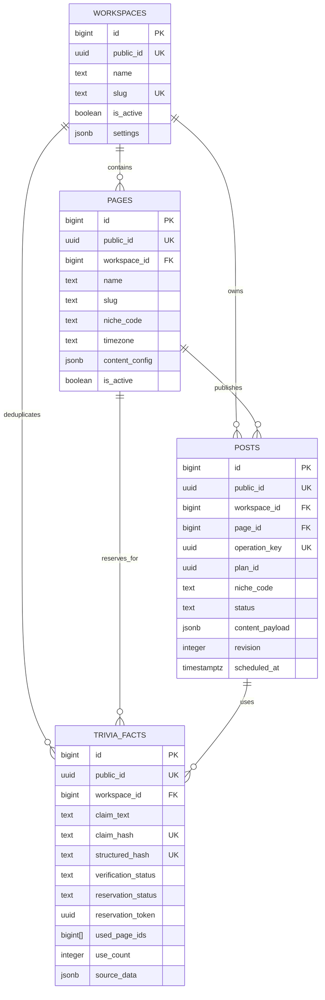

# Database Design — Content Producer MVP

## 1. Informasi dokumen

| Bagian | Keterangan |
|---|---|
| Nama produk | Content Producer |
| Versi produk | MVP |
| Versi dokumen | 1.0 |
| Status | Draf utama untuk ditinjau |
| Tanggal | 6 Oktober 2026 |
| Database | Supabase Postgres |
| Jumlah tabel MVP | 4 |
| Dokumen induk | `plans/PRD.md` |

Dokumen ini menjadi sumber utama untuk:

- Nama tabel dan kolom.
- Tipe data.
- Relasi.
- Constraint.
- Index.
- Struktur JSONB.
- Status data.
- Transaksi dan concurrency.
- Database function/RPC.
- RLS dan privilege.
- Pengujian database.

Jika dokumen ini bertentangan dengan `plans/PRD.md`, PRD menjadi acuan kebutuhan produk dan desain database harus diperbarui. Dokumen dalam folder `archive/` bukan sumber implementasi.

---

## 2. Ringkasan keputusan desain

Database MVP hanya mempunyai empat tabel:

1. `public.workspaces`
2. `public.pages`
3. `public.posts`
4. `public.trivia_facts`

Keputusan ini sengaja mempertahankan dashboard Supabase yang sederhana tanpa mengorbankan kebutuhan penting.

| Kebutuhan PRD | Penyelesaian database |
|---|---|
| Satu pengguna | Tidak ada tabel users atau memberships pada MVP |
| Multi-Page | `pages.workspace_id` |
| Konfigurasi berbeda per Page | `pages.content_config` |
| Core siap untuk niche lain | `pages.niche_code`, `posts.niche_code`, dan `posts.content_payload` |
| Fakta khusus trivia | `trivia_facts` sebagai tabel niche-specific |
| Kalender | `posts.scheduled_at` dan `posts.plan_id` |
| Revisi | `posts.revision`, tanpa tabel versions |
| Status post | `draft`, `ready`, `posted`, `archived` |
| Sumber fakta | `trivia_facts.source_data`; post merujuk fakta melalui payload |
| Keunikan canonical exact | `claim_hash` yang unik per workspace |
| Keunikan canonical terstruktur | `structured_hash` yang unik per workspace |
| Near-duplicate search | Full Text Search dan `pg_trgm` |
| Kerja beberapa chat | Reservasi atomic pada `trivia_facts` |
| Jumlah fakta per Page | `pages.content_config.fact_count` dengan mode fixed/adaptive |
| Kapasitas template | `pages.content_config.text_budget` |
| Reuse fakta per Page | `pages.content_config.fact_reuse_scope` |
| Idempotensi pembuatan post | `posts.operation_key` |
| Konflik revisi | Compare-and-swap menggunakan `posts.revision` |
| Batch | Beberapa post mandiri; tidak ada tabel job atau batch |
| Tanpa embeddings | Tidak ada vector extension atau vector column |

Istilah pada dokumen ini mempunyai batas yang tegas: **deduplikasi canonical** menjaga agar satu klaim hanya mempunyai satu row dalam workspace, sedangkan **reuse** menentukan apakah row itu boleh dipakai untuk Page tujuan. `page_unique` dapat mengizinkan reuse lintas Page, tetapi tidak pernah membuat row fakta duplikat.

---

## 3. Prinsip desain

### 3.1 Mudah dibaca

- Hanya empat tabel bisnis.
- Nama menggunakan lowercase `snake_case`.
- Kolom yang sering dilihat atau difilter disimpan sebagai kolom biasa.
- Data fleksibel dan detail output disimpan dalam JSONB dengan contract yang jelas.
- Tidak ada tabel teknis hanya untuk memenuhi pola arsitektur yang belum dibutuhkan.

### 3.2 Cepat untuk ChatGPT dan MCP

- Query utama mempunyai index yang sesuai.
- Daftar post tidak perlu menggabungkan banyak tabel.
- Kalender hanya membaca `posts`.
- Sumber fakta dapat diambil dari `trivia_facts` menggunakan daftar `fact_id` dalam payload post.
- Pencarian duplikat memakai index, bukan scan seluruh tabel.
- Write kompleks dibungkus dalam database function agar selesai dalam satu round trip.

### 3.3 Aman untuk concurrency

- Unique constraint menjadi pertahanan terakhir terhadap fakta ganda.
- Reservasi dilakukan dalam satu transaction.
- Row dikunci dalam urutan ID yang konsisten.
- Transaksi tidak melakukan web request atau pekerjaan AI.
- Revisi memakai expected revision.
- Slot jadwal Page dijaga partial unique index.

### 3.4 Siap dikembangkan

- `workspaces`, `pages`, dan `posts` adalah generic core.
- `trivia_facts` adalah modul trivia.
- Niche lain dapat menambahkan tabel sendiri tanpa mengubah fakta trivia.
- `schema_version` pada JSONB memungkinkan payload berkembang secara terkontrol.

### 3.5 Database menjaga integritas, ChatGPT menjaga kualitas editorial

Database bertanggung jawab atas:

- Relasi.
- Status yang valid.
- Keunikan.
- Reservasi.
- Idempotensi.
- Konflik revisi.
- Jadwal ganda.
- Struktur minimum JSON.

ChatGPT bertanggung jawab atas:

- Kebenaran penelitian dan kecukupan sumber.
- Penilaian kemiripan makna.
- Grammar, gaya bahasa, dan keterbacaan.
- Kualitas hook, fakta, CTA, caption, dan hashtag.

Database tidak mencoba menggantikan penilaian editorial dengan constraint yang rapuh.

---

## 4. Gambaran relasi



Relasi `posts → trivia_facts` disimpan melalui `posts.content_payload.facts[].fact_id`. Pendekatan ini memungkinkan satu fakta canonical dipakai pada beberapa Page ketika Page tujuan memakai `page_unique`, tanpa menambah tabel penghubung kelima.

`trivia_facts.used_page_ids` menyimpan daftar Page berbeda yang masih tercatat menggunakan atau pernah memublikasikan fakta tersebut. `use_count` adalah jumlah Page unik dalam array itu, bukan jumlah total post. Database function wajib menjaga ringkasan ini tetap konsisten dengan perubahan post. Urutan dan wording tampilan tetap berada pada payload post.

Array `used_page_ids` adalah kompromi sadar untuk mempertahankan empat tabel pada MVP. Tidak ada hard delete Page, seluruh perubahan array hanya melalui RPC transactional, dan setiap ID Page divalidasi sebelum ditulis. Jika kelak dibutuhkan riwayat penggunaan yang lebih kompleks atau banyak post per fakta pada Page yang sama, desain harus bermigrasi ke tabel relasi khusus.

---

## 5. Konvensi umum

### 5.1 Primary key dan public ID

Setiap tabel memakai:

- `id bigint generated always as identity` sebagai primary key internal.
- `public_id uuid` sebagai ID yang boleh dikembalikan melalui MCP.

Alasannya:

- `bigint` efisien untuk foreign key, index, join, dan insertion locality.
- UUID aman digunakan sebagai ID eksternal tanpa mengungkap jumlah row.
- Random UUID tidak menjadi clustered primary key sehingga fragmentasi index utama tetap kecil.

MCP tidak boleh mengekspos internal `id`.

### 5.2 Waktu

- Semua timestamp memakai `timestamptz`.
- Database menyimpan waktu dalam UTC.
- `pages.timezone` menyimpan nama zona IANA, misalnya `America/New_York` atau `Australia/Sydney`.
- Konversi untuk tampilan dilakukan berdasarkan zona Page.
- `scheduled_at` selalu menyimpan waktu absolut.

### 5.3 Teks

- Gunakan `text`, bukan `varchar(n)`.
- Batas panjang diterapkan melalui check constraint atau validator jika memang merupakan aturan produk.
- Slug harus lowercase dan mengikuti pola yang ditetapkan.

### 5.4 Status

Status memakai `text` dengan check constraint, bukan PostgreSQL enum. Hal ini membuat perubahan status pada pengembangan berikutnya lebih mudah dimigrasikan.

### 5.5 JSONB

JSONB hanya digunakan untuk data yang:

- Bentuknya dapat berbeda antar-niche.
- Tidak menjadi filter utama query harian.
- Lebih mudah dibaca sebagai satu dokumen.

Setiap JSONB mempunyai `schema_version`. Struktur minimum divalidasi saat write. Tidak semua JSONB diberi GIN index; index hanya ditambahkan jika ada query nyata yang membutuhkannya.

### 5.6 Soft lifecycle

MCP tidak menyediakan hard delete. Data dinonaktifkan atau diarsipkan melalui:

- `workspaces.is_active`
- `pages.is_active`
- `posts.status = 'archived'`
- `trivia_facts.verification_status = 'rejected'`

Foreign key memakai `on delete restrict` untuk mencegah penghapusan tidak sengaja.

---

## 6. Extensions

MVP membutuhkan:

```sql
create extension if not exists pgcrypto with schema extensions;
create extension if not exists pg_trgm with schema extensions;
```

Fungsi:

- `pgcrypto` menyediakan SHA-256 untuk hash dan dukungan UUID bila diperlukan.
- `pg_trgm` menyediakan kandidat kemiripan teks.

MVP tidak memasang:

- `vector`
- Extension embeddings.
- Extension queue.
- Extension cron hanya untuk membersihkan reservasi.

Reservasi kedaluwarsa dibersihkan secara opportunistic ketika tool fakta dipanggil. Cron dapat ditambahkan kelak jika volume membutuhkannya.

---

## 7. Tabel `workspaces`

### 7.1 Tanggung jawab

Menyimpan pengaturan global dan nilai default untuk Page baru. MVP mempunyai satu workspace aktif, tetapi tabel tetap dapat menyimpan workspace nonaktif untuk migrasi atau ekspansi masa depan.

### 7.2 Kolom

| Kolom | Tipe | Null | Default | Keterangan |
|---|---|---:|---|---|
| `id` | `bigint identity` | Tidak | Identity | Primary key internal |
| `public_id` | `uuid` | Tidak | `gen_random_uuid()` | ID eksternal |
| `name` | `text` | Tidak | — | Nama workspace |
| `slug` | `text` | Tidak | — | Identifier lowercase yang stabil |
| `language_code` | `text` | Tidak | `'en'` | Bahasa output default |
| `locale` | `text` | Tidak | `'en-US'` | Locale dan ejaan default |
| `target_markets` | `text[]` | Tidak | `['US','GB','CA','AU']` | Market utama |
| `settings` | `jsonb` | Tidak | Config MVP | Pengaturan global tambahan |
| `is_active` | `boolean` | Tidak | `true` | Workspace aktif |
| `created_at` | `timestamptz` | Tidak | `now()` | Waktu pembuatan |
| `updated_at` | `timestamptz` | Tidak | `now()` | Waktu perubahan terakhir |

### 7.3 Constraint

- Primary key pada `id`.
- Unique pada `public_id`.
- Unique pada `slug`.
- `slug` harus cocok dengan `^[a-z][a-z0-9-]{1,62}$`.
- `language_code` harus `en` pada MVP.
- `locale` harus `en-US` pada MVP.
- `target_markets` hanya boleh berisi `US`, `GB`, `CA`, dan `AU`.
- Array market harus memiliki minimal satu nilai dan tidak boleh duplikat.
- `settings` harus JSON object.
- Hanya satu row boleh mempunyai `is_active = true`.

### 7.4 Struktur `settings`

Versi awal:

```json
{
  "schema_version": 1,
  "default_fact_count": {
    "mode": "adaptive",
    "min": 5,
    "preferred": 7,
    "max": 9
  },
  "default_text_budget": {
    "hook_max_chars": 45,
    "fact_max_chars": 90,
    "facts_total_max_chars": 500,
    "cta_max_chars": 50,
    "canva_total_max_chars": 600
  },
  "default_fact_reuse_scope": "workspace_unique",
  "reservation_ttl_minutes": 30,
  "default_post_status": "draft"
}
```

Aturan:

- `default_fact_count` memakai mode adaptive 5/7/9.
- `default_text_budget` memakai baseline Canva MVP dan menjadi nilai awal Page baru.
- `default_fact_reuse_scope` adalah `workspace_unique`; nilai ini dipakai saat membuat Page baru.
- `reservation_ttl_minutes` antara 5 dan 120 menit.
- Nilai default adalah 30 menit.

---

## 8. Tabel `pages`

### 8.1 Tanggung jawab

Menyimpan satu profil Facebook Page dan aturan produksi kontennya.

### 8.2 Kolom

| Kolom | Tipe | Null | Default | Keterangan |
|---|---|---:|---|---|
| `id` | `bigint identity` | Tidak | Identity | Primary key internal |
| `public_id` | `uuid` | Tidak | `gen_random_uuid()` | ID eksternal |
| `workspace_id` | `bigint` | Tidak | — | Workspace pemilik |
| `name` | `text` | Tidak | — | Nama Facebook Page |
| `slug` | `text` | Tidak | — | Nama pendek unik dalam workspace |
| `niche_code` | `text` | Tidak | `'trivia'` | Modul konten yang digunakan |
| `language_code` | `text` | Tidak | `'en'` | Bahasa output |
| `locale` | `text` | Tidak | `'en-US'` | Standar bahasa utama |
| `timezone` | `text` | Tidak | `'UTC'` | Zona IANA untuk jadwal |
| `target_markets` | `text[]` | Tidak | `['US','GB','CA','AU']` | Market Page |
| `content_config` | `jsonb` | Tidak | — | Aturan konten Page |
| `is_active` | `boolean` | Tidak | `true` | Page tersedia untuk produksi |
| `created_at` | `timestamptz` | Tidak | `now()` | Waktu pembuatan |
| `updated_at` | `timestamptz` | Tidak | `now()` | Waktu perubahan terakhir |

### 8.3 Constraint dan relasi

- Foreign key `workspace_id → workspaces.id` dengan `on delete restrict`.
- Unique `public_id`.
- Unique `(workspace_id, slug)`.
- Composite unique `(workspace_id, id, niche_code)` untuk menjamin post berada pada workspace dan niche yang sama.
- `slug` mengikuti pola lowercase yang sama dengan workspace.
- `niche_code` mengikuti pola `^[a-z][a-z0-9_]{1,31}$`.
- MCP hanya menerima `trivia` pada MVP.
- `language_code = 'en'` dan `locale = 'en-US'` pada MVP.
- Market hanya `US`, `GB`, `CA`, `AU`, minimal satu, tanpa duplikat.
- `timezone` harus terdapat pada `pg_timezone_names`.
- `content_config` harus JSON object dan lulus validator niche.

### 8.4 Struktur `content_config` untuk trivia

Schema JSON berikut berlaku untuk semua Page trivia, tetapi nilainya dimiliki oleh masing-masing row `pages`. Karena itu dua Page dengan niche sama dapat mempunyai mode jumlah fakta, text budget, topik, bobot, gaya, dan kebijakan reuse yang berbeda.

Jika `create_page` tidak menerima pilihan jumlah, text budget, atau reuse, RPC menyalin default terkait dari workspace aktif ke `content_config` Page baru. Setelah Page dibuat, perubahan satu Page tidak memengaruhi konfigurasi Page lain.

```json
{
  "schema_version": 1,
  "architecture_weights": {
    "themed": 45,
    "single_subject": 40,
    "mixed": 15
  },
  "allowed_topics": [
    "animals",
    "food_science",
    "human_body",
    "nature_science",
    "geography",
    "history_origins",
    "inventions_everyday",
    "general_trivia"
  ],
  "topic_weights": {
    "animals": 25,
    "food_science": 20,
    "human_body": 15,
    "nature_science": 15,
    "geography": 15,
    "history_origins": 5,
    "inventions_everyday": 3,
    "general_trivia": 2
  },
  "fact_count": {
    "mode": "adaptive",
    "min": 5,
    "preferred": 7,
    "max": 9
  },
  "fact_reuse_scope": "workspace_unique",
  "text_budget": {
    "hook_max_chars": 45,
    "fact_max_chars": 90,
    "facts_total_max_chars": 500,
    "cta_max_chars": 50,
    "canva_total_max_chars": 600
  },
  "caption": {
    "max_chars": 500
  },
  "hashtags": {
    "default_count": 3,
    "min_count": 0,
    "max_count": 5
  },
  "style": {
    "english_variant": "en-US",
    "tone": "conversational_credible",
    "emoji_allowed": false,
    "regional_slang_allowed": false
  }
}
```

Validator wajib memastikan:

- Bobot architecture berjumlah 100.
- Bobot topic hanya memakai topic yang ada di `allowed_topics` dan berjumlah 100.
- `fact_count.mode` hanya `fixed` atau `adaptive`.
- Mode fixed mempunyai tepat `value` berupa bilangan bulat 5–9 dan tidak mempunyai `min`, `preferred`, atau `max`.
- Mode adaptive mempunyai `5 ≤ min ≤ preferred ≤ max ≤ 9` dan tidak mempunyai `value`.
- Default Page baru adalah adaptive dengan min 5, preferred 7, dan max 9.
- `text_budget` memiliki seluruh lima batas karakter positif; nilai Page tidak boleh melewati hard ceiling keamanan payload yang ditetapkan validator.
- `hook_max_chars ≤ 90`, `fact_max_chars ≤ 120`, `facts_total_max_chars ≤ 900`, `cta_max_chars ≤ 100`, dan `canva_total_max_chars ≤ 1000` pada MVP.
- `facts_total_max_chars` tidak boleh melebihi `canva_total_max_chars`.
- `fact_reuse_scope` hanya `workspace_unique` atau `page_unique`; default Page baru adalah `workspace_unique`.
- `workspace_unique` menolak fakta yang sudah digunakan Page mana pun.
- `page_unique` mengizinkan reuse lintas Page tetapi menolak fakta yang sudah digunakan Page tujuan yang sama.
- Batas Canva, caption, dan hashtag sesuai PRD.
- Tidak ada key wajib yang hilang.
- Key tambahan hanya diterima bila validator versi schema mengenalinya.

Contoh mode fixed untuk Page yang selalu memakai 7 fakta:

```json
{
  "fact_count": {
    "mode": "fixed",
    "value": 7
  }
}
```

Jumlah adaptif tidak memakai RNG. ChatGPT melakukan pemilihan berbasis kualitas dan panjang, sedangkan validator memastikan jumlah final serta teks final tidak melewati konfigurasi.

---

## 9. Tabel `posts`

### 9.1 Tanggung jawab

Menyimpan output post, status, jadwal, hasil quality check, dan payload sesuai niche.

### 9.2 Kolom

| Kolom | Tipe | Null | Default | Keterangan |
|---|---|---:|---|---|
| `id` | `bigint identity` | Tidak | Identity | Primary key internal |
| `public_id` | `uuid` | Tidak | `gen_random_uuid()` | ID yang ditampilkan ke ChatGPT |
| `workspace_id` | `bigint` | Tidak | — | Workspace post |
| `page_id` | `bigint` | Tidak | — | Facebook Page tujuan |
| `operation_key` | `uuid` | Tidak | — | Idempotency key saat pembuatan |
| `plan_id` | `uuid` | Ya | `null` | Pengelompokan kalender tanpa tabel plan |
| `niche_code` | `text` | Tidak | — | Niche post |
| `status` | `text` | Tidak | `'draft'` | Lifecycle post |
| `content_payload` | `jsonb` | Tidak | — | Seluruh output publik dan referensi fact ID |
| `quality_status` | `text` | Tidak | `'pending'` | `pending`, `passed`, atau `failed` |
| `quality_report` | `jsonb` | Tidak | `{}` | Ringkasan quality gate |
| `scheduled_at` | `timestamptz` | Ya | `null` | Waktu kalender/publikasi yang direncanakan |
| `ready_at` | `timestamptz` | Ya | `null` | Waktu disetujui |
| `posted_at` | `timestamptz` | Ya | `null` | Waktu ditandai telah diposting |
| `archived_at` | `timestamptz` | Ya | `null` | Waktu diarsipkan |
| `revision` | `integer` | Tidak | `1` | Optimistic concurrency counter |
| `created_at` | `timestamptz` | Tidak | `now()` | Waktu pembuatan |
| `updated_at` | `timestamptz` | Tidak | `now()` | Waktu perubahan terakhir |

### 9.3 Constraint dan relasi

- Foreign key `workspace_id → workspaces.id` dengan `on delete restrict`.
- Composite foreign key `(workspace_id, page_id, niche_code) → pages(workspace_id, id, niche_code)`.
- Unique `public_id`.
- Unique `(workspace_id, operation_key)`.
- `status` hanya `draft`, `ready`, `posted`, `archived`.
- `quality_status` hanya `pending`, `passed`, `failed`.
- `revision ≥ 1`.
- `content_payload` dan `quality_report` harus JSON object.
- `ready` dan `posted` hanya boleh mempunyai `quality_status = 'passed'`.
- Status `ready` atau `posted` membutuhkan `ready_at`.
- Status `posted` membutuhkan `posted_at`.
- Status `archived` membutuhkan `archived_at`.
- `content_payload` wajib lulus validator berdasarkan `niche_code`.
- Satu Page tidak boleh mempunyai dua post non-archived pada `scheduled_at` yang sama.

### 9.4 Struktur `content_payload` untuk trivia

```json
{
  "schema_version": 1,
  "rules_snapshot": {
    "fact_count": {
      "mode": "adaptive",
      "min": 5,
      "preferred": 7,
      "max": 9
    },
    "fact_count_applied": 5,
    "fact_count_override": false,
    "text_budget": {
      "hook_max_chars": 45,
      "fact_max_chars": 90,
      "facts_total_max_chars": 500,
      "cta_max_chars": 50,
      "canva_total_max_chars": 600
    },
    "fact_reuse_scope": "workspace_unique"
  },
  "architecture": "mixed",
  "topic_code": "general_trivia",
  "theme": "surprising facts",
  "hook": "Did you know?",
  "facts": [
    {
      "position": 1,
      "fact_id": "1f2a98b8-91bd-4f93-8998-b8050e4f6b08",
      "text": "Octopuses have three hearts."
    },
    {
      "position": 2,
      "fact_id": "1f2a98b8-91bd-4f93-8998-b8050e4f6b09",
      "text": "Honey never spoils when stored properly."
    },
    {
      "position": 3,
      "fact_id": "1f2a98b8-91bd-4f93-8998-b8050e4f6b0a",
      "text": "Bananas are berries, but strawberries are not."
    },
    {
      "position": 4,
      "fact_id": "1f2a98b8-91bd-4f93-8998-b8050e4f6b0b",
      "text": "A day on Venus is longer than its year."
    },
    {
      "position": 5,
      "fact_id": "1f2a98b8-91bd-4f93-8998-b8050e4f6b0c",
      "text": "Sharks existed before trees."
    }
  ],
  "cta": "Follow for more surprising facts.",
  "canva_copy": "Did you know?\n\n1. Octopuses have three hearts.\n2. Honey never spoils when stored properly.\n3. Bananas are berries, but strawberries are not.\n4. A day on Venus is longer than its year.\n5. Sharks existed before trees.\n\nFollow for more surprising facts.",
  "text_metrics": {
    "hook_chars": 13,
    "fact_chars": [28, 40, 46, 39, 28],
    "facts_total_chars": 200,
    "cta_chars": 33,
    "canva_total_chars": 250
  },
  "caption": "A ready-to-paste Facebook caption.",
  "hashtags": ["#DidYouKnow", "#AmazingFacts", "#Trivia"],
  "fact_count_exception": null,
  "visual_direction": {
    "background": "subtle wildlife footage",
    "motion": "slow"
  }
}
```

Validator `content_payload` trivia wajib memastikan:

- `schema_version = 1`.
- `rules_snapshot` wajib menyalin rule Page yang benar-benar diterapkan saat save.
- `fact_count_applied` harus sama dengan jumlah item `facts`.
- Pada fixed, jumlah harus sama dengan `value`; pada adaptive, jumlah harus berada antara `min` dan `max`.
- `fact_count_override = true` hanya untuk permintaan eksplisit pengguna yang berbeda dari fixed value atau berada di luar rentang adaptive tetapi tetap dalam batas MVP 5–9.
- `text_metrics` wajib dihitung ulang oleh database function; nilai dari client tidak dipercaya.
- Penghitungan memakai `char_length`, sehingga spasi, punctuation, nomor atau bullet yang dirender, dan line break ikut dihitung.
- `fact_chars` menghitung teks setiap fakta tanpa prefix posisi; `facts_total_chars` menghitung blok fakta final beserta prefix dan line break; `canva_total_chars` menghitung string `canva_copy` persis seperti disimpan.
- Setiap nilai aktual wajib kurang dari atau sama dengan batas terkait pada `rules_snapshot.text_budget`.
- `architecture` termasuk `themed`, `single_subject`, `mixed`.
- `topic_code` termasuk allowlist Page.
- Mode adaptive tidak mewajibkan jumlah sama dengan preferred; preferred adalah sasaran lunak setelah kualitas dan budget dipenuhi.
- Override eksplisit untuk satu post boleh berisi 5–9 item tanpa mengubah konfigurasi Page.
- Jumlah 1–4 hanya diterima jika `fact_count_exception` mencatat alasan, waktu, dan konfirmasi eksplisit pengguna sesuai PRD.
- `position` unik dan berurutan mulai dari 1.
- `fact_id` valid dan tidak berulang.
- `hook` tidak kosong dan mengikuti snapshot text budget.
- Setiap `facts[].text`, blok fakta hasil render, dan `cta` mengikuti snapshot text budget.
- `canva_copy` tidak kosong.
- `canva_copy` mengikuti `canva_total_max_chars`.
- `caption` maksimal 500 karakter.
- `hashtags` berupa array 0–5 string unik.
- Tidak ada URL sumber atau internal database ID di `canva_copy`.

Database function `save_post` dan `revise_post` harus memastikan setiap `fact_id` valid, memenuhi kebijakan reuse Page tujuan, dan riwayat Page pada fakta diperbarui secara atomic.

Perubahan `pages.content_config` tidak mengubah post lama. Revisi wording mempertahankan `rules_snapshot`. Revisi yang secara eksplisit menerapkan rule Page terbaru harus membaca config terbaru, memvalidasi ulang jumlah, text budget, dan reuse, lalu mengganti snapshot dalam transaction yang sama.

Sumber tidak disalin ke `posts.content_payload`. Sumber otoritatif tetap berada di `trivia_facts.source_data` dan diambil melalui relasi fakta yang dipakai post. Dengan begitu, aplikasi tidak mempunyai dua salinan sumber yang dapat berbeda. Output untuk Canva dan Facebook tetap bebas URL, sedangkan tool dapat menampilkan daftar sumber secara terpisah ketika diminta pengguna.

### 9.5 Struktur `quality_report`

```json
{
  "schema_version": 1,
  "checked_at": "2026-10-06T10:30:00Z",
  "checks": {
    "page_context": true,
    "fact_count": true,
    "text_budget": true,
    "sources": true,
    "reuse_policy": true,
    "fact_accuracy": true,
    "time_sensitive_context": true,
    "content_safety": true,
    "american_english": true,
    "global_clarity": true,
    "formatting": true,
    "caption": true,
    "hashtags": true
  },
  "notes": []
}
```

Database hanya memeriksa bahwa seluruh key kritis bernilai `true` sebelum status menjadi `ready`. Isi editorial berasal dari review ChatGPT.

---

## 10. Tabel `trivia_facts`

### 10.1 Tanggung jawab

Menyimpan satu klaim fakta per row beserta:

- Bentuk canonical.
- Data terstruktur untuk deduplikasi.
- Sumber.
- Status verifikasi.
- Ringkasan penggunaan per Page.
- Reservasi sementara.
- Referensi dari post melalui `content_payload`.

### 10.2 Kolom identitas dan relasi

| Kolom | Tipe | Null | Default | Keterangan |
|---|---|---:|---|---|
| `id` | `bigint identity` | Tidak | Identity | Primary key internal |
| `public_id` | `uuid` | Tidak | `gen_random_uuid()` | ID eksternal fakta |
| `workspace_id` | `bigint` | Tidak | — | Scope deduplikasi |
| `reserved_for_page_id` | `bigint` | Ya | `null` | Page tujuan saat reserved |

### 10.3 Kolom klaim dan deduplikasi

| Kolom | Tipe | Null | Default | Keterangan |
|---|---|---:|---|---|
| `claim_text` | `text` | Tidak | — | Klaim canonical yang mudah dibaca |
| `normalized_claim` | `text` | Tidak | — | Hasil normalisasi deterministik |
| `normalization_version` | `smallint` | Tidak | `1` | Versi algoritma normalisasi |
| `claim_hash` | `text` | Tidak | — | SHA-256 dari normalized claim |
| `subject_key` | `text` | Tidak | — | Subjek canonical |
| `relation_key` | `text` | Tidak | — | Relasi/predicate canonical |
| `object_key` | `text` | Tidak | — | Objek/nilai canonical |
| `numbers` | `jsonb` | Tidak | `[]` | Angka dan satuan canonical |
| `qualifiers` | `jsonb` | Tidak | `{}` | Batasan penting klaim |
| `structured_key` | `text` | Tidak | — | Bentuk terstruktur yang masih dapat dibaca |
| `structured_hash` | `text` | Tidak | — | SHA-256 structured key |
| `topic_code` | `text` | Tidak | — | Topik fakta |
| `search_vector` | `tsvector` | Tidak | Generated | Full Text Search document |

Contoh data terstruktur:

```json
{
  "subject_key": "octopus",
  "relation_key": "has_body_part_count",
  "object_key": "heart",
  "numbers": [
    {
      "value": 3,
      "unit": "count"
    }
  ],
  "qualifiers": {
    "species_scope": "general"
  }
}
```

`structured_key` yang dihasilkan:

```text
octopus|has_body_part_count|heart|count:3|species_scope:general
```

Unit harus dinormalisasi sebelum structured key dibentuk. Contohnya, 10 feet dan 3.048 meters harus menghasilkan nilai canonical yang sama jika keduanya menyatakan klaim yang sama.

### 10.4 Kolom sumber dan verifikasi

| Kolom | Tipe | Null | Default | Keterangan |
|---|---|---:|---|---|
| `source_data` | `jsonb` | Tidak | — | Satu atau lebih sumber |
| `verification_status` | `text` | Tidak | `'needs_review'` | Status bukti |
| `verified_at` | `timestamptz` | Ya | `null` | Waktu verifikasi |
| `as_of_date` | `date` | Ya | `null` | Tanggal konteks fakta dinamis |
| `expires_at` | `timestamptz` | Ya | `null` | Batas penggunaan tanpa recheck |
| `review_note` | `text` | Ya | `null` | Alasan review atau penolakan |

Nilai `verification_status`:

- `verified`
- `needs_review`
- `rejected`

MVP tidak menyimpan semua ide mentah. Fakta baru dimasukkan ketika sudah mempunyai sumber minimum. Hanya `verified` yang dapat direservasi atau digunakan.

### 10.5 Struktur `source_data`

```json
[
  {
    "url": "https://example.org/reference",
    "title": "Reference title",
    "publisher": "Publishing organization",
    "source_type": "primary",
    "accessed_at": "2026-10-06",
    "supports_claim": "The source directly states the relevant claim."
  }
]
```

Aturan:

- Harus berupa array dengan minimal satu item.
- Setiap item mempunyai URL HTTPS, title, publisher, source type, accessed date, dan support note.
- `source_type` adalah `primary`, `official`, atau `secondary`.
- URL yang sama tidak boleh berulang dalam satu fact row.
- Fakta sensitif atau mudah berubah dapat memiliki dua atau lebih sumber.
- Database memvalidasi struktur; ChatGPT menilai kecukupan dan relevansinya.

### 10.6 Kolom penggunaan dan reservasi

| Kolom | Tipe | Null | Default | Keterangan |
|---|---|---:|---|---|
| `reservation_status` | `text` | Tidak | `'available'` | `available` atau `reserved` |
| `reservation_token` | `uuid` | Ya | `null` | Token satu attempt produksi/revisi |
| `reserved_at` | `timestamptz` | Ya | `null` | Awal reservasi |
| `reserved_until` | `timestamptz` | Ya | `null` | Kedaluwarsa reservasi |
| `used_page_ids` | `bigint[]` | Tidak | `{}` | Page unik yang masih tercatat menggunakan atau pernah memublikasikan fakta ini |
| `use_count` | `integer` | Tidak | `0` | Jumlah Page pada `used_page_ids` |
| `usage_started_at` | `timestamptz` | Ya | `null` | Awal periode ketika `use_count` berubah dari 0 menjadi 1 |
| `usage_updated_at` | `timestamptz` | Ya | `null` | Waktu terakhir daftar Page penggunaan berubah |
| `created_at` | `timestamptz` | Tidak | `now()` | Waktu pertama disimpan |
| `updated_at` | `timestamptz` | Tidak | `now()` | Waktu perubahan terakhir |

Constraint lifecycle:

- `available`: seluruh kolom reservation kosong; fakta boleh belum pernah digunakan atau pernah digunakan Page lain.
- `reserved`: token, Page, `reserved_at`, dan `reserved_until` wajib terisi.
- `reserved_until > reserved_at`.
- `reserved` hanya diperbolehkan jika `verification_status = 'verified'`.
- `use_count = cardinality(used_page_ids)` dan `used_page_ids` tidak boleh berisi ID ganda.
- Jika `use_count = 0`, `usage_started_at` dan `usage_updated_at` kosong.
- Jika `use_count > 0`, kedua timestamp penggunaan wajib terisi.

`available` berarti tidak sedang dikunci oleh proses produksi, bukan berarti belum pernah dipakai. Kelayakan fakta ditentukan terpisah berdasarkan Page tujuan:

- `workspace_unique`: `use_count` harus 0.
- `page_unique`: `used_page_ids` tidak boleh mengandung ID Page tujuan.

Kelayakan diperiksa ketika reservation dan diulang di dalam transaction save/revise. Pemakaian berikutnya oleh Page lain tidak membuat post yang sudah tersimpan menjadi invalid.

### 10.7 Keunikan

Constraint penting:

```text
unique (workspace_id, claim_hash)
unique (workspace_id, structured_hash)
```

Kedua constraint berlaku untuk semua status verifikasi. Fakta yang pernah ditolak tetap tidak boleh dimasukkan kembali sebagai row baru dengan identitas sama; row lama harus ditinjau dan diperbarui secara eksplisit.

---

## 11. Lifecycle data

### 11.1 Lifecycle post

```text
draft → ready → posted → archived
   └────────────────────→ archived
ready ──────────────────→ archived
```

Transisi yang diperbolehkan:

| Dari | Ke | Syarat |
|---|---|---|
| `draft` | `ready` | Quality passed dan fakta valid |
| `draft` | `archived` | Perintah eksplisit pengguna |
| `ready` | `posted` | Perintah pengguna setelah posting manual |
| `ready` | `archived` | Perintah eksplisit pengguna |
| `posted` | `archived` | Perintah eksplisit pengguna |
| Status yang sama | Status yang sama | Idempotent, kembalikan row saat ini |

Revisi pada post `ready` mengubahnya kembali menjadi `draft`, mengosongkan `ready_at`, dan mengatur `quality_status = 'pending'`. Post `posted` dan `archived` tidak dapat direvisi pada MVP.

Mengarsipkan post tidak melepaskan faktanya.

Transisi langsung `draft → archived` atau `ready → archived` adalah jalur *discard* eksplisit, bukan tanda bahwa konten pernah dipublikasikan. Hanya status `posted` yang menyatakan pengguna sudah memposting konten secara manual.

### 11.2 Lifecycle fakta

```text
available ⇄ reserved
    │          │
    └──────────┴── penggunaan dicatat di used_page_ids
```

Aturan:

- `available → reserved` hanya melalui transaction reservation.
- `reserved → available` melalui release atau expiry.
- Saat `save_post` atau `revise_post` memakai fakta, ID Page ditambahkan ke `used_page_ids`, `use_count` diperbarui, lalu reservation kembali `available`.
- Saat fakta diganti dari post `draft` atau `ready`, ID Page lama dilepas dari fakta tersebut jika tidak ada penggunaan `posted` atau `archived` yang harus dipertahankan.
- Fakta pada post `posted` atau `archived` tidak pernah dilepas dari riwayat penggunaan.
- Reservation tetap eksklusif untuk satu Page pada satu waktu, walaupun Page memakai `page_unique`.

### 11.3 Lifecycle verifikasi

```text
needs_review → verified | rejected
verified     → needs_review | rejected
```

Perubahan dari `verified` tidak menghapus bukti penggunaan lama. Jika fakta yang sudah diposting kemudian ternyata salah, post terkait ditemukan melalui `content_payload.facts[].fact_id` dan ditangani manual.

---

## 12. Index

### 12.1 Index `workspaces`

| Index | Jenis | Tujuan |
|---|---|---|
| Primary key `id` | B-tree | Lookup dan relasi internal |
| Unique `public_id` | B-tree | Lookup MCP |
| Unique `slug` | B-tree | Lookup nama stabil |
| Partial unique active workspace | B-tree | Menjamin satu workspace aktif |

### 12.2 Index `pages`

| Index | Jenis | Tujuan |
|---|---|---|
| Primary key `id` | B-tree | Lookup internal |
| Unique `public_id` | B-tree | Lookup MCP |
| Unique `(workspace_id, slug)` | B-tree | Lookup dan keunikan Page |
| `(workspace_id, is_active, name)` | B-tree | `list_pages` |
| Composite relation keys | B-tree | Foreign key dan integrity |

### 12.3 Index `posts`

| Index | Jenis | Tujuan |
|---|---|---|
| Primary key `id` | B-tree | Lookup internal |
| Unique `public_id` | B-tree | Lookup MCP |
| Unique `(workspace_id, operation_key)` | B-tree | Idempotent create |
| `(page_id, status, created_at desc, id desc)` | B-tree | Daftar kerja Page |
| `(page_id, scheduled_at, id)` partial | B-tree | Kalender aktif |
| `(workspace_id, plan_id, scheduled_at)` partial | B-tree | Mengambil satu rencana |
| Unique `(page_id, scheduled_at)` partial | B-tree | Mencegah slot ganda |
| `content_payload jsonb_path_ops` | GIN | Menemukan seluruh post yang memakai satu fact ID |

Partial index kalender hanya mencakup `scheduled_at is not null and status <> 'archived'`.

### 12.4 Index `trivia_facts`

| Index | Jenis | Tujuan |
|---|---|---|
| Primary key `id` | B-tree | Lookup internal |
| Unique `public_id` | B-tree | Lookup MCP |
| Unique `(workspace_id, claim_hash)` | B-tree | Exact duplicate |
| Unique `(workspace_id, structured_hash)` | B-tree | Structured duplicate |
| `(workspace_id, reservation_status, topic_code, use_count, id)` | B-tree | Inventory dan selection |
| `(reservation_token, id)` partial | B-tree | Save/release satu reservation |
| `(reserved_until, id)` partial | B-tree | Expiry cleanup |
| `(reserved_for_page_id, id)` partial | B-tree | Mendukung foreign key Page reservation |
| `used_page_ids` | GIN | Pemeriksaan reuse per Page |
| `search_vector` | GIN | Full Text Search |
| `normalized_claim gin_trgm_ops` | GIN | Kemiripan teks |

JSONB selain `posts.content_payload` tidak diberi GIN index pada MVP karena tidak menjadi filter utama. Index payload diperlukan untuk audit balik dari fact ID ke post. Index lain baru ditambahkan setelah query nyata dan `EXPLAIN ANALYZE` menunjukkan kebutuhan.

---

## 13. Strategi deduplikasi tanpa embeddings

### 13.1 Normalisasi versi 1

`normalize_fact_text_v1` melakukan:

1. Trim.
2. Lowercase.
3. Mengubah smart quote dan dash menjadi bentuk standar.
4. Menghapus punctuation yang tidak mengubah arti.
5. Mengubah whitespace berulang menjadi satu spasi.
6. Menghapus trailing punctuation.

Normalisasi teks tidak bertugas menyamakan unit atau memahami makna. Unit, angka, dan qualifier ditangani oleh structured key.

### 13.2 Claim hash

```text
claim_hash = sha256(normalization_version + ':' + normalized_claim)
```

Claim hash mendeteksi teks yang sama setelah normalisasi.

### 13.3 Structured key

Structured key dibentuk secara deterministik dari:

- `subject_key`
- `relation_key`
- `object_key`
- `numbers` yang sudah memakai unit canonical
- `qualifiers` penting yang sudah diurutkan

```text
structured_hash = sha256(structured_key)
```

Structured hash mendeteksi parafrasa yang berhasil dipetakan ke arti terstruktur yang sama.

### 13.4 Candidate retrieval

Untuk setiap kandidat, database mencari:

1. Claim hash yang sama.
2. Structured hash yang sama.
3. Structured fields yang memiliki subject/relation/object sama atau beririsan.
4. Full Text Search match.
5. Trigram similarity pada `normalized_claim`.

Initial candidate threshold trigram adalah `0.35`. Nilai ini sengaja cukup longgar karena hasilnya hanya kandidat untuk ditinjau ChatGPT, bukan keputusan final.

Hasil maksimum default 10 dan batas keras 20 per kandidat. Setiap hasil menyertakan:

- `fact_id`
- Claim lama.
- Match type.
- Similarity score.
- Structured key.
- Verification status.
- Reservation status.
- `use_count` dan Page pemakai jika relevan.

### 13.5 Keputusan semantik

ChatGPT membandingkan kandidat dan menentukan:

- `duplicate`
- `related_but_distinct`
- `uncertain`

`uncertain` tidak boleh langsung digunakan. ChatGPT harus memperbaiki struktur fakta, mencari sumber tambahan, atau menggantinya.

Database tidak menerima keputusan `related_but_distinct` jika claim hash atau structured hash tetap sama. Kandidat harus mempunyai structured key yang benar-benar berbeda.

---

## 14. Reservasi atomic

### 14.1 Input

Reservation menerima:

- Workspace public ID.
- Page public ID.
- Satu `reservation_token` UUID.
- TTL 5–120 menit; default dari workspace.
- Array 1–9 kandidat fakta terverifikasi.

Satu token mewakili satu attempt post atau satu attempt revisi.

### 14.2 Urutan transaksi

Dalam satu database transaction:

1. Validasi workspace dan Page aktif.
2. Baca `fact_reuse_scope` dari `content_config` Page tujuan.
3. Bersihkan reservation workspace yang sudah kedaluwarsa.
4. Normalisasi ulang setiap claim di server/database.
5. Bangun ulang claim hash dan structured hash.
6. Cari row canonical yang sudah ada berdasarkan kedua hash.
7. Kunci row yang ditemukan menggunakan `for update` dalam urutan `id` menaik.
8. Jika row masih `reserved` oleh token lain, batalkan dengan `FACT_RESERVED`.
9. Untuk `workspace_unique`, tolak row dengan `use_count > 0` menggunakan `FACT_REUSE_BLOCKED`.
10. Untuk `page_unique`, tolak row jika `used_page_ids` sudah berisi Page tujuan menggunakan `FACT_REUSE_BLOCKED`.
11. Jika row `available` dan verified, ubah menjadi `reserved`.
12. Jika row belum ada, insert langsung sebagai `verified + reserved`.
13. Jika unique constraint kalah karena request paralel, batalkan seluruh transaksi dengan conflict yang stabil.
14. Kembalikan public fact IDs, kebijakan yang diterapkan, dan `reserved_until`.

Semua fakta untuk satu post menggunakan all-or-nothing reservation. Sistem tidak boleh mengembalikan lima fakta sukses dan satu gagal sebagai reservation yang seolah lengkap.

### 14.3 Idempotensi token

Jika token yang sama dikirim ulang:

- Jika seluruh set fakta dan Page sama serta reservation masih valid, kembalikan hasil yang sama.
- Jika token sudah menghasilkan post, kembalikan post tersebut.
- Jika token sama tetapi payload berbeda, kembalikan `RESERVATION_TOKEN_MISMATCH`.

### 14.4 Transaksi pendek

Web browsing, penulisan AI, dan quality review harus selesai sebelum memulai transaksi. Transaction hanya melakukan validasi, lock, insert/update, lalu commit dalam hitungan milidetik.

---

## 15. Menyimpan post secara atomic

### 15.1 Input minimum

- Workspace dan Page public ID.
- `reservation_token`.
- `operation_key`; untuk initial post nilainya sama dengan reservation token.
- `niche_code`.
- `content_payload`.
- `quality_status` dan `quality_report`.
- `scheduled_at` dan `plan_id` bila ada.

### 15.2 Urutan transaksi

1. Cari post berdasarkan `(workspace_id, operation_key)`.
2. Jika sudah ada, kembalikan post yang sama sebagai hasil retry.
3. Validasi Page aktif dan niche sesuai Page.
4. Kunci semua fakta dengan reservation token dalam urutan ID.
5. Pastikan reservation belum kedaluwarsa dan ditujukan untuk Page yang sama.
6. Baca ulang `fact_count`, `text_budget`, dan `fact_reuse_scope` Page, periksa kembali kelayakan seluruh fakta di dalam lock, lalu tulis nilainya ke `rules_snapshot`.
7. Pastikan fact IDs pada payload sama persis dengan row yang direservasi.
8. Validasi payload dan quality report.
9. Insert post `draft`.
10. Tambahkan Page ID ke `used_page_ids`, perbarui `use_count`, `usage_started_at`, dan `usage_updated_at` pada semua fakta.
11. Kembalikan `reservation_status` ke `available` dan kosongkan seluruh kolom reservation.
12. Commit.

Jika langkah mana pun gagal, post tidak tersimpan dan fakta tetap reserved sampai dilepas atau kedaluwarsa.

### 15.3 Batch

Batch tidak memakai satu transaction besar. Setiap post mempunyai reservation token dan operation key sendiri. Dengan demikian:

- Post yang berhasil tidak dibatalkan oleh kegagalan item lain.
- Chat dapat melanjutkan batch berdasarkan post yang sudah tersimpan.
- Tidak ada row job yang perlu disinkronkan.

---

## 16. Revisi post secara atomic

### 16.1 Revisi tanpa mengganti fakta

Input:

- Post public ID.
- `expected_revision`.
- Payload baru.
- Quality report baru.

Transaction:

1. Update hanya jika `revision = expected_revision` dan status `draft` atau `ready`.
2. Pastikan fact IDs tidak berubah.
3. Validasi payload.
4. Set status ke `draft` jika sebelumnya `ready`.
5. Set quality status sesuai hasil baru; default `pending`.
6. Naikkan revision satu angka.
7. Jika tidak ada row yang cocok, kembalikan `POST_REVISION_CONFLICT` atau `POST_NOT_EDITABLE`.

### 16.2 Revisi dengan mengganti fakta

Fakta baru harus direservasi sebelum `revise_post` dipanggil.

Dalam satu transaction:

1. Kunci post dan cek expected revision.
2. Kunci fakta lama yang akan dilepas dan fakta baru berdasarkan urutan ID.
3. Pastikan post belum `posted` atau `archived`.
4. Pastikan fakta baru reserved untuk Page yang benar.
5. Pastikan payload baru mereferensikan set fakta final yang tepat.
6. Periksa kembali `fact_reuse_scope` Page terhadap fakta baru di dalam lock.
7. Tambahkan Page ID ke `used_page_ids` fakta baru dan perbarui counter/timestamp.
8. Lepaskan Page ID dari fakta lama yang dikeluarkan, turunkan `use_count`, dan kosongkan timestamp penggunaan jika count menjadi nol.
9. Kembalikan fakta baru dari `reserved` ke `available` dengan membersihkan reservation.
10. Update payload, quality status, timestamps, dan revision.
11. Commit.

Tidak ada keadaan sementara ketika summary penggunaan menjadi tidak konsisten, fakta yang sama muncul dua kali pada Page yang sama, atau post kehilangan seluruh fakta.

---

## 17. Mengubah status dan jadwal

### 17.1 Status

`update_post_status` harus:

- Mengunci post.
- Memvalidasi transisi.
- Bersifat idempotent jika target sama dengan status saat ini.
- Mengisi timestamp status yang relevan.
- Tidak melepaskan fakta ketika archived.

Transisi `draft → ready` wajib memeriksa ulang:

- `quality_status = passed`.
- Seluruh `fact_id` pada payload masih valid dan `used_page_ids` berisi Page post.
- Seluruh fakta verified.
- Jumlah fakta memenuhi fixed value, rentang adaptive, override eksplisit 5–9, atau pengecualian 1–4 yang valid dan sudah dikonfirmasi pengguna.
- Seluruh `text_metrics` cocok dengan hasil hitung ulang dan tidak melewati text budget snapshot.
- `rules_snapshot.fact_reuse_scope` tersedia dan cocok dengan rule yang diterapkan ketika post disimpan; rule tidak dievaluasi ulang secara retroaktif terhadap pemakaian Page lain yang terjadi kemudian.
- Source data tersedia.

### 17.2 Jadwal

Jadwal dapat diubah pada post `draft` atau `ready` dengan expected revision. Perubahan:

- Menulis `scheduled_at`.
- Dapat menulis/mengganti `plan_id`.
- Menaikkan revision.
- Tunduk pada unique schedule index.

Post `posted` tidak dijadwalkan ulang. Post `archived` tidak muncul pada kalender aktif.

### 17.3 Kalender

Query kalender:

```sql
select ...
from public.posts
where page_id = :page_id
  and scheduled_at >= :from
  and scheduled_at < :to
  and status <> 'archived'
order by scheduled_at, id;
```

Tidak ada tabel, view materialized, atau cache kalender pada MVP.

---

## 18. Database function dan RPC

### 18.1 Prinsip

- Function write yang menyentuh beberapa row harus transactional.
- Gunakan `security invoker`.
- Gunakan schema-qualified object names.
- Tetapkan `search_path` aman.
- Jangan gunakan dynamic SQL kecuali benar-benar diperlukan.
- Revoke execute dari `public`, `anon`, dan `authenticated`.
- Grant execute hanya kepada role backend yang digunakan Edge Function.
- Jangan melakukan HTTP request di dalam function.

### 18.2 Helper internal

| Function | Fungsi |
|---|---|
| `set_updated_at()` | Mengisi `updated_at` pada update |
| `normalize_fact_text_v1(text)` | Normalisasi deterministik |
| `sha256_hex(text)` | Membuat hash |
| `build_structured_key(...)` | Membuat structured key canonical |
| `validate_market_array(text[])` | Memastikan market valid dan unik |
| `validate_page_content_config(text, jsonb)` | Memvalidasi config berdasarkan niche |
| `validate_post_payload(text, jsonb)` | Memvalidasi payload niche |
| `measure_trivia_text(jsonb)` | Menghitung ulang metrics karakter dari payload final |
| `validate_source_data(jsonb)` | Memvalidasi source array |
| `fact_is_eligible(bigint, bigint, text)` | Mengecek reuse berdasarkan workspace, Page, dan scope |
| `expire_trivia_reservations(bigint)` | Melepaskan reservation kedaluwarsa |

### 18.3 RPC utama

| RPC | Sifat | Hasil |
|---|---|---|
| `db_create_page` | Write | Slug dan payload sama mengembalikan row lama; payload berbeda menghasilkan conflict |
| `db_update_page` | Write | Page yang diperbarui |
| `db_find_similar_trivia_facts` | Read | Kandidat duplicate/related |
| `db_reserve_trivia_facts` | Write transaction | Fact IDs dan expiry |
| `db_release_trivia_facts` | Write idempotent | Jumlah row yang dilepas |
| `db_save_post` | Write transaction | Post baru atau hasil retry |
| `db_revise_post` | Write transaction | Post dengan revision terbaru |
| `db_update_post_status` | Write transaction | Post dengan status terbaru |
| `db_reschedule_post` | Write transaction | Jadwal dan revision terbaru |

Read sederhana seperti workspace, Page, post, atau kalender dapat memakai parameterized select melalui Supabase client. Semua write tetap melewati function yang sesuai agar invariants tidak tersebar di Edge Function.

### 18.4 Mapping ke MCP tools

| MCP tool | Database access |
|---|---|
| `health_check` | Read connection dan active workspace |
| `get_workspace_context` | Select `workspaces` dan ringkasan inventory |
| `list_pages` | Select `pages` |
| `create_page` | `db_create_page` |
| `update_page` | `db_update_page` |
| `trivia_find_similar_facts` | `db_find_similar_trivia_facts` |
| `trivia_reserve_facts` | `db_reserve_trivia_facts` |
| `trivia_release_facts` | `db_release_trivia_facts` |
| `save_post` | `db_save_post` |
| `get_posts` | Parameterized select dan fact join |
| `revise_post` | `db_revise_post` dan, bila perlu, `db_reschedule_post` |
| `update_post_status` | `db_update_post_status` |

Nama RPC bersifat internal. Nama MCP tools tetap mengikuti PRD.

---

## 19. Error contract

Database function harus mengembalikan atau memetakan error berikut secara stabil:

| Error code | Arti |
|---|---|
| `WORKSPACE_NOT_FOUND` | Workspace tidak ada atau tidak aktif |
| `PAGE_NOT_FOUND` | Page tidak ada atau tidak aktif |
| `PAGE_SLUG_CONFLICT` | Slug sudah dipakai |
| `INVALID_TIMEZONE` | Zona IANA tidak valid |
| `INVALID_CONTENT_CONFIG` | Config gagal validator |
| `INVALID_POST_PAYLOAD` | Payload gagal validator |
| `FACT_COUNT_RULE_VIOLATION` | Jumlah final tidak sesuai fixed/adaptive rule atau override |
| `TEXT_BUDGET_EXCEEDED` | Salah satu component atau total Canva text melewati snapshot budget |
| `INVALID_SOURCE_DATA` | Source array tidak valid |
| `FACT_DUPLICATE` | Input baru cocok dengan fakta canonical yang sudah ada |
| `FACT_RESERVED` | Fakta sedang dimiliki token lain |
| `FACT_REUSE_BLOCKED` | Fakta melanggar `workspace_unique` atau `page_unique` Page tujuan |
| `FACT_NOT_VERIFIED` | Fakta belum layak digunakan |
| `FACT_EXPIRED` | Verifikasi fakta perlu diperbarui |
| `RESERVATION_EXPIRED` | Reservation sudah lewat batas waktu |
| `RESERVATION_TOKEN_MISMATCH` | Token dipakai dengan payload berbeda |
| `POST_NOT_FOUND` | Post tidak ditemukan |
| `POST_ALREADY_EXISTS` | Operation key sudah menghasilkan post lain |
| `POST_REVISION_CONFLICT` | Expected revision sudah lama |
| `POST_NOT_EDITABLE` | Status tidak memperbolehkan revisi |
| `QUALITY_NOT_PASSED` | Post belum boleh menjadi ready |
| `INVALID_STATUS_TRANSITION` | Perubahan lifecycle tidak valid |
| `SCHEDULE_CONFLICT` | Slot Page sudah terisi |

Edge Function menerjemahkan database error menjadi MCP structured result. Pesan untuk pengguna tidak boleh menampilkan SQL, nama role, credential, atau detail internal yang sensitif.

---

## 20. Security, RLS, dan privilege

### 20.1 Posisi tabel

Keempat tabel berada di schema `public` agar mudah dibaca melalui Supabase Dashboard. Karena `public` dapat menjadi exposed schema, semua tabel wajib mempunyai RLS.

### 20.2 Kebijakan MVP

MVP tidak memiliki login pengguna. Karena itu:

- RLS diaktifkan pada seluruh tabel.
- Tidak dibuat policy untuk `anon` atau `authenticated`.
- Seluruh privilege tabel dan function dicabut dari `anon` dan `authenticated`.
- Edge Function menggunakan Supabase Secret API key pada backend.
- Secret key tersebut menjalankan operasi sebagai `service_role` dan melewati RLS.

RLS dalam desain ini adalah defense in depth terhadap akses Data API biasa, bukan pengganti autentikasi endpoint MCP.

Supabase saat ini merekomendasikan Secret API key untuk backend dan sedang menggantikan legacy `service_role` key. Implementasi baru harus memakai Secret API key bila tersedia. Key tidak pernah dikirim kepada ChatGPT dan tidak pernah disimpan di GitHub.

### 20.3 Grants

Prinsip awal:

```sql
alter table public.workspaces enable row level security;
alter table public.pages enable row level security;
alter table public.posts enable row level security;
alter table public.trivia_facts enable row level security;

revoke all on public.workspaces from anon, authenticated;
revoke all on public.pages from anon, authenticated;
revoke all on public.posts from anon, authenticated;
revoke all on public.trivia_facts from anon, authenticated;

revoke all on sequence public.workspaces_id_seq from anon, authenticated;
revoke all on sequence public.pages_id_seq from anon, authenticated;
revoke all on sequence public.posts_id_seq from anon, authenticated;
revoke all on sequence public.trivia_facts_id_seq from anon, authenticated;
```

Semua RPC juga harus:

```sql
revoke all on function public.<function_signature> from public, anon, authenticated;
grant execute on function public.<function_signature> to service_role;
```

Tidak ada function `security definer` pada baseline. Jika di masa depan benar-benar diperlukan, function harus berada di schema non-exposed, memiliki authorization check eksplisit, `search_path` aman, dan melalui security review baru.

### 20.4 Secret

- Gunakan Supabase Edge Function secrets.
- Local secret berada dalam file env yang di-ignore Git.
- Repository hanya menyimpan `.env.example` tanpa nilai.
- Jangan log Secret API key, database password, atau request authorization header.

### 20.5 Risiko no-auth MCP

Endpoint MCP tetap public karena PRD memilih `No authentication`. Database design mengurangi dampak melalui:

- Tidak ada hard-delete RPC.
- Tidak ada arbitrary SQL tool.
- Payload dibatasi.
- Function hanya menjalankan operasi yang dikenal.
- Rate limiting dilakukan di Edge Function.
- Database constraint tetap berlaku walaupun request berbahaya masuk.

Kontrol tersebut tidak setara dengan user authentication. OAuth 2.1 tetap menjadi kebutuhan sebelum plugin dibagikan atau dipakai multi-user.

---

## 21. Query utama

### 21.1 Daftar Page

```sql
select public_id, name, slug, niche_code, timezone, target_markets, content_config
from public.pages
where workspace_id = :workspace_id
  and is_active = true
order by name, id;
```

### 21.2 Daftar kerja post

```sql
select public_id, status, scheduled_at, revision, content_payload, updated_at
from public.posts
where page_id = :page_id
  and status = :status
  and (created_at, id) < (:cursor_created_at, :cursor_id)
order by created_at desc, id desc
limit :limit;
```

Gunakan cursor pagination, bukan deep offset.

### 21.3 Sumber post

```sql
with requested_facts as (
  select
    (item ->> 'fact_id')::uuid as fact_public_id,
    (item ->> 'position')::integer as position
  from public.posts p
  cross join lateral jsonb_array_elements(p.content_payload -> 'facts') as item
  where p.id = :post_id
)
select f.public_id, f.claim_text, f.source_data, f.as_of_date, f.verified_at
from requested_facts r
join public.trivia_facts f on f.public_id = r.fact_public_id
order by r.position;
```

Urutan visual tetap berasal dari `posts.content_payload.facts[].position`.

### 21.4 Kalender

Gunakan query pada Bagian 17.3 dengan index `(page_id, scheduled_at, id)`.

### 21.5 Inventory fakta

Inventory dihitung ketika diperlukan:

```sql
select reservation_status, verification_status, topic_code,
       count(*) filter (where use_count = 0) as never_used,
       count(*) filter (where use_count > 0) as used_on_any_page,
       count(*) as total
from public.trivia_facts
where workspace_id = :workspace_id
group by reservation_status, verification_status, topic_code;
```

Tidak ada tabel counter terpisah pada MVP.

---

## 22. Reference DDL tabel

DDL berikut adalah blueprint implementasi. Migration final harus dibuat melalui Supabase CLI, dilengkapi helper functions, lalu diuji pada database kosong.

```sql
create table public.workspaces (
  id bigint generated always as identity primary key,
  public_id uuid not null default gen_random_uuid(),
  name text not null,
  slug text not null,
  language_code text not null default 'en',
  locale text not null default 'en-US',
  target_markets text[] not null default array['US', 'GB', 'CA', 'AU']::text[],
  settings jsonb not null default '{
    "schema_version": 1,
    "default_fact_count": {
      "mode": "adaptive",
      "min": 5,
      "preferred": 7,
      "max": 9
    },
    "default_text_budget": {
      "hook_max_chars": 45,
      "fact_max_chars": 90,
      "facts_total_max_chars": 500,
      "cta_max_chars": 50,
      "canva_total_max_chars": 600
    },
    "default_fact_reuse_scope": "workspace_unique",
    "reservation_ttl_minutes": 30,
    "default_post_status": "draft"
  }'::jsonb,
  is_active boolean not null default true,
  created_at timestamptz not null default now(),
  updated_at timestamptz not null default now(),

  constraint workspaces_public_id_key unique (public_id),
  constraint workspaces_slug_key unique (slug),
  constraint workspaces_slug_format_check
    check (slug ~ '^[a-z][a-z0-9-]{1,62}$'),
  constraint workspaces_language_check
    check (language_code = 'en' and locale = 'en-US'),
  constraint workspaces_target_markets_check
    check (
      cardinality(target_markets) between 1 and 4
      and target_markets <@ array['US', 'GB', 'CA', 'AU']::text[]
    ),
  constraint workspaces_settings_object_check
    check (jsonb_typeof(settings) = 'object')
);

create unique index workspaces_one_active_idx
  on public.workspaces ((1))
  where is_active = true;

create table public.pages (
  id bigint generated always as identity primary key,
  public_id uuid not null default gen_random_uuid(),
  workspace_id bigint not null,
  name text not null,
  slug text not null,
  niche_code text not null default 'trivia',
  language_code text not null default 'en',
  locale text not null default 'en-US',
  timezone text not null default 'UTC',
  target_markets text[] not null default array['US', 'GB', 'CA', 'AU']::text[],
  content_config jsonb not null,
  is_active boolean not null default true,
  created_at timestamptz not null default now(),
  updated_at timestamptz not null default now(),

  constraint pages_public_id_key unique (public_id),
  constraint pages_workspace_fk
    foreign key (workspace_id)
    references public.workspaces (id)
    on delete restrict,
  constraint pages_workspace_slug_key unique (workspace_id, slug),
  constraint pages_workspace_id_key unique (workspace_id, id),
  constraint pages_workspace_id_niche_key unique (workspace_id, id, niche_code),
  constraint pages_slug_format_check
    check (slug ~ '^[a-z][a-z0-9-]{1,62}$'),
  constraint pages_niche_format_check
    check (niche_code ~ '^[a-z][a-z0-9_]{1,31}$'),
  constraint pages_language_check
    check (language_code = 'en' and locale = 'en-US'),
  constraint pages_target_markets_check
    check (
      cardinality(target_markets) between 1 and 4
      and target_markets <@ array['US', 'GB', 'CA', 'AU']::text[]
    ),
  constraint pages_content_config_object_check
    check (jsonb_typeof(content_config) = 'object')
);

create index pages_workspace_active_name_idx
  on public.pages (workspace_id, is_active, name, id);

create table public.posts (
  id bigint generated always as identity primary key,
  public_id uuid not null default gen_random_uuid(),
  workspace_id bigint not null,
  page_id bigint not null,
  operation_key uuid not null,
  plan_id uuid,
  niche_code text not null,
  status text not null default 'draft',
  content_payload jsonb not null,
  quality_status text not null default 'pending',
  quality_report jsonb not null default '{}'::jsonb,
  scheduled_at timestamptz,
  ready_at timestamptz,
  posted_at timestamptz,
  archived_at timestamptz,
  revision integer not null default 1,
  created_at timestamptz not null default now(),
  updated_at timestamptz not null default now(),

  constraint posts_public_id_key unique (public_id),
  constraint posts_workspace_fk
    foreign key (workspace_id)
    references public.workspaces (id)
    on delete restrict,
  constraint posts_page_niche_fk
    foreign key (workspace_id, page_id, niche_code)
    references public.pages (workspace_id, id, niche_code)
    on delete restrict,
  constraint posts_workspace_operation_key unique (workspace_id, operation_key),
  constraint posts_status_check
    check (status in ('draft', 'ready', 'posted', 'archived')),
  constraint posts_quality_status_check
    check (quality_status in ('pending', 'passed', 'failed')),
  constraint posts_revision_check
    check (revision >= 1),
  constraint posts_payload_object_check
    check (jsonb_typeof(content_payload) = 'object'),
  constraint posts_quality_report_object_check
    check (jsonb_typeof(quality_report) = 'object'),
  constraint posts_ready_quality_check
    check (status not in ('ready', 'posted') or quality_status = 'passed'),
  constraint posts_ready_at_check
    check (status not in ('ready', 'posted') or ready_at is not null),
  constraint posts_posted_at_check
    check (status <> 'posted' or posted_at is not null),
  constraint posts_archived_at_check
    check (status <> 'archived' or archived_at is not null)
);

create index posts_page_status_created_idx
  on public.posts (page_id, status, created_at desc, id desc);

create index posts_page_schedule_idx
  on public.posts (page_id, scheduled_at, id)
  where scheduled_at is not null and status <> 'archived';

create unique index posts_page_schedule_unique_idx
  on public.posts (page_id, scheduled_at)
  where scheduled_at is not null and status <> 'archived';

create index posts_workspace_plan_schedule_idx
  on public.posts (workspace_id, plan_id, scheduled_at, id)
  where plan_id is not null and scheduled_at is not null;

create index posts_content_payload_path_idx
  on public.posts using gin (content_payload jsonb_path_ops);

create table public.trivia_facts (
  id bigint generated always as identity primary key,
  public_id uuid not null default gen_random_uuid(),
  workspace_id bigint not null,
  reserved_for_page_id bigint,

  claim_text text not null,
  normalized_claim text not null,
  normalization_version smallint not null default 1,
  claim_hash text not null,
  subject_key text not null,
  relation_key text not null,
  object_key text not null,
  numbers jsonb not null default '[]'::jsonb,
  qualifiers jsonb not null default '{}'::jsonb,
  structured_key text not null,
  structured_hash text not null,
  topic_code text not null,
  search_vector tsvector generated always as (
    to_tsvector(
      'simple',
      coalesce(normalized_claim, '') || ' ' ||
      coalesce(subject_key, '') || ' ' ||
      coalesce(relation_key, '') || ' ' ||
      coalesce(object_key, '')
    )
  ) stored,

  source_data jsonb not null,
  verification_status text not null default 'needs_review',
  verified_at timestamptz,
  as_of_date date,
  expires_at timestamptz,
  review_note text,

  reservation_status text not null default 'available',
  reservation_token uuid,
  reserved_at timestamptz,
  reserved_until timestamptz,
  used_page_ids bigint[] not null default '{}'::bigint[],
  use_count integer not null default 0,
  usage_started_at timestamptz,
  usage_updated_at timestamptz,
  created_at timestamptz not null default now(),
  updated_at timestamptz not null default now(),

  constraint trivia_facts_public_id_key unique (public_id),
  constraint trivia_facts_workspace_fk
    foreign key (workspace_id)
    references public.workspaces (id)
    on delete restrict,
  constraint trivia_facts_reserved_page_fk
    foreign key (workspace_id, reserved_for_page_id)
    references public.pages (workspace_id, id)
    on delete restrict,
  constraint trivia_facts_workspace_claim_hash_key
    unique (workspace_id, claim_hash),
  constraint trivia_facts_workspace_structured_hash_key
    unique (workspace_id, structured_hash),
  constraint trivia_facts_normalization_version_check
    check (normalization_version >= 1),
  constraint trivia_facts_claim_hash_format_check
    check (claim_hash ~ '^[0-9a-f]{64}$'),
  constraint trivia_facts_structured_hash_format_check
    check (structured_hash ~ '^[0-9a-f]{64}$'),
  constraint trivia_facts_numbers_array_check
    check (jsonb_typeof(numbers) = 'array'),
  constraint trivia_facts_qualifiers_object_check
    check (jsonb_typeof(qualifiers) = 'object'),
  constraint trivia_facts_source_array_check
    check (jsonb_typeof(source_data) = 'array' and jsonb_array_length(source_data) >= 1),
  constraint trivia_facts_verification_status_check
    check (verification_status in ('verified', 'needs_review', 'rejected')),
  constraint trivia_facts_reservation_status_check
    check (reservation_status in ('available', 'reserved')),
  constraint trivia_facts_verified_at_check
    check (verification_status <> 'verified' or verified_at is not null),
  constraint trivia_facts_expiry_check
    check (expires_at is null or verified_at is null or expires_at > verified_at),
  constraint trivia_facts_reservation_window_check
    check (reserved_until is null or reserved_at is null or reserved_until > reserved_at),
  constraint trivia_facts_verified_reservation_check
    check (reservation_status = 'available' or verification_status = 'verified'),
  constraint trivia_facts_reservation_shape_check
    check (
      (
        reservation_status = 'available'
        and reservation_token is null
        and reserved_for_page_id is null
        and reserved_at is null
        and reserved_until is null
      )
      or
      (
        reservation_status = 'reserved'
        and reservation_token is not null
        and reserved_for_page_id is not null
        and reserved_at is not null
        and reserved_until is not null
      )
    ),
  constraint trivia_facts_use_count_check
    check (use_count >= 0 and use_count = cardinality(used_page_ids)),
  constraint trivia_facts_usage_timestamp_check
    check (
      (use_count = 0 and usage_started_at is null and usage_updated_at is null)
      or
      (use_count > 0 and usage_started_at is not null and usage_updated_at is not null)
    )
);

create index trivia_facts_workspace_reservation_topic_idx
  on public.trivia_facts (workspace_id, reservation_status, topic_code, use_count, id);

create index trivia_facts_reservation_token_idx
  on public.trivia_facts (reservation_token, id)
  where reservation_token is not null;

create index trivia_facts_reserved_until_idx
  on public.trivia_facts (reserved_until, id)
  where reservation_status = 'reserved';

create index trivia_facts_reserved_page_idx
  on public.trivia_facts (reserved_for_page_id, id)
  where reserved_for_page_id is not null;

create index trivia_facts_used_page_ids_idx
  on public.trivia_facts using gin (used_page_ids);

create index trivia_facts_search_vector_idx
  on public.trivia_facts using gin (search_vector);

create index trivia_facts_normalized_claim_trgm_idx
  on public.trivia_facts
  using gin (normalized_claim extensions.gin_trgm_ops);
```

### 22.1 Validator yang tidak cukup diwakili CHECK

Hal berikut wajib divalidasi oleh database function sebelum insert/update:

- Market array tidak mengandung duplikat.
- Timezone ada pada `pg_timezone_names`.
- Struktur penuh `settings` dan `content_config`.
- Struktur per-item `source_data`.
- Struktur penuh `content_payload`.
- Fact IDs pada payload sama dengan fakta yang direservasi dan memenuhi reuse rule Page.
- `used_page_ids` tidak mempunyai duplikat dan seluruh ID berasal dari workspace yang sama.
- Perubahan `used_page_ids` dan `use_count` hanya dilakukan bersama perubahan post dalam RPC transactional.
- `niche_code = trivia` pada MVP.
- `expires_at > now()` sebelum reservation.
- Transisi status.
- Expected revision.

Constraint dan RPC saling melengkapi. MCP validation saja tidak cukup, dan CHECK constraint saja tidak dapat mencakup seluruh aturan lintas-row.

---

## 23. Trigger

### 23.1 Updated timestamp

Satu helper trigger mengisi `updated_at = now()` untuk seluruh tabel sebelum update.

### 23.2 Proteksi fakta yang sudah digunakan

Meaning fields berikut tidak boleh diubah langsung ketika `use_count > 0`:

- `claim_text`
- `normalized_claim`
- `claim_hash`
- `subject_key`
- `relation_key`
- `object_key`
- `numbers`
- `qualifiers`
- `structured_key`
- `structured_hash`

Sumber dapat ditambah atau diperbaiki, dan verification status dapat berubah jika ditemukan koreksi. Perubahan klaim harus membuat fakta baru dengan identitas yang berbeda dan melalui review.

Baseline dapat menegakkan proteksi ini melalui trigger `protect_used_fact_meaning` atau dengan memastikan seluruh write hanya melalui RPC. Trigger direkomendasikan sebagai defense in depth.

Trigger ringan `validate_fact_usage_summary` juga wajib menolak `used_page_ids` yang berulang atau berisi Page dari workspace lain, serta memastikan `use_count` sama dengan cardinality array. Trigger tidak menambah atau menghapus ID; perubahan bisnis tetap dilakukan oleh RPC transactional.

### 23.3 Tidak ada trigger untuk AI work

Trigger tidak boleh:

- Memanggil URL.
- Menjalankan AI.
- Membuat caption.
- Menentukan apakah fakta menarik.
- Melakukan operasi berat yang memperpanjang lock.

---

## 24. Pagination dan batas query

`get_posts` menggunakan cursor `(created_at, id)` atau `(scheduled_at, id)`, bukan offset besar.

Batas default dan maksimum:

| Query | Default | Maksimum |
|---|---:|---:|
| Pages | 50 | 100 |
| Posts | 20 | 100 |
| Kalender | Sesuai rentang | 500 post |
| Similar facts per candidate | 10 | 20 |
| Fact inventory detail | 50 | 200 |

Rentang kalender maksimum per request adalah 366 hari pada MVP.

---

## 25. Retention dan backup

- Post dan fakta tidak dihapus otomatis.
- Archived post tetap menyimpan relasi fakta.
- Riwayat `used_page_ids` tidak dihapus hanya karena fakta sudah lama digunakan.
- Fakta tidak otomatis boleh dipakai kembali berdasarkan umur; kelayakan tetap mengikuti rule Page tujuan.
- Reservation yang kedaluwarsa dibersihkan saat operasi fakta berikutnya.
- Backup mengikuti kemampuan Supabase plan yang digunakan.
- Sebelum migration berisiko, lakukan backup atau export yang sesuai.
- Restore procedure harus diuji sebelum production dianggap selesai.

---

## 26. Migration strategy

Urutan migration:

1. Extensions.
2. Tables dalam urutan dependensi: `workspaces`, `pages`, `posts`, lalu `trivia_facts`.
3. Helper validation functions.
4. Transactional RPC functions.
5. Triggers.
6. Index.
7. RLS dan grants.
8. Seed satu workspace.
9. Database tests.

Aturan:

- Migration dibuat melalui Supabase CLI.
- Jangan mengarang nama migration timestamp secara manual.
- Semua migration harus dapat dijalankan pada database kosong.
- Jangan mengedit schema production melalui Dashboard tanpa migration yang setara.
- Setelah perubahan, jalankan database advisors dan periksa migration list.
- Constraint besar pada data produksi kelak dapat ditambahkan `not valid`, divalidasi, lalu diaktifkan untuk mengurangi lock; strategi ini tidak diperlukan pada database kosong.

---

## 27. Pengujian database

### 27.1 Schema tests

- Tepat empat tabel bisnis aplikasi tersedia.
- Semua primary key, public ID, foreign key, dan unique constraint tersedia.
- Semua foreign key columns mempunyai index yang dapat digunakan.
- Semua tabel memiliki RLS aktif.
- `anon` dan `authenticated` tidak dapat membaca atau menulis data.

### 27.2 Config validation tests

- Market valid diterima.
- `UK` pada input dinormalisasi menjadi `GB` sebelum database write.
- Market tidak dikenal ditolak.
- Market ganda ditolak.
- Timezone IANA valid diterima.
- Bobot architecture atau topic yang tidak berjumlah 100 ditolak.
- Fixed value 5, 7, dan 8 diterima pada Page yang berbeda.
- Fixed value di luar 5–9 ditolak.
- Adaptive 5/7/9 diterima dan menjadi default Page baru.
- Adaptive ditolak jika urutan `min ≤ preferred ≤ max` tidak terpenuhi atau berada di luar 5–9.
- Config fixed yang membawa key adaptive, dan config adaptive yang membawa `value`, ditolak.
- Text budget lengkap dan positif diterima; key hilang, nilai nol/negatif, atau batas di atas hard ceiling ditolak.
- `facts_total_max_chars > canva_total_max_chars` ditolak.
- `fact_reuse_scope` menerima `workspace_unique` dan `page_unique` saja.
- Page baru tanpa pilihan eksplisit memakai adaptive 5/7/9, baseline text budget, dan `workspace_unique`.
- Fact count post 5–9 sebagai hasil fixed/adaptive atau override eksplisit diterima tanpa pengecualian kualitas.
- Fact count 1–4 tanpa `fact_count_exception` ditolak.
- Fact count 1–4 dengan alasan, waktu, dan konfirmasi eksplisit pengguna diterima.
- Fact count lebih dari 9 ditolak.

### 27.3 Deduplication tests

- Teks exact setelah normalisasi menghasilkan claim hash sama.
- Case, punctuation, dan whitespace tidak membuat fakta baru.
- Parafrasa dengan structured key sama ditolak.
- Subjek sama dengan klaim berbeda dapat mempunyai structured key berbeda.
- FTS dan trigram mengembalikan near-duplicate sebagai kandidat.
- Unit berbeda yang dinormalisasi ke nilai sama menghasilkan structured hash sama.
- Fakta canonical tetap satu row walaupun dipakai lintas Page melalui `page_unique`.

### 27.4 Reservation tests

- Available fact dapat direservasi.
- `workspace_unique` menolak fakta dengan `use_count > 0`.
- `page_unique` menerima fakta yang hanya pernah dipakai Page lain.
- `page_unique` menolak fakta yang sudah terdapat pada `used_page_ids` Page tujuan.
- Reserved fact tidak dapat diambil token lain.
- Token sama dan payload sama idempotent.
- Token sama dan payload berbeda ditolak.
- Reservation kedaluwarsa kembali available.
- Sepuluh request simultan untuk fakta sama menghasilkan satu pemenang.
- Setelah pemenang menyimpan post, retry Page lain dievaluasi ulang berdasarkan rule Page tersebut.
- Lock dilakukan dalam urutan konsisten dan tidak menyebabkan deadlock pada test.

### 27.5 Post tests

- Save post mengonsumsi seluruh reserved facts secara atomic.
- Save retry dengan operation key sama mengembalikan post lama.
- Payload dengan fact ID tambahan atau hilang ditolak.
- Save post menambahkan Page tepat satu kali ke `used_page_ids`, menaikkan `use_count`, lalu membersihkan reservation.
- Save post memeriksa ulang rule reuse setelah row terkunci.
- Post dengan Page dari workspace lain ditolak.
- Niche post yang tidak sama dengan Page ditolak.
- Post trivia dengan 1–4 fakta tanpa pengecualian yang valid tidak dapat disimpan sebagai `ready`.
- Post trivia dengan 1–4 fakta dan pengecualian yang valid tetap dapat disimpan sebagai `draft` lalu dipromosikan ke `ready` setelah semua quality gate lulus.
- Post adaptive dengan 5 fakta panjang berhenti pada minimum ketika fakta ke-6 menyebabkan overflow.
- Post adaptive dengan fakta pendek dapat mencapai 8–9 selama semua kandidat kuat dan budget lulus.
- Mismatch antara `text_metrics` input dan hasil hitung database ditolak.
- Hook, satu fakta, blok fakta, CTA, atau Canva copy yang melewati budget masing-masing ditolak.
- Slot Page yang sama ditolak oleh unique index.
- Page berbeda boleh memiliki waktu yang sama.

### 27.6 Revision tests

- Expected revision benar berhasil.
- Expected revision lama ditolak.
- Revisi ready kembali menjadi draft.
- Penggantian fakta menambahkan Page ke fakta baru dan melepas Page dari fakta lama dalam satu transaction.
- Post posted dan archived tidak dapat direvisi.
- Dua revisi paralel hanya menghasilkan satu pemenang.

### 27.7 Status tests

- Draft dengan quality pending tidak dapat menjadi ready.
- Draft dengan quality passed dan fakta valid dapat menjadi ready.
- Ready dapat menjadi posted hanya melalui perintah tool.
- Posted membutuhkan `posted_at`.
- Archived tidak melepaskan fakta.
- Mengirim target status yang sama bersifat idempotent.

### 27.8 Query performance tests

Gunakan `EXPLAIN (ANALYZE, BUFFERS)` untuk:

- List Page.
- List post berdasarkan Page dan status.
- Kalender berdasarkan Page dan rentang.
- Lookup operation key.
- Lookup reservation token.
- Exact hash duplicate.
- Structured hash duplicate.
- FTS candidate search.
- Trigram candidate search.

Target query server mengikuti PRD: read sederhana p95 ≤ 2 detik; duplicate search dan write sederhana p95 ≤ 3 detik.

---

## 28. Audit kesesuaian dengan PRD

| Keputusan PRD | Status desain | Bukti dalam desain |
|---|---|---|
| Empat tabel | Sesuai | Bagian 2 dan 7–10 |
| Multi-Page | Sesuai | `pages.workspace_id`, `posts.page_id` |
| Trivia saja pada MVP | Sesuai | `trivia_facts`, validator niche |
| Siap niche lain | Sesuai | Generic pages/posts dan `niche_code` |
| Fakta canonical workspace-wide | Sesuai | Unique hash menggunakan `workspace_id` |
| Jumlah fakta per Page | Sesuai | Mode fixed atau adaptive dalam `content_config.fact_count` |
| Text budget per Page | Sesuai | Component dan total budget dalam `content_config.text_budget` |
| Reuse per Page | Sesuai | `workspace_unique` atau `page_unique`; default workspace |
| Tanpa embeddings | Sesuai | Hash, FTS, dan trigram saja |
| Multi-chat | Sesuai | Atomic reservation dan revision check |
| Tidak ada job queue | Sesuai | Batch adalah beberapa post independen |
| Kalender tanpa tabel baru | Sesuai | `scheduled_at` dan `plan_id` pada posts |
| Tidak ada versions table | Sesuai | `posts.revision` |
| Empat status post | Sesuai | Check constraint lifecycle |
| Sumber per fakta | Sesuai | `trivia_facts.source_data` |
| Output siap Canva/Facebook | Sesuai | `posts.content_payload` |
| Tanpa OpenAI API | Sesuai | Tidak ada AI/embedding credential atau table |
| MCP di Supabase | Sesuai | RPC dirancang untuk Edge Function |
| Tanpa Vercel | Sesuai | Tidak ada dependency hosting eksternal |
| Tanpa OAuth pada MVP | Sesuai dengan risiko | RLS deny public roles; Edge Function backend secret |
| Tidak ada hard delete | Sesuai | Lifecycle dan `on delete restrict` |

Tidak ditemukan kebutuhan PRD yang memerlukan tabel kelima pada MVP.

---

## 29. Pengembangan database setelah MVP

### 29.1 Niche quotes

Tambahkan tabel khusus seperti `quote_items` hanya saat niche tersebut dibangun. `posts` tetap dipakai untuk output dan jadwal.

Quotes dapat mempunyai aturan reuse berbeda dari trivia, sehingga tidak boleh dimasukkan ke `trivia_facts`.

### 29.2 Niche psikologi dan motivasi

Tambahkan tabel sumber khusus hanya jika klaim, referensi, dan deduplikasinya tidak cukup diwakili generic post payload.

### 29.3 Multi-user

Ketika multi-user dibangun:

- Tambahkan owner atau membership model.
- Hubungkan workspace dengan `auth.users`.
- Tambahkan RLS policy berbasis ownership/membership.
- Tambahkan OAuth 2.1 pada MCP.
- Hentikan penggunaan backend-wide access untuk operasi yang seharusnya user-scoped.

Perubahan ini merupakan migration tersendiri dan bukan bagian MVP.

### 29.4 Analytics

Performance metrics dapat ditambahkan ke `posts` sebagai JSONB pada tahap awal. Tabel analytics terpisah baru dibuat jika data menjadi time-series atau membutuhkan banyak event per post.

### 29.5 Post versions dan audit

Tabel version atau audit hanya ditambahkan jika kebutuhan rollback, tim reviewer, atau compliance benar-benar muncul. `posts.revision` cukup untuk concurrency MVP.

---

## 30. Handoff ke implementation plan

Implementation plan tidak boleh menyalin ulang seluruh keputusan schema karena salinan tersebut mudah tidak sinkron. Dokumen implementasi harus merujuk langsung ke:

- Bagian 7–10 untuk tabel, kolom, JSONB, dan constraint.
- Bagian 13–17 untuk deduplikasi canonical, reuse, transaksi, revisi, status, dan jadwal.
- Bagian 18–20 untuk RPC, error contract, serta security.
- Bagian 22–23 untuk DDL referensi, validator, dan trigger.
- Bagian 27 untuk kasus pengujian database.

Jika implementasi membutuhkan perubahan struktur atau invariant, PRD diperbarui lebih dahulu bila kebutuhan produk berubah, kemudian dokumen database ini diperbarui sebelum implementation plan.

---

## 31. Referensi teknis

- [Supabase — Securing your data](https://supabase.com/docs/guides/database/secure-data)
- [Supabase — Row Level Security](https://supabase.com/docs/guides/database/postgres/row-level-security)
- [Supabase — Full Text Search](https://supabase.com/docs/guides/database/full-text-search)
- [Supabase — Managing Indexes](https://supabase.com/docs/guides/database/postgres/indexes)
- [Supabase — Edge Function secrets](https://supabase.com/docs/guides/functions/secrets)
- [Supabase — API keys](https://supabase.com/docs/guides/getting-started/api-keys)
